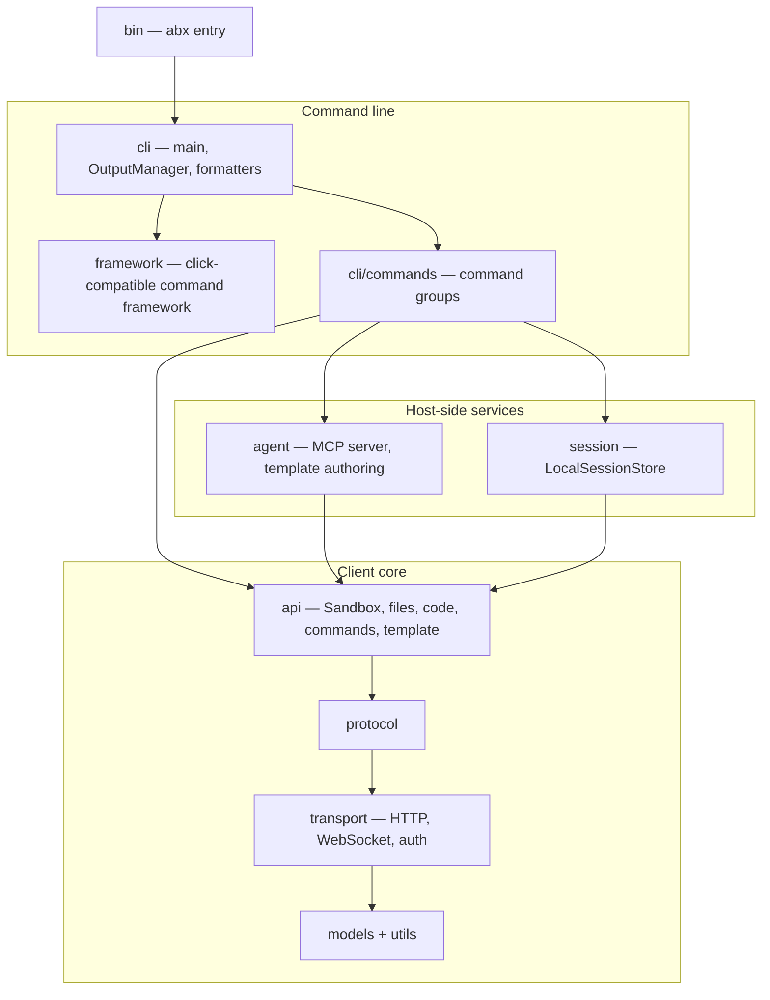

# AGENTS.md — AI Contributor Entry Point

> **For AI coding assistants** (Cursor, Copilot, Codex, Qoder, etc.).
> Human contributors: see [CONTRIBUTING.md](.github/CONTRIBUTING.md).

## Project Overview

**Agent Sandbox** (npm package name `@agent-sandbox/cli`, CLI command `abx`) is the CLI for the Alibaba Cloud FC Agent Sandbox service. It builds and deploys sandbox templates. The Python SDK (distribution name `agent-sandbox-client`, import `agent_sandbox`) and the in-sandbox runtime (`agent-sandbox-server`) live in the `python-sdk` repository. The standard Express command path follows the pinned Alibaba-supported E2B behavior contract; project provider/build/MCP extensions remain explicit. Read the bilingual migration guide before changing either path.

- **Language:** TypeScript (strict, ESM), Node.js >= 20
- **Build system:** `tsc` (`npm run build`); standalone binaries via esbuild bundle + Node SEA (`scripts/build_binary.mjs`)
- **Package:** `src/`
- **Entry point:** `abx` → `src/bin/abx.ts` (built to `dist/bin/abx.js`)

---

## Directory Structure

```
agent-sandbox/
├── src/                       # CLI source (TypeScript, ESM)
│   ├── models/                # Data models: config, errors, sandbox, template, session, filesystem, process
│   ├── transport/             # HTTP/WS transport, auth, codec, retry, streaming
│   ├── protocol/              # Protocol abstractions: sandbox, filesystem, process, terminal, port, code_interpreter
│   ├── api/                   # High-level API: Sandbox, files, code, commands, network, image, capability, session_manager, template
│   ├── cli/                   # `abx` CLI: main, output/formatters, command modules
│   │   └── commands/          # Subcommands: config_cmd, deploy, mcp, sandbox, sandbox_files, sandbox_process, sandbox_system, template
│   ├── framework/             # Mini click-compatible command framework (groups, options, help rendering, lazy subcommands)
│   ├── agent/                 # AI agent tooling: MCP server, tool definitions, template authoring/adoption
│   ├── session/               # Session persistence: local (LocalSessionStore)
│   ├── utils/                 # Async bridge, secret store, logging, registry, retry
│   └── bin/                   # `abx.ts` executable entry point
├── tests/                     # Mirrors src/ structure (test_api/, test_cli/, test_models/, …); vitest
├── parity/                    # Python-test ledger used by `npm run parity:coverage`
├── docs/
│   ├── PORTING.md             # Porting contract: Python `abx` -> Node.js `abx`
│   ├── en/
│   │   ├── design/            # CLI design documents (English): architecture, cli-design, mcp-server, templates-catalog
│   │   ├── guide/             # User tutorials & how-to guides
│   │   ├── reference/         # CLI/error-code/config reference
│   │   └── DESIGN.md          # Design topic index (links to design/)
│   ├── design/                # English-only maintainer drafts (repository layout, provider specs, fixtures)
│   └── zh/
│       ├── design/            # CLI design documents (Chinese mirror)
│       ├── guide/             # User tutorials & how-to guides
│       ├── reference/         # CLI/error-code/config reference
│       └── DESIGN.md          # Design topic index (links to design/)
├── scripts/                   # Utility scripts (binary build, template deploy helpers, parity coverage)
├── benchmarks/                # Performance benchmarks (CLI startup)
└── package.json               # Build config, dependencies, npm scripts
```

The Python client, declarative API, in-sandbox server, examples and SDK/API docs live in the `python-sdk` repository. This repository keeps its own `.agents/` (ADRs in `notes/`, golden-file `evidence/`, design notes).

---

## Architecture Layers

The CLI follows a strict layered structure — **lower layers never import upper layers**. The full description (layer table, source directories, command groups, build and release, parity contract) is [`docs/en/design/architecture.md`](docs/en/design/architecture.md) ([中文](docs/zh/design/architecture.md)).



The client core mirrors the Python SDK's layers one-to-one; the SDK's own standard-client, provider, declarative and server architecture is documented in the [`python-sdk` repository](https://github.com/alibaba-agent-sandbox/python-sdk/blob/main/docs/en/design/architecture.md).

---

## Development Commands

### Setup

```bash
# Install dependencies (Node.js >= 20)
npm ci

# Run the CLI from source
npm run dev -- --help        # tsx src/bin/abx.ts --help
```

### Day-to-Day

| Command                           | What it does                                                                 |
|-----------------------------------|------------------------------------------------------------------------------|
| `make test` / `npm test`          | `vitest run` (integration tests excluded)                                    |
| `make lint`                       | Run ESLint (`npm run lint`); type checking is a separate gate |
| `make typecheck` / `npm run typecheck` | `tsc -p tsconfig.json --noEmit` (strict)                                |
| `make build` / `npm run build`    | `tsc -p tsconfig.build.json` (emits `dist/`)                                 |
| `make binary`                     | `node scripts/build_binary.mjs` — standalone binary for the current platform |
| `npm run parity:coverage`         | Run vitest and report Python-ledger tests without a Node counterpart         |
| `npm run test:integration`        | `vitest run tests/integration`                                               |
| `make clean`                      | Remove build artifacts (`dist/`, `build/`)                                   |

### Running a Specific Test

```bash
npx vitest run tests/test_api/test_sandbox.test.ts
npx vitest run -t "test_capability"
```

---

## Key Conventions

### Error Code System

All SDK errors live in [`models/errors.ts`](src/models/errors.ts). Error codes follow `E{category}{sequence}`:

| Range   | Category       | Base Class               |
|---------|----------------|--------------------------|
| E1xxx   | Authentication | `AuthenticationError`    |
| E2xxx   | Creation       | `SandboxCreationError`   |
| E3xxx   | Execution      | `ExecutionError`         |
| E4xxx   | Filesystem     | `FileOperationError`     |
| E5xxx   | Network        | `NetworkError`           |
| E6xxx   | Session        | `SessionError`           |
| E70xx   | Deploy/Build   | `SandboxError` (`DeployError` covers E7000–E7003; E7010–E7011 inherit `SandboxError` directly) |
| E702x   | Docker/ACR     | `SandboxError` (E7020–E7022 inherit it directly) |

Every exception carries: `code`, `message`, `suggestion`, `docs_url` (populated when documentation is available).

### Whole-template startup contract

Project manifests use spec v5 with `provides` and optional `start_cmd` / `ready_cmd`.
`template launch` starts the complete template once, runs declared readiness commands,
resolves every service endpoint, and checks known Agent Sandbox Server v2 endpoints
using health/discovery. Other protocols are not automatically probed. There is no
workflow selector. Retired workflows and capability claims are rejected with
migration guidance. Provider preparation and resource cleanup remain provider-owned.
See [template startup](docs/en/guide/template-workflows.md) and its
[Chinese translation](docs/zh/guide/template-workflows.md).

---

## Testing Conventions

### Standard Tests

- Framework: **vitest** (async tests are plain `async` functions)
- Structure mirrors `src/`: `tests/test_api/`, `tests/test_cli/`, `tests/test_models/`, etc.
- Integration tests live in `tests/integration/` — `npm test` skips them; run them with `npm run test:integration`
- Type checking enforced: `tsc --noEmit` with `strict: true`

### Golden-File CLI Evidence

The original auto-generated golden-file set (every CLI command's input→output behaviour) lives in [`.agents/evidence/cli/`](.agents/evidence/cli/); the Node snapshot tests compare against it under `tests/test_cli_evidence/golden/` as the port lands (see [`docs/PORTING.md`](docs/PORTING.md)).

**Regenerate:**
```bash
# Update golden files when tests use snapshot comparison
ABX_UPDATE_EVIDENCE=1 npm test
```

The offline/live evidence *capture* script lives in this repository as `scripts/capture-cli-evidence.mjs` (`--live`, `--command <group>`, `--out <dir>`; see [`tests/test_cli_evidence/README.md`](tests/test_cli_evidence/README.md)). It replaced the Python `scripts/capture_cli_evidence.py` driver and writes the Markdown evidence under `.agents/evidence/cli/`. Snapshot tests still compare against `tests/test_cli_evidence/golden/`.

---

## Contributing References

| Resource                | Path                                                                 |
|-------------------------|----------------------------------------------------------------------|
| Contributing guide      | [`.github/CONTRIBUTING.md`](.github/CONTRIBUTING.md)                 |
| PR template             | [`.github/PULL_REQUEST_TEMPLATE.md`](.github/PULL_REQUEST_TEMPLATE.md) |
| Security policy         | [`.github/SECURITY.md`](.github/SECURITY.md)                        |
| Architecture decisions  | [`.agents/notes/`](.agents/notes/README.md) (this repository's ADRs) |
| CLI architecture        | [`docs/en/design/architecture.md`](docs/en/design/architecture.md)  |
| Design documents (EN) | [`docs/en/design/`](docs/en/design/)                                |
| Design documents (ZH) | [`docs/zh/design/`](docs/zh/design/)                                |
| Design index (EN)     | [`docs/en/DESIGN.md`](docs/en/DESIGN.md)                            |
| Design index (ZH)     | [`docs/zh/DESIGN.md`](docs/zh/DESIGN.md)                            |
| CLI evidence            | [`.agents/evidence/`](.agents/evidence/README.md) (golden files) |
| SDK documentation       | [`python-sdk` docs](https://github.com/alibaba-agent-sandbox/python-sdk/blob/main/docs/en/README.md) (SDK, server SDK, `template.yaml` contract) |
| Changelog               | [`CHANGELOG.md`](CHANGELOG.md)                                      |

### ADR System (`.agents/notes/`)

Architecture Decision Records (this repository; the SDK repository keeps its own) follow a `proposed → implemented | rejected` lifecycle:

```
.agents/notes/
├── proposed/          # Under review
│   ├── architecture/
│   ├── feature/
│   └── process/
├── implemented/       # Accepted and active
│   ├── architecture/
│   ├── feature/
│   └── process/
└── rejected/          # Considered but not adopted (flat directory, no subdirectories)
    ├── .gitkeep
    └── *.md
```

See [`.agents/notes/README.md`](.agents/notes/README.md) for the full template and process.

---

## AI Assistant Guardrails

**MUST follow:**

1. **Never auto-commit.** Make changes; let the human review and commit.
2. **Never delete golden files** in `tests/test_cli_evidence/golden/`. If CLI output changes, regenerate them via `ABX_UPDATE_EVIDENCE=1 npm test`.
3. **After modifying any CLI command**, regenerate the affected evidence files and verify they look correct.
4. **Launch the whole template.** Derive startup prerequisites from its actual services and commands; do not infer Provider permissions from installed software or reintroduce workflow selection.
5. **Never fabricate FC/envd API endpoints.** If you're unsure about a real backend API, flag it as a TODO rather than inventing a placeholder.
6. **Run the full test suite** (`make test && make lint && make typecheck`) before claiming a task is done.
7. **Secret scanning** is enforced via `.githooks/check-secrets.sh`. Never commit API keys, tokens, or passwords. Use `REPLACE_ME` or `placeholder` for examples.
8. **Conventional Commits** for all commit messages: `feat:`, `fix:`, `docs:`, `chore:`, `test:`, `refactor:`, `perf:`.
9. **Minimize changes.** Touch only the files necessary for the task. Don't refactor unrelated code.
10. **Type annotations** on all public APIs (explicit parameter and return types). TSDoc comments.
11. **Layer dependency constraint.** Lower layers must never import upper layers (L0 must not import L1+, L1 must not import L2+, etc.). If you need a type from a higher layer, refactor it downward or use dependency injection.
12. **Maintain module exports.** When adding or removing any public symbol that a package re-exports (its `index.ts`, if present), update the export list to match.
13. **Wire-name alias convention.** Model fields that map to camelCase API responses are exposed under their snake_case names (`sandbox_id`, `exit_code`, …, as in the Python models), and parsing accepts both the camelCase wire alias and the snake_case name. See [`docs/PORTING.md`](docs/PORTING.md).

## Standard migration contract

Read `docs/en/guide/migrate-from-e2b.md` before changing standard APIs. Preserve the pinned behavior, synchronous/asynchronous distinction, pagination, return models, errors and terminal semantics. Project extensions use explicit entry points. Generated/source-ported code has provenance and licenses; update its reproducible source process when changing it. Do not imply unsupported Alibaba capabilities work because a client symbol exists.

Standard commands are owned under `src/standard_cli/`; regenerate with the pinned `vendor/e2b-cli` lockfile. Standard template init and create keep E2B meanings; project workflows use template scaffold (--prompt/--adopt) and template from-image. Keep embedded scaffold assets and license notices working in npm and SEA artifacts.

Provider ownership is resolved before backend requests. Qualified references and remote exec flags must never switch an invocation to Express implicitly. A feature declaration is not a protocol implementation: native FC/ACR template handlers are Express-only until an adapter exists. Keep each provider's feature set independent of the host registry, and distinguish declaration from account/runtime availability. See docs/en/guide/providers.md.


## Current provider implementation boundary

Core protocols and authentication are structural contracts. Backend implementations,
Express template UI/build/authentication and shared envd adapters live under
`src/providers/`. Import implementations from their owning provider modules; retired forwarding paths are removed.
Retired Image/TemplateManager create, GlobalConfig, named-session persistence,
PortClient, secret-store and generic-retry implementations remain removed. Pure
configuration values are under utils; executable registry selection is composed
above transport. The pinned standard CLI is a separate migration entry; maintain
its generated source/notice provenance and explicit routing tests.

For standard source updates, read `vendor/e2b-cli/README.md`. Preserve both external
and upstream-prebundled package inventories, retained notices and source-map hashes.
Run `npm run test:standard-provenance` and the locked `npm run vendor:e2b` replay.
Large license/standard output must drain through real stdout pipes before exit.
Generated Python installation must use a tested matching client/server source pair;
the MCP artifact has its separately verified native source pin and tool catalog.

## Provider command ownership

Common code owns configuration isolation, schema validation, transport and generic discovery/dispatch. Keep vendor API mappings, resource identifiers and admission conditions in the owning Provider. Prefer the existing `provider-commands/1` contract for provider-specific operations: the CLI `provider command` namespace and Python `agent_sandbox.providers.commands` discover the same engine catalog. Do not add a backend switch or duplicate cloud implementation in each consumer. Stable typed APIs may be thin wrappers; registration does not generate language methods or establish live-account readiness. Express is bundled in the CLI provider tree; catalog plugin source remains in awesome-providers. Standard compatibility clients keep their existing contract.

Contextual help and `provider run OPERATION` must derive from that same catalog. Keep operation IDs
opaque under the fixed runner namespace so plugins cannot shadow host management commands. Help must
remain local metadata-only discovery without credentials, plugin execution or cloud requests; an
invalid default can degrade help while preserving repair commands, but execution must fail strictly.
Retain explicit-ID `provider command list/info/run` and JSON compatibility. Do not turn arbitrary
JSON Schema properties into flags or imply MCP/completion/type generation. Installation's default
post-consent verification may execute plugin code; do not confuse that phase with static help.
