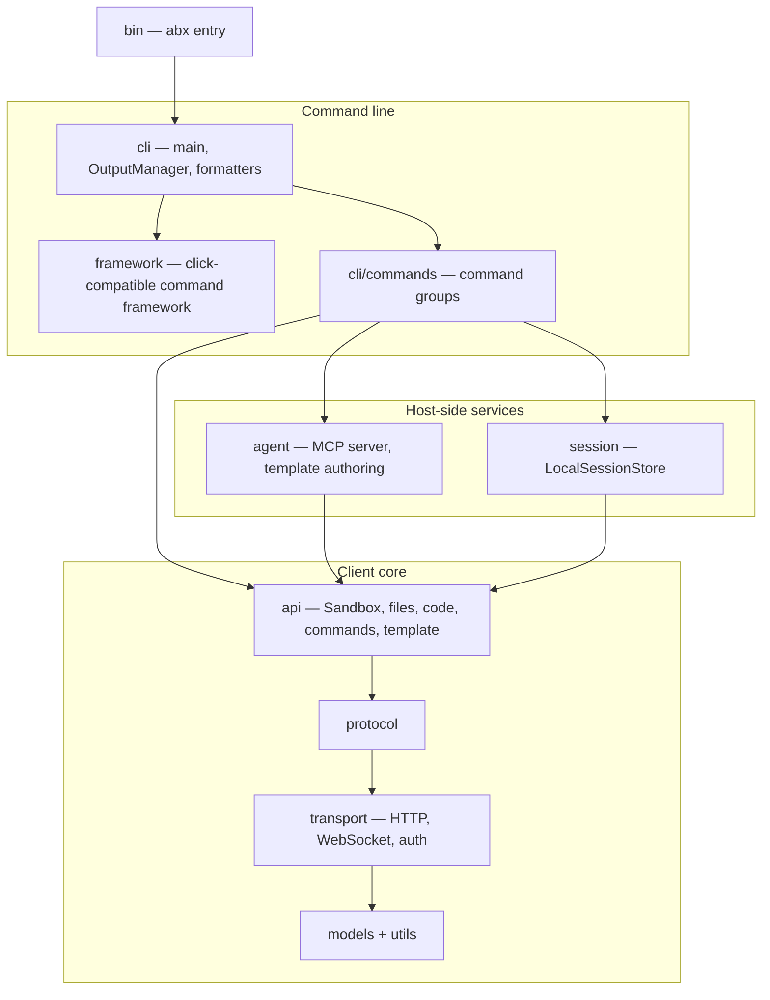

# Agent Sandbox CLI — Design Document Index

> **Version**: v3.0 | **Last Updated**: 2026-10-12
>
> Entry point and index for the design documentation of the `abx` CLI (this repository). Detailed designs live in the topic documents under [`design/`](design/). The Python SDK has its own design set in the [`python-sdk` repository](https://github.com/alibaba-agent-sandbox/python-sdk); see [Related SDK documentation](#related-sdk-documentation).

---

## Project Overview

**`abx`** (npm package `@agent-sandbox/cli`) is the command-line client for the Alibaba Cloud FC Agent Sandbox service, designed for both human developers and AI Agents. It is implemented in Node.js / TypeScript. It also hosts the MCP server that exposes sandboxes to IDE agents.

### Core Principles

1. **Stable command surface** — command names, options, help text, error text, output channels and exit codes (0–6) stay stable; golden files guard them
2. **AI-first** — natural language sandbox creation, `--json` / `--quiet` / `--ci` output modes, the MCP server as a first-class citizen
3. **Zero configuration defaults** — install, export an API key, create a sandbox

### Quick Start

```bash
npm install -g @agent-sandbox/cli   # abx CLI (Node.js 20+)
export ABX_SANDBOX_API_KEY=your-api-key
abx create --template base
abx list
```

---

## Architecture Overview

The CLI follows a strict layered structure — lower layers never import upper layers. The full breakdown (layer table, source directories, build and release, parity contract) is [CLI Architecture](design/architecture.md).



---

## Design Topic Index

### Architecture and Commands

| Topic | Document | Summary |
|-------|----------|---------|
| **CLI Architecture** | [architecture.md](design/architecture.md) | Layers, `src/` directory structure, command groups, output and exit codes, config/credentials, build / SEA binary / release, parity contract |
| **CLI Command System** | [cli-design.md](design/cli-design.md) | Command tree (45 commands), global options, natural language creation, OutputManager, AI-friendly design |
| **Templates Catalog** | [templates-catalog.md](design/templates-catalog.md) | Single source of truth (SSOT): the awesome-templates catalog repo, the remote index client, caching/degradation behaviour, the fixture boundary, and the template command surface |
| **Template build modes** | [template-build-modes.md](design/template-build-modes.md) | One publish path per invocation: local Dockerfile or `template.yaml` `build:` expanded into `CreateTemplate` `sandboxConfig.steps` |
| **Provider template deploy** | [provider-template-deploy.md](../design/provider-template-deploy.md) | Design only: `abx template deploy` per provider. Express's build/push/register layer, the four catalog APIs, and the proposed `template.deploy` feature. [中文](../zh/design/provider-template-deploy.md) |
| **Node provider architecture** | [node-provider-architecture.md](design/node-provider-architecture.md) | One Node/TypeScript provider layer: four kinds, the kit, CLI in-process vs the local engine vs exec, and the HTTP/SSE/WebSocket contract |

### AI and Agent Integration

| Topic | Document | Summary |
|-------|----------|---------|
| **MCP Server** | [mcp-server.md](design/mcp-server.md) | 7 P0 MCP tools, STDIO + Streamable HTTP transports, FC deployment artifact, session binding |
| **Agents API** | [agents-api.md](https://github.com/alibaba-agent-sandbox/python-sdk/blob/main/docs/en/guide/agents-api.md) | In-sandbox agent sessions. Codex and Qwen Code today; more CLIs on the same routes later |

### Port, layout, and provider spec

[`PORTING.md`](../PORTING.md) and [`repository-layout.md`](../design/repository-layout.md) are English. The provider spec the tests read is English at [`docs/design/providers-and-credentials-cli.md`](../design/providers-and-credentials-cli.md). The Chinese copy is [`docs/zh/design/providers-and-credentials-cli.md`](../zh/design/providers-and-credentials-cli.md). The wiring record is the same pair: [English](../design/provider-wiring-plan.md), [中文](../zh/design/provider-wiring-plan.md).

| Topic | Document | Summary |
|-------|----------|---------|
| **Python to Node port** | [PORTING.md](../PORTING.md) | Module-by-module port rules, the parity gate, test ledger |
| **Repository layout** | [repository-layout.md](../design/repository-layout.md) | CLI repository layout review and docs-ownership rule |
| **Providers and credentials (CLI spec)** | [providers-and-credentials-cli.md](../design/providers-and-credentials-cli.md) | CLI grammar, JSON shapes and tests for the provider layer |
| **Providers review log** | [providers-and-credentials-cli-review.md](../design/providers-and-credentials-cli-review.md) | Review log for the spec above |

---

## Implementation Status

| Feature | Status | Notes |
|---------|--------|-------|
| CLI (45 commands) | **Implemented** | See [cli-design.md](design/cli-design.md) |
| MCP Server (STDIO) | **Implemented** | 7 P0 tools |
| MCP Server (Streamable HTTP) | **Implemented** | `agent/mcp_http.ts` |
| `abx mcp deploy` (FC artifact generation) | **Implemented** | Generates deploy artifact; manual FC deployment steps printed. See [mcp-server.md](design/mcp-server.md#7-fc-deployment) |
| Template build/push/create pipeline | **Implemented** | Via official CreateTemplate API |
| Single-file binary (Node SEA) | **Implemented** | See [Binary Installation](guide/binary-installation.md) |
| Provider commands | **Implemented** for `alicloud-express` and installed `node`, `exec` and `rest` providers (`opensandbox`, `e2b`, `cubesandbox`, `alicloud-container`) | `abx --provider <id>` loads an installed plugin; an id that is neither built in nor installed exits `E8001`. See [Providers](guide/providers.md) and [Node provider architecture](design/node-provider-architecture.md) |

---

## Related Resources

| Resource | Location |
|----------|----------|
| Architecture Decision Records (ADR) | [`.agents/notes/`](../../.agents/notes/README.md) |
| CLI golden-file evidence | [`.agents/evidence/`](../../.agents/evidence/) |
| Agents API | [python-sdk `docs/en/guide/agents-api.md`](https://github.com/alibaba-agent-sandbox/python-sdk/blob/main/docs/en/guide/agents-api.md) |
| User guides | [`docs/en/guide/`](guide/) |
| CLI reference | [`docs/en/reference/`](reference/) |
| Chinese (中文) design index | [`docs/zh/DESIGN.md`](../zh/DESIGN.md) |

## Related SDK documentation

The Python SDK (`agent-sandbox`), the in-sandbox server SDK and the platform contracts are documented in the [`python-sdk` repository](https://github.com/alibaba-agent-sandbox/python-sdk). The pages a CLI reader most often needs:

- [Architecture](https://github.com/alibaba-agent-sandbox/python-sdk/blob/main/docs/en/design/architecture.md) — the SDK's six-layer architecture, which the CLI's client core mirrors
- [SDK API Design](https://github.com/alibaba-agent-sandbox/python-sdk/blob/main/docs/en/design/sdk-api-design.md) and [Sandbox Types](https://github.com/alibaba-agent-sandbox/python-sdk/blob/main/docs/en/design/sandbox-types.md)
- [Template System](https://github.com/alibaba-agent-sandbox/python-sdk/blob/main/docs/en/design/template-system.md) and [template.yaml Spec](https://github.com/alibaba-agent-sandbox/python-sdk/blob/main/docs/en/reference/template-yaml-spec.md) — the `template.yaml` contract
- [Built-in Agents](https://github.com/alibaba-agent-sandbox/python-sdk/blob/main/docs/en/design/built-in-agents.md) and [Server API](https://github.com/alibaba-agent-sandbox/python-sdk/blob/main/docs/en/design/server-api.md)
