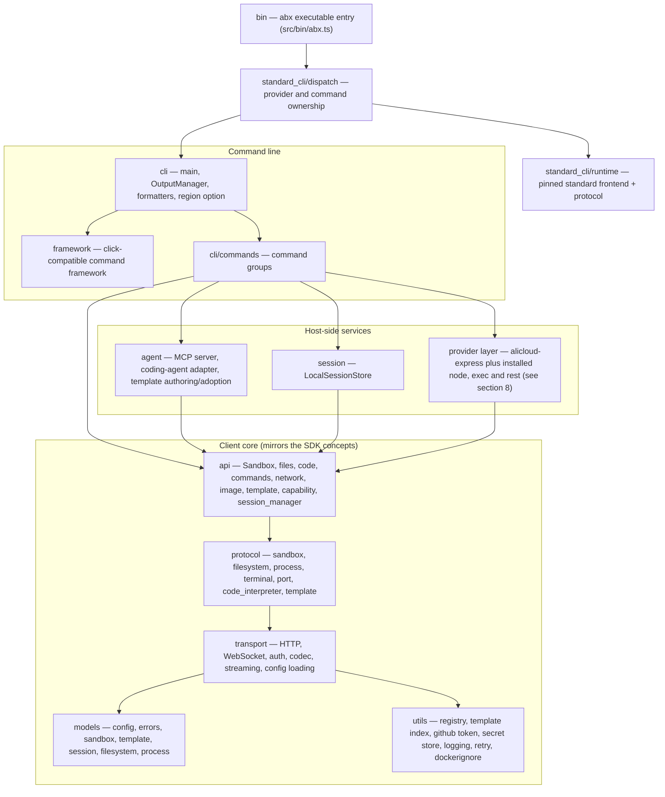

# CLI Architecture

> This page describes the Node.js / TypeScript `abx` CLI (`@agent-sandbox/cli`) itself: its layers, its source
> directories, and how it is built and shipped. Command-level behaviour is in [CLI Command System](cli-design.md); the MCP server in
> [MCP Server](mcp-server.md); the template catalog client in [Templates Catalog](templates-catalog.md).
>
> The executable dispatches to two command frontends. Standard Alibaba Express commands use the pinned, MIT-licensed source port in `src/standard_cli/`; provider and project extensions use the native TypeScript layers described below. The two frontends retain different parsing, output and terminal implementations. See [Migrate from E2B](../guide/migrate-from-e2b.md) for the standard contract and [Providers](../guide/providers.md) for adapter coverage.

Provider ownership is resolved before backend requests. Global options must not silently move a standard command into the native implementation: unsupported standard options are rejected by its parser. This is an ownership and semantic boundary, not a completed unification of the frontends.

---

## 1. Layered structure

The native layers follow a downward dependency rule. The standard source port has its own protocol implementation; it does not run through the native `api` / `protocol` layers. The CLI contains no in-sandbox Server implementation.



| Layer | Directory | Responsibility |
|-------|-----------|----------------|
| Entry | `src/bin/` | `abx.ts`, the executable entry point (built to `dist/bin/abx.js`, the `bin` target of the npm package) |
| Standard commands | `src/standard_cli/` | Dispatch boundary, maintained pinned CLI/protocol source port, embedded scaffold assets and notices |
| Native command framework | `src/framework/` | A click-compatible mini framework (`Context`, `Command`, `Group`, `Option`, `Argument`, parameter types, help formatting, `termui` prompts, lazy sub-commands). It preserves the original Python CLI behavior for the native project extensions; the standard frontend uses its pinned parser |
| CLI | `src/cli/` | `main` (root group, global options), `output` (`OutputManager`), `formatters` (table / JSON / quiet), `region` (the shared command-level `--region` option), `_rich*` (terminal table rendering helpers) |
| Command groups | `src/cli/commands/` | One module per command group, see section 4 |
| Agent / MCP | `src/agent/` | MCP server (`mcp`, `mcp_http`, `mcp_main`, `tools`), host-side coding-agent adapter (`coding_agent`, `qwen_code`, `clarify`, `codegen`, `template_guide`) and template authoring/adoption (`adopt`, `dockerfile_sources`) |
| Session | `src/session/` | `LocalSessionStore`: JSON session files under `~/.abx/sessions/` |
| API | `src/api/` | `Sandbox` and its modules (`files`, `code`, `commands`, `network`), `image`, `template` (`TemplateManager`), `fc_template` (official CreateTemplate API adapter), `docker_builder` (local `docker build` + ACR push), `capability`, `session_manager` |
| Protocol | `src/protocol/` | Typed wrappers for the platform API and the in-sandbox envd API (`sandbox`, `filesystem`, `process`, `terminal`, `port`, `code_interpreter`, `template`) |
| Transport | `src/transport/` | HTTP and WebSocket clients, API Key / AK-SK auth providers, codec, streaming, and the layered configuration loader (`config`) |
| Models | `src/models/` | Typed data models and the error hierarchy (`errors`, codes `E1xxx`–`E7xxx`) |
| Utils | `src/utils/` | GitHub / local template registry client, remote template index client, GitHub token guidance, secret store (`keychain`), logging, retry, `.dockerignore` matcher, dotenv/tar/YAML helpers |

Files whose names start with an underscore (for example `src/api/_yaml.ts`, `src/utils/_pyformat.ts`,
`src/agent/_pycompat.ts`) are internal compatibility helpers that reproduce the exact semantics of the Python
standard-library calls the original code relied on, so that wire output, `--json` output and on-disk files stay
byte-identical.

## 2. Native command framework (`src/framework/`)

- Parameters and command attributes keep Click's snake_case names (`is_flag`, `help_option_names`); methods are
  camelCase (`ctx.getHelp()`, `group.addCommand()`).
- Python `None` is `null`; "no value yet" is the `UNSET` sentinel.
- Everything that may run user code or load a lazy command is `async`. A command callback has the signature
  `(ctx, params) => unknown | Promise<unknown>`, where `params` holds the values by parameter name.
- Sub-commands can be registered lazily so that `abx --version` and `abx --help` do not load every command module
  (the startup cost is tracked by `benchmarks/`).
- Tests use a `CliRunner` helper (`tests/helpers/cliRunner.ts`), the counterpart of `click.testing.CliRunner`.

## 3. Native output and formatting (`src/cli/output.ts`, `src/cli/formatters.ts`)

This section applies to native commands. Standard commands use the pinned frontend's formatting, option names and exit behavior, including remote command exit codes; these are not normalized through `OutputManager`.

- `OutputManager` decides native command stdout/stderr routing. Results go to stdout;
  diagnostics, progress and warnings go to stderr (channel policy documented in
  [CLI Command System §7](cli-design.md)).
- Global switches `--json`, `--quiet`, `--ci`, `--no-color` and `--verbose` are resolved once and stored in the click
  context (`ctx.meta["abx.output"]`); formatters (table, JSON, quiet) are obtained from it.
- CI and TTY detection (`isCiEnv`, `isTty`): CI is recognised from a fixed list of CI environment variables; a CI run
  implies quiet, no colour and JSON-friendly output. A non-TTY, `TERM=dumb`, `--json`, `--quiet` and `--ci` suppress
  the transient "running" header.
- Long-running steps draw a transient header with rolling grey activity lines (`ABX_ACTIVITY_LINES`, 1–10).
- Exit codes are deterministic: `0` success, `1` general error, `2` argument error, `3` authentication failure,
  `4` resource not found, `5` timeout, `6` quota exceeded.

## 4. Command groups (`src/cli/commands/`)

The table below describes native command modules, not the final dispatch tree. Standard commands take precedence for Express: `template init` / `template create` keep their E2B meaning; project generation/adoption uses `template scaffold --prompt/--adopt`, and image creation uses `template from-image`. Native lifecycle handlers serve other providers and explicit project extensions. See [CLI Command System](cli-design.md) and the migration guide for invocation syntax. The native module split follows the porting contract
(`cli/commands/<name>.py` becomes `src/cli/commands/<name>.ts`):

| Module | Command group |
|--------|---------------|
| `config_cmd` | `abx config` (`init`, `get`, `set`, `list`, `delete`) (credentials and region; `--build` / `--llm` add sections) |
| `sandbox` | the sandbox lifecycle commands (`create`, `list`, `info`, `kill`, `exec`, `run`, `connect`, `upload`, `download`), reachable at top level and under `abx sandbox` |
| `sandbox_files` | `abx sandbox files` (`list`, `stat`, `mkdir`, `rm`, `mv`, `search`) |
| `sandbox_process` | `abx sandbox process` (`list`, `start`, `info`, `signal`) |
| `sandbox_system` | `abx sandbox system` (`info`, `env`, `ports`, `packages`, `metrics`) |
| `template` | `abx template` (`scaffold`, `from-image`, `deploy`, `build`, `push`, `install`, `list`, `info`, `delete`, `search`) |
| `deploy` | `abx deploy` |
| `mcp` | `abx mcp` (`install`, `start`, `status`, `deploy`) |

`abx sandbox capabilities`, `abx sandbox command` and the fixed top-level shortcuts (`src/cli/command_surface.ts`) are part of the same command tree; their
exact parameters are in [CLI Command System](cli-design.md).

Native commands orchestrate: they parse options through the framework, load configuration, call the `api` layer (or the
`agent` layer for natural-language creation and MCP), and print through `OutputManager`.

## 5. Client core: api, protocol, transport, session, models

The native client core follows the provider/server extension layers of the Python SDK. Standard commands use their bundled protocol client instead:

- **Transport** (`src/transport/`): `HttpClient` handles timeouts, connections and streaming; data-plane authentication uses `ApiKeyAuth` behind `AuthProvider`. Official Express control-plane clients use AK/SK separately. Layered configuration resolves canonical code parameters, environment variables, environment files and TOML settings.
- **Protocol**: `src/protocol/contracts.ts` defines the host interfaces. Implementations live in the owning provider modules, including `src/providers/shared/e2b/`; Express template operations use its official control-plane adapter.
- **API** (`src/api/`): the native `Sandbox` façade, sandbox modules and provider-owned template project preparation. `DockerBuilder` and the official template adapter belong to the Express provider.
- **Session** (`src/session/`): `LocalSessionStore` persists named sessions as JSON files. Concurrent access is
  guarded with a lock directory next to each file (Node has no `flock`; see `parity/KNOWN-GAPS.md`).
- **Models** (`src/models/`): data fields that appear on the wire or in `--json` output keep their Python `snake_case`
  names and key order; exception classes keep their names, `code` and message text.

## 6. Agent and MCP modules (`src/agent/`)

| Module | Role |
|--------|------|
| `mcp.ts` | MCP STDIO server: a self-contained minimal JSON-RPC 2.0 handler (`abx mcp start`), `SandboxManager` for default-sandbox session binding |
| `mcp_http.ts` | MCP Streamable HTTP transport on `node:http` (`POST/GET/DELETE /mcp`, `/health`, bearer-token auth); used by `abx mcp start --http` and by the FC deployment artifact |
| `mcp_main.ts` | Entry point equivalent to `python -m agent_sandbox.agent.mcp` |
| `tools.ts` | The 7 P0 tool schemas (`TOOL_SCHEMAS`) and their handlers |
| `coding_agent.ts`, `qwen_code.ts` | Pluggable host-side coding-agent boundary and the Qwen Code adapter (locate or install the agent, run it headless) |
| `clarify.ts`, `codegen.ts`, `template_guide.ts` | Natural-language `abx create --prompt "<description>"`: research-first clarification, template generation, the reference material given to the agent |
| `adopt.ts`, `dockerfile_sources.ts` | `abx template scaffold --adopt`: stage an existing project, write back only the reviewed whitelist, validate Dockerfile `COPY`/`ADD` sources |
| `_archive.ts`, `_http.ts` | Safe tar/zip extraction and a proxy-aware downloader for the Qwen Code standalone installer |

MCP behaviour (tools, session binding, transports, FC deployment) is specified in [MCP Server](mcp-server.md).

## 7. Configuration and credentials

- Resolution order for every credential: explicit option → process environment → `./.env` → `~/.abx` (`.env`, then
  `config.toml`) → built-in default. Blank values do not count. The full table is in the
  [Configuration reference](../reference/configuration.md#credential-resolution).
- On-disk state lives under `~/.abx/`: `config.toml`, `.env` (credentials, mode 600), `sessions/`, `templates/`,
  `index/` (remote template index cache), `bin/` (installed coding agent), `generated/` (natural-language output),
  and `secrets.json` (plaintext, mode 600; local development only).
- `utils/github_token.ts` holds the single GitHub-token remedy text shared by the registry client and the template
  index client; `utils/template_index.ts` is the remote catalog client described in
  [Templates Catalog](templates-catalog.md).
- Credentials are never printed: secrets are masked in `abx config list`, and test fixtures use placeholders.

## 8. Provider layer

`abx provider` and `--provider` load the built-in `alicloud-express` and installed `node`, `exec` and `rest` plugins. The catalog ids `opensandbox`, `alicloud-container`, `cubesandbox` and `e2b` are `node` plugins (`provider.mjs`, `create(kit)`), installed with `abx provider install alibaba-agent-sandbox/awesome-providers//<id>` (or a path or git URL). An id that is neither built in nor installed exits `E8001`. A manifest with `kind = "python"` is rejected. The grammar is [Providers and Credentials — CLI spec](../../design/providers-and-credentials-cli.md). The layer sits between the command groups and the `api` layer. `src/utils/config_keys.ts` is generated from the shared key registry. The Python SDK reaches the same `node` plugins through `abx provider engine serve`. User steps are [Providers](../guide/providers.md).

The registry describes adapter features; it does not automatically provide a CLI command or prove account/runtime availability. Native FC/ACR template handlers are Express-only until a provider-specific adapter exists. Common pause/resume commands and provider PTY semantics are not fully unified across the two frontends. Python standard `Sandbox` / `AsyncSandbox` clients do not change protocol through `ABX_PROVIDER`; the SDK provider path is `ProviderSandbox`.

## 9. Directory structure

```
cli/
├── src/
│   ├── bin/               # abx.ts — executable entry point
│   ├── standard_cli/      # dispatcher, pinned frontend/protocol port, assets and notices
│   ├── framework/         # native click-compatible command framework
│   ├── cli/               # main, output, formatters, region, _rich*
│   │   └── commands/      # config_cmd, deploy, mcp, provider, sandbox, sandbox_files, sandbox_process, sandbox_system, template
│   ├── agent/             # MCP server, coding-agent adapter, template authoring/adoption
│   ├── providers/         # builtin, node, exec, rest, installer, manifest
│   ├── engine/            # local engine: HTTP, SSE and WebSocket on 127.0.0.1
│   ├── session/           # LocalSessionStore
│   ├── api/               # Sandbox, files, code, commands, network, image, template, capability, session_manager
│   ├── protocol/          # platform + envd protocol wrappers
│   ├── transport/         # HTTP/WS, auth, codec, streaming, config
│   ├── models/            # data models, errors, config
│   └── utils/             # registry, template index, github token, secret store, logging, retry, helpers
├── tests/                 # mirrors src/ (test_api/, test_cli/, test_agent/, …); vitest; helpers/, fixtures/
├── parity/                # Python-test ledger and known gaps
├── scripts/               # build_binary.mjs, parity-coverage.mjs, repo checks, template deploy helpers
├── benchmarks/            # CLI startup benchmark
├── docs/                  # en/ and zh/ documentation, PORTING.md, design/ drafts
└── .agents/               # ADRs, evidence, research (not published)
```

## 10. Build, packaging and the standalone binary

- **Standard source port**: `vendor/e2b-cli/package-lock.json` pins the regeneration inputs; `npm ci --prefix vendor/e2b-cli && npm run vendor:e2b` rebuilds the maintained standard bundle. Scaffold assets are embedded for standalone use.
- **npm package**: `npm run build` runs `tsc -p tsconfig.build.json`, emits `dist/` and copies standard runtime assets/notices; `package.json#bin` maps
  `abx` to `dist/bin/abx.js`; `files` is an allow-list (`dist`, `README.md`, `SKILL.md`, `LICENSE`, `NOTICE`).
  Node.js ≥ 20; CI runs the test matrix on Node 20 and 22.
- **Release**: pushing a `vX.Y.Z` tag triggers `release.yml`; npm publication runs only when `NPM_PUBLISH=true`, checks the tag against `package.json#version`, and uses provenance. This workflow configuration is not a claim that the package is already published.
- **Standalone binary**: `scripts/build_binary.mjs` bundles `src/bin/abx.ts` and every dependency into one CommonJS
  file with esbuild, then injects it into a copy of the `node` binary with the Node.js Single Executable Applications
  (SEA) mechanism (`postject`; ad-hoc re-signing on macOS). The output is named
  `abx-{version}-{platform}-{arch}[.exe]` (`linux`/`darwin`/`windows`, `x64`/`arm64`), smoke-tested with
  `abx --version`, and published with SHA256 checksums by `release-binary.yml` on the five-target build matrix.
  Installation is described in [Binary Installation](../guide/binary-installation.md).
- **Developer commands**: `make test`, `make typecheck`, `make lint`, `make build`, `make binary`, `make ci`;
  `npm run dev -- --help` runs the CLI from source with `tsx`.

## 11. Parity-with-Python contract

The Python porting ledger remains the regression baseline for retained native project extensions. Standard Express commands intentionally follow the pinned E2B contract instead; their current golden set and behavioral changes are recorded separately. Historical Python golden captures remain evidence, not the current specification for those standard commands. The native porting checks are:

| Item | Where |
|------|-------|
| Porting rules (module mirroring, naming, data-field and string rules, config locations, stack) | [`docs/PORTING.md`](../../PORTING.md) |
| Python tests that must exist as Node tests (the ledger) | `parity/python-tests-to-port.txt` |
| Coverage report of the ledger | `npm run parity:coverage` (`scripts/parity-coverage.mjs`) |
| Documented behavioural differences (language-level, never silent) | `parity/KNOWN-GAPS.md` |
| Golden CLI output captures | `.agents/evidence/cli/` and the golden files under `tests/` |
| Differential testing of two `abx` binaries | `parity/diff/` (described in PORTING.md) |

Native porting rules keep module ownership, camelCase functions and snake_case wire/JSON fields. Output channels and exit codes belong to the relevant frontend's contract. Verify the shipped executable in addition to native helper tests; parity coverage alone does not prove standard command behavior.

## Reuse existing primitives

Before adding a helper to a command or agent tool, check the owning module:

| Requirement | Existing owner |
| --- | --- |
| Resolve configuration and validate field/authentication requirements | `utils/config_resolver.ts` |
| Prompt for missing CLI configuration and resume the operation | `cli/config_guidance.ts` |
| Resolve and prompt for template runtime environment | `cli/template_environment.ts` |
| Acquire local, catalog or repository template source | `cli/template_catalog.ts` (`acquireTemplateSource`) |
| Render an always-quoted POSIX shell literal | `utils/shell.ts` (`quoteShellLiteral`) |
| Format a Python-compatible float | `utils/_pyformat.ts` (`pyFloatRepr`) |
| Construct MCP JSON-RPC responses and errors | `agent/mcp.ts` (`_jsonrpcResponse`, `_jsonrpcError`) |

Commands and agent tools import these owners; compatibility exports may forward to them.
Preserve existing shell command text: `api/_shlex.ts` implements the separately tested
CPython `shlex.quote` format. Share a primitive only when input, output and failure
semantics match. Provider admission, process ownership and archive extraction policies
stay with their owners. CLI prompts remain outside SDK configuration.

## Related SDK documentation

The Python SDK, the in-sandbox server runtime and the shared `template.yaml` contract are documented in the
[`python-sdk` repository](https://github.com/alibaba-agent-sandbox/python-sdk):

- [Architecture](https://github.com/alibaba-agent-sandbox/python-sdk/blob/main/docs/en/design/architecture.md) — standard clients and native provider extension layers
- [SDK API Design](https://github.com/alibaba-agent-sandbox/python-sdk/blob/main/docs/en/design/sdk-api-design.md)
- [Sandbox Types](https://github.com/alibaba-agent-sandbox/python-sdk/blob/main/docs/en/design/sandbox-types.md)
- [Template System](https://github.com/alibaba-agent-sandbox/python-sdk/blob/main/docs/en/design/template-system.md) and
  [Template YAML Spec](https://github.com/alibaba-agent-sandbox/python-sdk/blob/main/docs/en/reference/template-yaml-spec.md)
- [Server API](https://github.com/alibaba-agent-sandbox/python-sdk/blob/main/docs/en/design/server-api.md)


Provider composition after the main integration uses structural core contracts and provider-owned session, port and file URL adapters. Native Express implementations live under providers/alicloud_express and shared/e2b. Retired forwarding imports are removed; the retired Python gRPC engine is absent. The pinned standard migration surface is separate from explicit provider routing, and unavailable backend operations do not gain support from command registration.


## Unused-code review

The TypeScript gate checks unused locals and parameters. Cleanup preserves initialization calls and positional callback/constructor contracts. Exported helpers require a consumer and compatibility review; an executable import graph alone does not justify removing deep imports. Generated configuration helpers are maintained through their generator. Retired SDK-port implementations remain removed.
