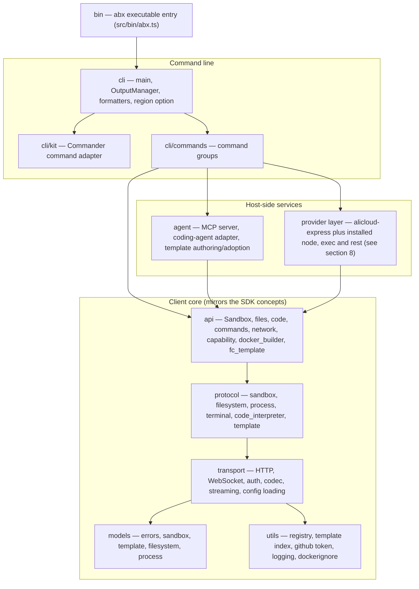

# CLI Architecture

> This page describes the Node.js / TypeScript `abx` CLI (`@agent-sandbox/cli`) itself: its layers, its source
> directories, and how it is built and shipped. Command-level behaviour is in [CLI Command System](cli-design.md); the MCP server in
> [MCP Server](mcp-server.md); the template catalog client in [Templates Catalog](templates-catalog.md).
>
> The CLI is a client of the Agent Sandbox platform. It re-implements, in TypeScript, the client-side layers it needs
> (models, transport, protocol, high-level API). The CLI keeps only the core implementations its commands use; the SDK's own design is documented in the SDK repository (see
> [Related SDK documentation](#related-sdk-documentation) at the bottom of this page).

---

## 1. Layered structure

Lower layers never import upper layers. The CLI repository implements the layers below the dashed line that a command
line needs; it has no Compat, Declarative, Extensions, Integrations or in-sandbox Server layer.



| Layer | Directory | Responsibility |
|-------|-----------|----------------|
| Entry | `src/bin/` | `abx.ts`, the executable entry point (built to `dist/bin/abx.js`, the `bin` target of the npm package) |
| Command definitions | `src/cli/kit.ts`, `types.ts`, `io.ts`, `errors.ts` | Declarative command adapter over Commander, validation, terminal I/O and errors |
| CLI | `src/cli/` | `main` (root group, global options), `output` (`OutputManager`), `formatters` (table / JSON / quiet), `region` (the shared command-level `--region` option), `table` (terminal tables) |
| Command groups | `src/cli/commands/` | One module per command group, see section 4 |
| Agent / MCP | `src/agent/` | MCP server (`mcp`, `mcp_http`, `mcp_main`, `tools`), host-side coding-agent adapter (`coding_agent`, `qwen_code`, `clarify`, `codegen`, `template_guide`) and template authoring/adoption (`adopt`, `dockerfile_sources`) |
| API | `src/api/` | `Sandbox` and its modules (`files`, `code`, `commands`, `network`), `fc_template` (official CreateTemplate API adapter), `docker_builder` (local `docker build` + ACR push), `capability` |
| Protocol | `src/protocol/` | Typed wrappers for the platform API and the in-sandbox envd API (`sandbox`, `filesystem`, `process`, `terminal`, `code_interpreter`, `template`) |
| Transport | `src/transport/` | HTTP and WebSocket clients, API Key / AK-SK auth providers, codec, streaming, and the layered configuration loader (`config`) |
| Models | `src/models/` | Typed data models and the error hierarchy (`errors`, codes `E1xxx`–`E7xxx`) |
| Utils | `src/utils/` | GitHub / local template registry client, remote template index client, GitHub token guidance, logging, `.dockerignore` matcher, dotenv/tar/YAML helpers |

Files whose names start with an underscore (for example `src/api/_yaml.ts`, `src/utils/_pyformat.ts`,
`src/agent/_pycompat.ts`) are internal compatibility helpers that reproduce the exact semantics of the Python
standard-library calls the original code relied on, so that wire output, `--json` output and on-disk files stay
byte-identical.

## 2. Command definitions (`src/cli/kit.ts`)

Commander parses arguments and renders help. `kit.ts` adapts declarative `command`,
`group`, `option` and `argument` definitions to Commander and supplies the async
callback context. `types.ts`, `io.ts` and `errors.ts` provide value validation,
terminal I/O and usage errors. There is no `src/framework/` runtime.
Lazy command registration keeps unrelated modules out of version/help startup.
See [the command contributor guide](../../../src/cli/commands/README.md).

## 3. Output and formatting (`src/cli/output.ts`, `src/cli/formatters.ts`)

- `OutputManager` is the single place that decides what goes to stdout and what goes to stderr. Results go to stdout;
  diagnostics, progress and warnings go to stderr (channel policy documented in
  [CLI Command System §7](cli-design.md)).
- Global switches `--json`, `--quiet`, `--ci`, `--no-color` and `--verbose` are resolved once and stored in the click
  context (`ctx.meta["abx.output"]`); formatters (table, JSON, quiet) are obtained from it.
- CI and TTY detection (`isCiEnv`, `isTty`): CI is recognised from a fixed list of CI environment variables; a CI run
  implies quiet, no colour and JSON-friendly output. A non-TTY, `TERM=dumb`, `--json`, `--quiet` and `--ci` suppress
  the transient "running" header.
- Long-running steps draw a transient header with rolling grey activity lines (`ABX_ACTIVITY_LINES`, 1–10).
- Exit codes are deterministic: `0` success, `1` general error, `2` argument error, `3` authentication failure,
  `4` resource not found, `5` timeout, `6` quota exceeded.

## 4. Command groups (`src/cli/commands/`)

The command tree is defined in [CLI Command System](cli-design.md). The module split follows the porting contract
(`cli/commands/<name>.py` becomes `src/cli/commands/<name>.ts`):

| Module | Command group |
|--------|---------------|
| `config_cmd` | `abx config` (`init`, `get`, `set`, `list`, `delete`) (credentials and region; `--build` / `--llm` add sections) |
| `sandbox` | the sandbox lifecycle commands (`create`, `list`, `info`, `kill`, `exec`, `run`, `connect`, `upload`, `download`), reachable at top level and under `abx sandbox` |
| `sandbox_files` | `abx sandbox files` (`list`, `stat`, `mkdir`, `rm`, `mv`, `search`) |
| `sandbox_process` | `abx sandbox process` (`list`, `start`, `info`, `signal`) |
| `sandbox_system` | `abx sandbox system` (`info`, `env`, `ports`, `packages`, `metrics`) |
| `template` | `abx template` (`init`, `deploy`, `build`, `push`, `create`, `install`, `list`, `info`, `delete`, `search`) |
| `deploy` | `abx deploy` |
| `mcp` | `abx mcp` (`install`, `start`, `status`, `deploy`) |

`abx sandbox capabilities`, `abx sandbox command` and the fixed top-level shortcuts (`src/cli/command_surface.ts`) are part of the same command tree; their
exact parameters are in [CLI Command System](cli-design.md).

Commands only orchestrate: they parse options through the framework, load configuration, call the `api` layer (or the
`agent` layer for natural-language creation and MCP), and print through `OutputManager`.

## 5. Client core: api, protocol, transport and models

The CLI shares wire concepts and error codes with the Python SDK. The [retirement boundary](cli-module-retirement.md) documents SDK-only ports removed from this repository:

- **Transport** (`src/transport/`): `HttpClient` (timeouts and connection handling), WebSocket helper, streaming
  decoder, `ApiKeyAuth` / `AkSkAuth` providers behind the `AuthProvider` interface, and `config.ts`, the layered
  loader that resolves code parameters, process environment (`ABX_*` and the vendor-official `ALICLOUD_*` / `ALIBABA_CLOUD_*` names), `.env` files (merged per
  key) and `~/.abx/config.toml`.
- **Protocol** (`src/protocol/`): one class per wire surface (`SandboxProtocol`, `ProcessProtocol`,
  `FilesystemProtocol`, `CodeInterpreterProtocol`, `TerminalSession`, `TemplateProtocol`).
- **API** (`src/api/`): the internal `Sandbox` class and its modules, `DockerBuilder`
  and the official template API adapter.
- **Models** (`src/models/`): data fields that appear on the wire or in `--json` output keep their Python `snake_case`
  names and key order; exception classes keep their names, `code` and message text.

## 6. Agent and MCP modules (`src/agent/`)

| Module | Role |
|--------|------|
| `mcp.ts` | MCP STDIO server: a self-contained minimal JSON-RPC 2.0 handler (`abx mcp start`), `SandboxManager` for default-sandbox session binding |
| `mcp_http.ts` | MCP Streamable HTTP transport on `node:http` (`POST/GET/DELETE /mcp`, `/health`, bearer-token auth); used by `abx mcp start --http` and by the FC deployment artifact |
| `mcp_main.ts` | Entry point equivalent to `python -m agent_sandbox.agent.mcp` |
| `tools.ts` | The 7 P0 tool schemas (`TOOL_SCHEMAS`) and their handlers |
| `coding_agent.ts`, `qwen_code.ts` | Pluggable host-side coding-agent boundary and the Qwen Code adapter (locate or install the agent, run it headless) |
| `clarify.ts`, `codegen.ts`, `template_guide.ts` | Natural-language `abx create "<description>"`: research-first clarification, template generation, the reference material given to the agent |
| `adopt.ts`, `dockerfile_sources.ts` | `abx template init --adopt`: stage an existing project, write back only the reviewed whitelist, validate Dockerfile `COPY`/`ADD` sources |
| `_archive.ts`, `_http.ts` | Safe tar/zip extraction and a proxy-aware downloader for the Qwen Code standalone installer |

MCP behaviour (tools, session binding, transports, FC deployment) is specified in [MCP Server](mcp-server.md).

## 7. Configuration and credentials

- Resolution order for every credential: explicit option → process environment → `./.env` → `~/.abx` (`.env`, then
  `config.toml`) → built-in default. Blank values do not count. The full table is in the
  [Configuration reference](../reference/configuration.md#credential-resolution).
- On-disk state lives under `~/.abx/`: `config.toml`, `.env` (credentials, mode 600), `templates/`,
  `index/` (remote template index cache), `bin/` (installed coding agent), `generated/` (natural-language output),
  plus provider installation receipts and engine discovery records.
- `utils/github_token.ts` holds the single GitHub-token remedy text shared by the registry client and the template
  index client; `utils/template_index.ts` is the remote catalog client described in
  [Templates Catalog](templates-catalog.md).
- Credentials are never printed: secrets are masked in `abx config list`, and test fixtures use placeholders.

## 8. Provider layer

`abx provider` and `--provider` load the built-in `alicloud-express` and installed `node`, `exec` and `rest` plugins. The catalog ids `opensandbox`, `alicloud-container`, `cubesandbox` and `e2b` are `node` plugins (`provider.mjs`, `create(kit)`), installed with `abx provider install alibaba-agent-sandbox/awesome-providers//<id>` (or a path or git URL). An id that is neither built in nor installed exits `E8001`. A manifest with `kind = "python"` is rejected. The grammar is [Providers and Credentials — CLI spec](../../design/providers-and-credentials-cli.md). The layer sits between the command groups and the `api` layer. `src/utils/config_keys.ts` is generated from the shared key registry. The Python SDK reaches the same `node` plugins through `abx provider engine serve`. User steps are [Providers](../guide/providers.md).

## 9. Directory structure

```
cli/
├── src/
│   ├── bin/               # abx.ts — executable entry point
│   ├── cli/               # main, Commander adapter, output, formatters, region
│   │   └── commands/      # config_cmd, deploy, mcp, provider, sandbox, sandbox_files, sandbox_process, sandbox_system, template
│   ├── agent/             # MCP server, coding-agent adapter, template authoring/adoption
│   ├── providers/         # builtin, node, exec, rest, installer, manifest
│   ├── engine/            # local engine: HTTP, SSE and WebSocket on 127.0.0.1
│   ├── api/               # Sandbox, files, code, commands, network, capability, docker_builder, fc_template
│   ├── protocol/          # platform + envd protocol wrappers
│   ├── transport/         # HTTP/WS, auth, codec, streaming, config
│   ├── models/            # data models and errors
│   └── utils/             # registry, template index, github token, logging, compatibility helpers
├── tests/                 # mirrors src/ (test_api/, test_cli/, test_agent/, …); vitest; helpers/, fixtures/
├── parity/                # Python-test ledger and known gaps
├── scripts/               # build_binary.mjs, parity-coverage.mjs, repo checks, template deploy helpers
├── benchmarks/            # CLI startup benchmark
├── docs/                  # en/ and zh/ documentation, PORTING.md, design/ drafts
└── .agents/               # ADRs, evidence, research (not published)
```

## 10. Build, packaging and the standalone binary

- **npm package**: `npm run build` removes previous `dist/` output, runs `tsc -p tsconfig.build.json` and emits `dist/`; `package.json#bin` maps
  `abx` to `dist/bin/abx.js`; `files` is an allow-list (`dist`, `README.md`, `SKILL.md`, `LICENSE`, `NOTICE`).
  Node.js ≥ 20; CI runs the test matrix on Node 20 and 22.
- **Release**: pushing a `vX.Y.Z` tag runs `release.yml`, which checks the tag against `package.json#version` and
  publishes `@agent-sandbox/cli` to npm with provenance.
- **Standalone binary**: `scripts/build_binary.mjs` bundles `src/bin/abx.ts` and every dependency into one CommonJS
  file with esbuild, then injects it into a copy of the `node` binary with the Node.js Single Executable Applications
  (SEA) mechanism (`postject`; ad-hoc re-signing on macOS). The output is named
  `abx-{version}-{platform}-{arch}[.exe]` (`linux`/`darwin`/`windows`, `x64`/`arm64`), smoke-tested with
  `abx --version`, and published with SHA256 checksums by `release-binary.yml` on the four-platform build matrix.
  Installation is described in [Binary Installation](../guide/binary-installation.md).
- **Developer commands**: `make test`, `make typecheck`, `make lint`, `make build`, `make binary`, `make ci`;
  `npm run dev -- --help` runs the CLI from source with `tsx`.

## 11. Parity-with-Python contract

The Node CLI replaces the CLI of the original single-package Python project and must not lose, degrade or silently
change behaviour. The contract and its enforcement:

| Item | Where |
|------|-------|
| Porting rules (module mirroring, naming, data-field and string rules, config locations, stack) | [`docs/PORTING.md`](../../PORTING.md) |
| Python tests that must exist as Node tests (the ledger) | `parity/python-tests-to-port.txt` |
| Coverage report of the ledger | `npm run parity:coverage` (`scripts/parity-coverage.mjs`) |
| Documented behavioural differences (language-level, never silent) | `parity/KNOWN-GAPS.md` |
| Golden CLI output captures | `.agents/evidence/cli/` and the golden files under `tests/` |
| Differential testing of two `abx` binaries | `parity/diff/` (described in PORTING.md) |

Rules that matter when reading or changing the code: modules live at `src/<pkg>/<mod>.ts`; functions are camelCase, wire/JSON data fields keep `snake_case`; every user-visible string is
verbatim; stdout/stderr routing and exit codes are part of the contract.

## Related SDK documentation

The Python SDK, the in-sandbox server runtime and the shared `template.yaml` contract are documented in the
[`python-sdk` repository](https://github.com/alibaba-agent-sandbox/python-sdk):

- [Architecture](https://github.com/alibaba-agent-sandbox/python-sdk/blob/main/docs/en/design/architecture.md) — the six-layer
  architecture whose client-side layers this CLI mirrors
- [SDK API Design](https://github.com/alibaba-agent-sandbox/python-sdk/blob/main/docs/en/design/sdk-api-design.md)
- [Sandbox Types](https://github.com/alibaba-agent-sandbox/python-sdk/blob/main/docs/en/design/sandbox-types.md)
- [Template System](https://github.com/alibaba-agent-sandbox/python-sdk/blob/main/docs/en/design/template-system.md) and
  [Template YAML Spec](https://github.com/alibaba-agent-sandbox/python-sdk/blob/main/docs/en/reference/template-yaml-spec.md)
- [Server API](https://github.com/alibaba-agent-sandbox/python-sdk/blob/main/docs/en/design/server-api.md)

- [Provider implementation boundaries](provider-isolation.md)

Builtin platform/envd HTTP uses one transport attempt. Legacy retry fields are compatibility data, with the exact boundary in [configuration](../reference/configuration.md#legacy-retry-compatibility); engine recovery remains separate.
Command callbacks import error rendering from `cli/error_handler.ts`; the root re-exports its old names for compatibility and loads commands without a reverse command-to-root import. Shared Python-compatible exception helpers live in `utils/_pyerrors.ts`, provider error values in `models/provider_errors.ts`. Old deep import paths re-export the same class objects.


Provider integration keeps core transport/auth contracts independent of backend implementations. Active Express template UI, Docker/FC operations and authentication live under `providers/alicloud_express/`; `providers/shared/e2b/` owns the explicitly selected envd wire implementation. Historical `api`/`protocol`/`transport.auth` paths are aliases. Retired Image/TemplateManager, named-session and port-client implementations remain removed. Lower configuration layers consume pure `utils/bundled_config.ts` metadata; executable registry selection stays in the composition root.
