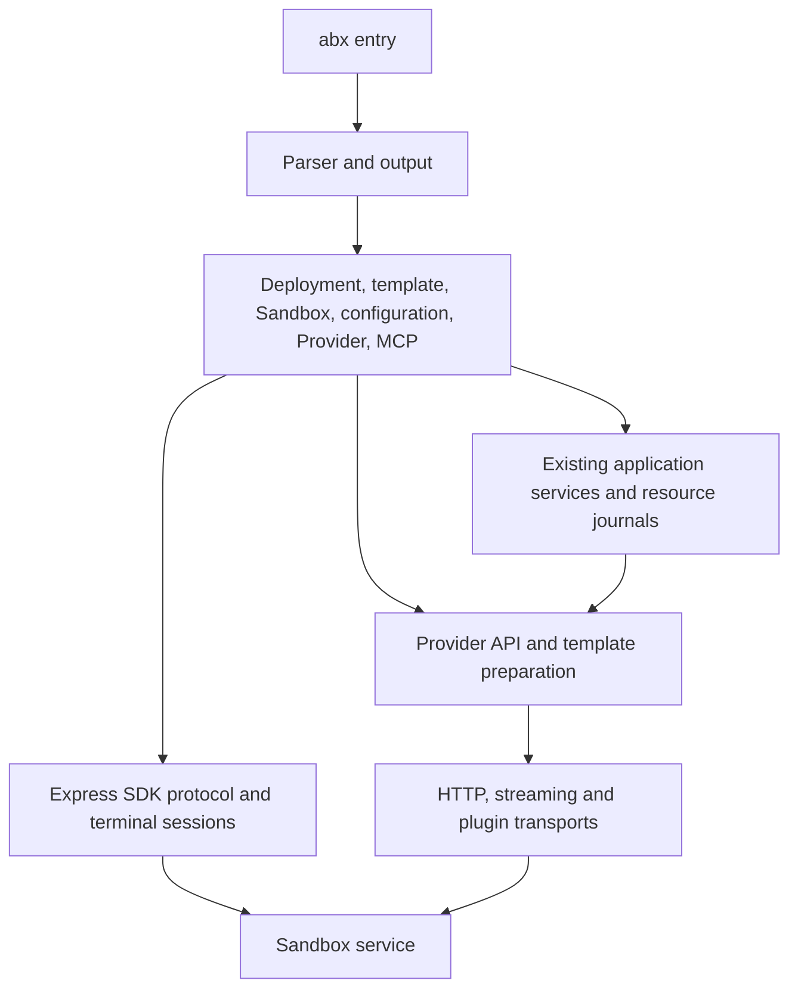

# CLI architecture

The CLI has one parser and command tree. Provider selection chooses the backend, not a second command-line implementation. The bundled Express runtime contains its pinned SDK protocol and attribution; session helpers provide stdin, terminal and signal handling.

| Owner | Source | Responsibility |
| --- | --- | --- |
| Entry and parsing | `src/bin/`, `src/framework/`, `src/cli/main.ts` | Global options, command discovery, help and dispatch |
| User operations | `src/cli/commands/` | Validate input, guide configuration and call services |
| Deployment names | `src/cli/deployment_store.ts` | Locate existing receipts and record non-secret target routing |
| Application lifecycle | `src/application/` | Profile validation, FC deployment, revision publication and owned cleanup |
| Template workflow | `src/cli/template_catalog.ts`, `template_build.ts`, `template_publish.ts`, `template_launch.ts` | Fetch, author, prepare, publish source and start declared services |
| Provider contracts | `src/providers/` | Features, configuration, native management and preparation adapters |
| Express protocol | `src/standard_cli/` | Pinned SDK transport plus process/PTY helpers; no command parser |
| Client operations | `src/api/`, `src/protocol/`, `src/transport/` | Provider-bound lifecycle, files, commands and transport |
| MCP and authoring | `src/agent/` | Local MCP tools and optional coding-agent assistance |

Lower-level clients do not depend on the CLI parser. A deployment name is a local locator, not a new cloud authority. Managed application cleanup uses existing account/resource identity and drain checks. Sandbox cleanup uses durable resource intents and confirmed identities. Unknown outcomes are retained for observation, never treated as permission to replay creation.

A reusable build is distinct from an instance. The author owns an explicit build; deployment-owned automatic builds are cleaned with their application. Consumer admission and cleanup share one local lock. This lock does not coordinate separate hosts.

The Python repository owns the client and in-sandbox server. Its optional server extra installs local runtime support; its standard, asynchronous, Provider and HTTP clients retain separate purposes. The Node.js SDK remains an application HTTP client. The Provider engine is a reusable service used by the Python Provider path, not another user-facing deployment layer.

Build with `npm ci` and `npm run build`; packaging and pinned SDK reproduction are checked by repository CI. The current command layout is source-only until released. See [commands](cli-design.md), [catalog](templates-catalog.md), [MCP](mcp-server.md), and [contributing](../../../.github/CONTRIBUTING.md).
