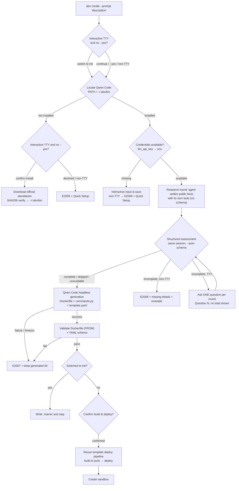

> For standard Express commands use the [E2B migration contract](../guide/migrate-from-e2b.md): create takes a template, --prompt requests generation, template create uses E2B build semantics, and from-image creates an Alibaba image template.

# CLI Command System Design

> `abx` CLI is the command-line entry point for Agent Sandbox, designed for both human developers and AI Agents. The CLI's ultimate goal: **Users don't need to know about templates, resource specs, or configuration parameters — just describe what you want to do, and the sandbox handles everything automatically.**

***

## Table of Contents

1. [Command Tree](#1-command-tree)
2. [Global Options](#2-global-options)
3. [Natural Language Creation](#3-natural-language-creation-ai-template-generation)
4. [Core Command Details](#4-core-command-details)
5. [Configuration Management](#5-configuration-management)
6. [Core Workflows](#6-core-workflows)
7. [OutputManager Unified Output Management](#7-outputmanager-unified-output-management)
8. [AI Friendly Design Principles](#8-ai-friendly-design-principles)
9. [Future Plans](#9-future-plans)

***

## 1. Command Tree

```mermaid
graph TB
    abx["abx"]

    abx --- sandbox["sandbox"]
    abx --- template["template"]
    abx --- mcp["mcp"]
    abx --- config["config"]
    abx --- provider["provider"]
    abx --- shortcuts["Fixed shortcuts: create / list / info / kill / exec / connect / upload / download / run / deploy"]

    sandbox --- sb_crud["create / list / info / kill / exec / connect / upload / download / capabilities"]
    sandbox --- sb_files["files"]
    sandbox --- sb_process["process"]
    sandbox --- sb_system["system"]
    sandbox --- sb_command["command"]

    sb_files --- f_list["list"]
    sb_files --- f_stat["stat"]
    sb_files --- f_mkdir["mkdir"]
    sb_files --- f_rm["rm"]
    sb_files --- f_mv["mv"]
    sb_files --- f_search["search"]

    sb_process --- p_list["list"]
    sb_process --- p_info["info"]
    sb_process --- p_signal["signal"]

    sb_command --- c_list["list"]
    sb_command --- c_run["run"]

    sb_system --- sys_info["info"]
    sb_system --- sys_env["env"]
    sb_system --- sys_ports["ports"]
    sb_system --- sys_packages["packages"]
    sb_system --- sys_metrics["metrics"]

    template --- tpl_init["init"]
    template --- tpl_deploy["deploy"]
    template --- tpl_build["build"]
    template --- tpl_push["push"]
    template --- tpl_create["create"]
    template --- tpl_install["install"]
    template --- tpl_list["list"]
    template --- tpl_info["info"]
    template --- tpl_delete["delete"]
    template --- tpl_search["search"]

    mcp --- mcp_install["install"]
    mcp --- mcp_start["start"]
    mcp --- mcp_status["status"]
    mcp --- mcp_deploy["deploy"]

    config --- cfg_init["init"]
    config --- cfg_get["get"]
    config --- cfg_set["set"]
    config --- cfg_list["list"]
    config --- cfg_delete["delete"]
```



Every action has **one canonical `abx GROUP VERB` path**. The top-level shortcuts (`create`, `list`, `info`, `kill`, `exec`, `connect`, `upload`, `download`, `run`, `deploy`) are a small **fixed, hard-coded** set, each documented in `abx --help` as "Same as 'abx …'" (`run` = `sandbox command run`, `deploy` = `template deploy`). They cannot be configured, renamed or removed; there is no top-level `init` or `install`. The full tree and the removed spellings are in the [CLI Command Reference](../reference/cli-commands.md).

> `config reset` was removed before the first stable release — remove one stored value with `abx config delete KEY` (or `abx config set KEY ""`). The key falls back to its default or to not set. There is no command that wipes `~/.abx`.

***

## 2. Global Options

| Option         | Short  | Description                | Default        |
| -------------- | ------ | -------------------------- | -------------- |
| `--json`       | `-j`   | Output in JSON format (AI-friendly) | `false`        |
| `--quiet`      | `-q`   | Quiet mode, only output key results | `false`        |
| `--verbose`    | `-v`   | Verbose output (DEBUG level logs)   | `false`        |
| `--no-color`   |        | Disable colored output             | `false`        |
| `--log-level`  |        | Explicitly set log level (DEBUG/INFO/WARNING/ERROR) | `None` |
| `--ci`         |        | CI/CD mode (equivalent to quiet + no-color + json) | `false` |
| `--version`    |        | Show version number                |                |
| `--help`       | `-h`   | Show help and exit (every command level) |           |

There is no global `--timeout` and no `--profile`: a sandbox lifetime is `--timeout` on `create`, a command timeout is `--timeout` on `exec`.

Every command accepts both `-h` and `--help`: the alias is configured once on the root group (the `help_option_names` context setting, `['-h', '--help']`) and inherited by the whole command tree through the Context mechanism of the mini click-compatible framework (`src/framework`) — lazily loaded groups and nested sub-groups included.

```bash
# Example: JSON output + quiet
abx list --json --quiet

# CI/CD mode (auto quiet + no-color + json)
abx list --ci

# Specify log level
abx create --prompt "python environment" --log-level DEBUG
```

`--region`/`-r` is a **command-level option**, not a global one. Only commands that talk to a regional control plane accept it:

```bash
# Region override for a single invocation
abx list --region cn-shanghai
abx sandbox list --region cn-shanghai
abx template build ./my-template --acr-namespace ns --region cn-shanghai
abx mcp deploy --region cn-shanghai

# Persistent region default
abx config set region cn-shanghai
```

Resolution priority: command `--region` > `ALIBABA_CLOUD_REGION_ID` > `abx config set region` > `cn-hangzhou`.

The CLI automatically detects CI environments (`CI`, `GITHUB_ACTIONS`, `GITLAB_CI`, `JENKINS_URL`, etc.) and enables CI mode automatically. Color output is automatically disabled in non-TTY environments.

***

## 3. Natural Language Creation (AI Template Generation)

> **Describe what you need in natural language, and the CLI calls Qwen Code to generate a Dockerfile, a commands.py HTTP server entry point, and template.yaml, then builds, deploys, and creates the sandbox.**

`abx create` has three routes, decided by the invocation:

| Invocation | Path |
|-----------|------|
| `abx create` (no arguments) | **Rejected** — explicit usage error (exit code 2) listing the three valid routes; bare create never defaults to `base` silently |
| `abx create <name>` | Direct template path (no template generation) |
| `abx create --prompt "natural language description"` | generation path (the focus of this section) |
| `abx create --prompt "description" --template <name>` | Rejected — `DESCRIPTION` and `--template` are mutually exclusive (usage error, exit code 2) |

Neither input is ever silently dropped: when both are given the command refuses to run.

### Generation Path Flow



**Scope check.** Before any install or generation, an interactive terminal is shown that natural-language create will generate a template, build and push the image, deploy it, and create a sandbox, and is asked whether to switch to template init. Answering yes runs the same local-only generation as `abx template scaffold --prompt "DESCRIPTION"` (`Dockerfile`, `commands.py`, `template.yaml`, and `README.md` under `./<name>/`) and stops — no build, push, deploy, or sandbox. The default is to continue the full create. `--yes` and `--json` skip the question and keep the full pipeline. A non-interactive shell prints the same reminder and continues; the build confirmation below still applies.

1. **Executable discovery**: checks `PATH` first, then `~/.abx/bin` (recognizing `.cmd`/`.exe` suffixes on Windows).
2. **Install guidance**: when missing, interactive terminals are asked whether to install the official standalone build (SHA256-verified, atomically installed into `~/.abx/bin`, executable bit set on Unix); non-TTY or a declined prompt raises `E2005` with the Quick Setup — no hang, no silent fallback.
3. **Credential resolution**: a process environment variable wins over `./.env`, which wins over `~/.abx` for a key it sets. Each key has one environment variable: the LLM API key is `ABX_LLM_API_KEY`, the base URL is `ABX_LLM_BASE_URL`, and the model is `ABX_LLM_MODEL`. `abx config set llm_api_key` stores `ABX_LLM_API_KEY`. `~/.qwen/settings.json` is used only when none of those keys exist. Interactive terminals may prompt for and securely store a key; non-TTY raises `E2006`.
4. **Pre-generation clarification (research-first, two phases on one native session)**: before generating, the coding agent first runs a plain research round (`--session-id`, **no** `--json-schema`) in which it settles every publicly verifiable fact with its own tools (web fetch / shell) — tool stack, official install method, common runtimes and dependencies — recording safe defaults for anything unreachable. The same session then continues (`--resume`) with one structured `--json-schema` assessment round; verified against qwen-code 0.15.11, `--json-schema` ends the session on the first valid `structured_output` call, so the schema is deliberately absent from the research round to keep the tool loop free. Only user preferences, private constraints, and business decisions the agent cannot infer may count as missing. Below the 80% threshold, interactive terminals are asked exactly ONE question per round, numbered `Question 1`, `Question 2`, … with **no total shown** (the internal 5-round cap is mentioned only when reached); each answer resumes the same native session and triggers a fresh assessment against the full description + Q/A history, already-asked topics are embedded in every follow-up prompt (an exactly-repeated question breaks the loop defensively), and delegation answers ("you decide" / "use the default") instruct the agent to settle the choice itself with safe defaults. Non-TTY / CI sessions without `--yes` fail fast with `E2008`, listing the missing template facets and a ready-to-use example description. `--yes` skips research and assessment entirely; a failed research round only warns with a reason-specific hint (never a gate; the research is bounded to 20 turns / 240 s, `ABX_QWEN_RESEARCH_TIMEOUT` overrides, and its prompt caps slow web fetches at three) and the assessment then starts a **fresh** session — qwen rejects re-pinning a `--session-id` the failed round may already have created, which used to surface as a bogus “assessment unavailable”; an unavailable assessment degrades to direct generation with a warning. Phase status (researching / assessing / re-assessing / generating) renders on **stderr** as a spinner (TTY) or one machine-readable progress line (non-TTY), and — while the agent works — a header `Assessing description... 12s` with the last six activity lines in grey underneath (a Rich status normally, a self-erasing `\r` line under `--verbose` / `--no-color`, absent for `--json` / `--quiet` / CI / `TERM=dumb`). The headless run streams `--output-format stream-json --include-partial-messages` to feed that line, but shows the assistant's text tail and a short redacted tool detail (command, url, query, or path). File bytes, thinking, and credentials stay hidden; the whole agent process tree is killed on timeout or Ctrl-C. stdout stays clean and the model's research output is never echoed. Generation then resumes the clarification session, so the model keeps the description, the research summary, and every Q/A pair in its own memory.
5. **Generation & validation**: runs Qwen Code in headless mode inside a fresh `<slug>-<timestamp>-<token>/` workspace under `--dir` (default `~/.abx/generated/`; an interactive terminal is asked where to save it, Enter accepts the default; template name `abx-nl-<slug>-<token>`) via `qwen "<prompt>" --output-format json --yolo` (the prompt is positional — the legacy `-p` flag is deprecated per the 0.15.11 `--help`; list-form arguments, bounded cwd and timeout — 600s by default, overridable with `ABX_QWEN_CODEGEN_TIMEOUT`), expecting a *usable* template — a Dockerfile, a `commands.py` that starts the container-side `agent_sandbox.server` `SandboxServer` on port 9000 (a deployed sandbox is reached over HTTP(S), so a Dockerfile alone cannot be used), a template.yaml, and a README. The prompt carries the server SDK reference (`agent/template_guide.py`: Dockerfile rules, `CapabilityGroup`, `CommandRegistry`, `RouteTable.route`, `template.yaml` fields). The output is then validated — the Dockerfile must contain `FROM` and reference `commands.py`, `commands.py` must be valid Python that imports `agent_sandbox.server` and calls `serve()`/`start()`, and template.yaml must pass the `parse_template_data` YAML schema check. Failure or timeout raises `E2007` and keeps the generated directory for inspection.
6. **Build & create**: after confirmation, reuses the `abx template deploy` build/deploy pipeline (`--acr-namespace` selects the push namespace) and then calls the existing `Sandbox.create`. No step ever silently falls back to `base`; failures report the error code, the Quick Setup, and next-step commands.

### Examples

```bash
# Interactive: generated template → build & deploy → create
# abx create --prompt "run python data analysis with pandas and jupyter"

# Non-interactive (CI): -y is required, otherwise install/credentials/confirm steps fail fast
# abx create -y "a node.js api server"

# Explicit template bypasses template generation
# abx create codex
# abx create -T browser-automation

# Non-interactive with an incomplete description → E2008 (missing details + example)
# abx create --prompt "run python"

# Rejected: DESCRIPTION and --template are mutually exclusive (exit code 2)
# abx create --prompt "a node.js api" --template base

# With file upload
# abx create --prompt "analyze this CSV file" --upload data.csv
```

### Install & Credential Guidance

- **Automatic install**: official standalone assets are downloaded into `~/.abx/bin`; download sources are verified — the Aliyun mirror is preferred with the GitHub release asset as fallback, and `SHA256SUMS` must validate (a mismatch fails immediately, no fallback).
- **Manual install**: the Quick Setup and `abx create --help` print the official installer commands (`install-qwen-standalone.sh` / `.ps1`).
- **Credential storage**: `abx config set llm_api_key <KEY>` writes to `~/.abx/.env`; alternatively `abx config init` configures the sandbox API key, region, and LLM API key in one guided pass (printing equivalent non-interactive commands on non-TTY).

### Available Templates

The single source of truth for template content and the index is the
[`alibaba-agent-sandbox/awesome-templates`](https://github.com/alibaba-agent-sandbox/awesome-templates)
repository (`awesome-templates.yaml` at its root). The CLI no longer ships a
fixed template list — it discovers templates from the remote index:

```bash
abx template search web             # search the remote index by name/tag/description
abx template install node-web      # install by index name (resolved to owner/repo//subdir@ref)
```

- The index is cached under `~/.abx/index/` with a 1-hour TTL; a fresh cache is served without touching the network.
- On network failures / rate limits (403/429/5xx) the client falls back to the stale cache with a warning; without a cache it fails loudly with remediation (`abx config set github_token` / `GITHUB_TOKEN`, `--index-url`, `--refresh`). An anonymous rate limit (E5000) additionally shows the officially documented fine-grained PAT prefill URL, and in an interactive terminal offers a masked one-shot `github_token` setup followed by exactly one automatic retry.
- Entries may pin a remote revision via the `ref` field; bare names that resolve to builtin templates (`base`, `code-interpreter-v1`) never hit the network.
- The index schema carries a `schema_version`; a version newer than the client supports fails explicitly with an upgrade hint.

> `examples/templates/` (in the `python-sdk` repository) keeps only the minimal `python-hello`
offline **fixture** — it is not a publishing source.

***

## 4. Core Command Details

### abx create

```bash
abx create [DESCRIPTION] [options]

Arguments:
  DESCRIPTION               Natural language description (optional; the basis for template generation)

Options:
  --template, -T <name>     Specify template name (skips template generation; mutually exclusive with DESCRIPTION)
  --upload, -u <path>       Upload local file/directory after creation
  --timeout, -t <seconds>   Sandbox lifetime (default: 300)
  --env, -e <KEY=VALUE>     Environment variable (can be used multiple times)
  --metadata, -m <KEY=VALUE> Metadata key-value pair (can be used multiple times)
  --yes, -y                 Skip interactive confirmations and the research-first clarification flow (install/credentials/description research & assessment/build & deploy); required in non-interactive environments
  --acr-namespace <ns>      ACR namespace for building and pushing generated templates

Examples:
  abx create --prompt "python data analysis"       # generated template → build & deploy → create
  abx create -y "node.js api server"     # Non-interactive generation path
  abx create code-interpreter # Direct template path
  abx create --prompt "Node.js API" -e PORT=3000
  abx create --prompt "Analyze data" --upload ./data.csv
```

### abx list

```bash
abx list [options]

Options:
  --status, -s <status>     Filter by status (running/stopped/creating/paused/error)
  --limit, -l <n>           Limit count (default: 20)

Examples:
  abx list
  abx list --status running --json
  abx list -l 50
```

**Output Format**:

```
$ abx list
  ID            Template             Status    Region
  sb-a1b2c3d4   code-interpreter     running   cn-hangzhou
  sb-e5f6g7h8   python-data-science  running   cn-hangzhou
  sb-i9j0k1l2   base                 stopped   cn-shanghai
```

### abx info

```bash
abx info <sandbox-id>

Examples:
  abx info sb-a1b2c3d4
  abx info sb-a1b2c3d4 --json
```

**Output Format**:

```
$ abx info sb-a1b2c3d4
  ID:           sb-a1b2c3d4
  Template:     code-interpreter
  Status:       running
  Region:       cn-hangzhou
  Timeout:      300s
  URL:          https://sb-a1b2c3d4.envd.example.com
  Started:      2026-09-01 14:00:00
```

### abx kill

```bash
abx kill <sandbox-id> [options]
abx kill --all [options]

Options:
  --all                     Destroy all running sandboxes
  --yes, -y                 Skip confirmation prompt

Examples:
  abx kill sb-abc123
  abx kill sb-abc123 --yes
  abx kill --all
```

### abx exec

```bash
abx exec <sandbox-id> [options] -- <command>...

Options:
  --cwd <path>              Working directory
  --env, -e <KEY=VALUE>     Environment variable (can be used multiple times)
  --timeout, -t <seconds>   Command timeout (default: 60)
  --background              Start the command, print its pid, do not wait
  --stream                  Print stdout/stderr live while the command runs

Examples:
  abx exec sb-abc123 -- python train.py
  abx exec sb-abc123 --timeout 120 -- npm start
  abx exec sb-abc123 --stream -- pip install numpy
  abx exec sb-abc123 --background -- python -m http.server 8000
  abx exec sb-abc123 "ls -la | wc -l" --json
```

`exec` is the one command-execution entry point (`abx sandbox exec` is the canonical spelling). It replaces the former `sandbox process start` (now `--background`) and `sandbox shell-stream` (now `--stream`). The command after `--` runs as given, without a shell; a single quoted argument is read as a command line and gets a shell only when it contains pipes or redirects. `--background` and `--stream` cannot be combined.

**Output Format**:

```
$ abx exec sb-abc123 -- python -c 'print(1+1)'
2

$ abx exec sb-abc123 --json -- python -c 'print(1+1)'
{
  "stdout": "2\n",
  "stderr": "",
  "exit_code": 0,
  "execution_time": 0.12
}
```

The `exec` command propagates the exit code from the sandbox command as its own exit code.

`abx connect <sandbox-id>` is a line-by-line REPL: every line is a new process (no PTY; `cd` and exported variables do not persist).

### abx run

```bash
abx run <sandbox-id> <command-name> [options]      # same as: abx sandbox command run
abx sandbox command list <sandbox-id>

Arguments:
  command-name              Named command registered on the in-sandbox server

Options:
  --arg, -a <KEY=VALUE>     Named command argument (can be used multiple times)
  --json-args <JSON>        Arguments as a JSON object
  --server-port <port>      Port of the in-sandbox server (default: 9000)

Examples:
  abx sandbox command list sb-abc123
  abx run sb-abc123 serve --arg port=9000
  abx run sb-abc123 add --json-args '{"x": 1, "y": 2}'
```

There is exactly **one** named-command mechanism: commands registered on the `SandboxServer` running inside the sandbox (`@registry.command`, `CommandRegistry`), listed by `GET /commands` and called with `POST /commands/{name}`. They are **not** declared in `template.yaml` (the former `custom_commands` key and its placeholder substitution were removed, aligned with the Python client).

**Semantic distinction between `run` and `exec`**:

- `abx exec` = raw command (arbitrary argv or command line).
- `abx run` = named command with structured, typed parameters (the server validates and coerces them).

Error handling:

- Unknown `command-name` → `CommandNotFoundError` (exit 2) with a hint to run `abx sandbox command list`.
- No SandboxServer reachable in the sandbox → clean error, non-zero exit.
- The command raises on the server → exit 1 with the server's message.

### abx deploy

`abx deploy` is the **publish step** of the template lifecycle and a fixed pipeline: `docker build` → push to ACR → `CreateTemplate` → poll until ready. It is exactly `abx template deploy` with `PATH` defaulting to `.`, reuses that command's option set verbatim (so the two cannot drift and `-v/--verbose` works), and needs no LLM. On an interactive terminal each long step is a `message... 12s` header with the latest six lines of docker or poll output in grey underneath (the same block as template generation; `ABX_ACTIVITY_LINES` changes the count). The header keeps moving once a second while the tool is silent. `--verbose` prints the full log instead. `--json`, `--quiet`, CI, and non-TTY stay one progress line.

The same header is the progress display for every other step that can sit still: creating a sandbox, uploading or downloading files, fetching a template or the template index, registering a template from an image, installing the coding-agent CLI, and `abx kill --all`. Where a step has a safe log — relative paths, install milestones (mirror, checksum, extract), docker lines, or a poll status — the last six lines sit under the header (`ABX_ACTIVITY_LINES`, 1–10). Grey rows include a short redacted tool detail (command, url, query, or path). File bytes, thinking, and credentials stay hidden; ACR tokens and `--build-arg` values are not part of that log; the info line that records the docker command redacts build-arg values. `--verbose` still prints the full deploy log and does not draw the deploy block. Other commands keep the moving header on a terminal, including under `--verbose` and `--no-color`. `--json`, `--quiet`, CI, `TERM=dumb`, and a non-TTY stay silent for these headers.

```text
abx template scaffold ["DESCRIPTION" | --adopt DIR]  →  abx deploy [PATH]  →  abx create ID
  author (scaffold, a sentence, or an existing project)   publish (fixed)        launch
abx create --prompt "DESCRIPTION"  =  all three, with a confirmation before anything is pushed
```

```bash
abx deploy [PATH] [options]

Arguments:
  PATH                            Template directory (default: .)

Options:
  (all options of `abx template deploy`, e.g. --acr-namespace, --alias, --yes, -v)
```

Design notes:

- **The description belongs to authoring, not publishing.** What a template *is* — name, description, ports, capabilities, resources, env, custom commands, and the `commands.py` server that makes a deployed sandbox usable — is written into `template.yaml` / `Dockerfile` / `commands.py` by `abx template scaffold` (a scaffold, a description, or `--adopt` on an existing project), where it can be reviewed and versioned. `abx deploy` only *reads* `template.yaml` (`name`, `resources.cpu`, `resources.memory`, `generation`). A second place to describe the project at deploy time would be a second source of truth that never lands in `template.yaml`. `--adopt` is specified in ADR `2026-09-30-template-init-adopt-existing-project.md`.
- Consequently `deploy` has **no INSTRUCTION argument and no AI flag** (an earlier `--agent` design was dropped for exactly this reason; see ADR `2026-09-30-deploy-fixed-pipeline-agent-flag.md`).

### abx connect

```bash
abx connect <sandbox-id>

Examples:
  abx connect sbx-abc123
```

Connect to the sandbox's interactive, line-based REPL - not a PTY or an SSH session. Every entered line runs in a new process (30-second timeout) and no shell state survives between lines: `cd`, environment variables and aliases are gone after each command (use `cd /path && <cmd>` on one line, or `abx exec --cwd`). Interactive terminals get basic line editing and history (Up/Down, Ctrl+R, Ctrl+A/E). Type `exit`, `quit`, or `Ctrl+D` to disconnect; `Ctrl+C` also disconnects. Failed commands produce one friendly message - never a raw HTTP error, sandbox URL or MDN link.

**Interactive Example**:

```
$ abx connect sbx-abc123
✓ Connected to sandbox sbx-abc123
Type 'exit' or Ctrl+D to disconnect
Note: each line runs in an independent process - cd, environment variables and shell state do not persist

abx:sbx-abc1> ls /app
main.py  data/  requirements.txt

abx:sbx-abc1> sl /app
[E3006] Command not found: sl
  Suggestion: Did you mean 'ls'? It ran earlier in this session.

abx:sbx-abc1> python -c "print('hello')"
hello

abx:sbx-abc1> exit
Disconnected.
```

### abx upload

```bash
abx upload <sandbox-id> <local-path> <remote-path>

Examples:
  abx upload sb-abc123 ./script.py /app/script.py
  abx upload sb-abc123 ./data/ /app/data/
```

Supports uploading single files or entire directories. Directory uploads recursively upload all files.

### abx download

```bash
abx download <sandbox-id> <remote-path> <local-path>

Examples:
  abx download sb-abc123 /app/result.csv ./result.csv
  abx download sb-abc123 /app/output.log .
```

Download files from the sandbox to local. If `local-path` is a directory, the filename is taken from the remote path.

### abx sandbox files

Sandbox file operation subcommand group with 6 commands.

#### files list

```bash
abx sandbox files list <sandbox-id> [options]

Options:
  --path, -p <path>       Directory path (default: /home/user)
  --recursive, -r         List recursively (max depth 5)

Examples:
  abx sandbox files list abc123
  abx sandbox files list abc123 --path /app --recursive
```

#### files stat

```bash
abx sandbox files stat <sandbox-id> [options]

Options:
  --path, -p <path>       File or directory path (required)

Examples:
  abx sandbox files stat abc123 --path /home/user/app.py
```

#### files mkdir

```bash
abx sandbox files mkdir <sandbox-id> [options]

Options:
  --path, -p <path>       Directory path to create (required)

Examples:
  abx sandbox files mkdir abc123 --path /home/user/myproject/src
```

Automatically creates parent directories.

#### files rm

```bash
abx sandbox files rm <sandbox-id> [options]

Options:
  --path, -p <path>       File or directory path to delete (required)
  --yes, -y               Skip confirmation

Examples:
  abx sandbox files rm abc123 --path /home/user/temp.txt
  abx sandbox files rm abc123 --path /home/user/old_dir -y
```

#### files mv

```bash
abx sandbox files mv <sandbox-id> [options]

Options:
  --source, -s <path>     Source path (required)
  --dest, -d <path>       Destination path (required)

Examples:
  abx sandbox files mv abc123 --source /home/user/old.py --dest /home/user/new.py
```

#### files search

```bash
abx sandbox files search <sandbox-id> [options]

Options:
  --path, -p <path>       Search directory (required)
  --pattern <glob>        Glob pattern, e.g., '*.py' (required)
  --max-depth <n>         Max search depth (default: 5)

Examples:
  abx sandbox files search abc123 --path /home/user --pattern "*.py"
  abx sandbox files search abc123 --path /app --pattern "*.log" --max-depth 3
```

### abx sandbox process

Sandbox process inspection subcommand group with 3 commands (`list`, `info`, `signal`). Starting a process is `abx exec --background`.

#### process list

```bash
abx sandbox process list <sandbox-id>

Examples:
  abx sandbox process list abc123
```

Lists processes running in the sandbox, including PID, command, and status.

#### process info

```bash
abx sandbox process info <sandbox-id> <pid>

Examples:
  abx sandbox process info abc123 1234
```

Queries process information using `ps`, outputting PPID, User, State, RSS, Elapsed, etc.

#### process signal

```bash
abx sandbox process signal <sandbox-id> <pid> [options]

Options:
  --signal, -s <number>   Signal number: 15 (SIGTERM, default) or 9 (SIGKILL)

Examples:
  abx sandbox process signal abc123 1234
  abx sandbox process signal abc123 1234 --signal 9
```

Supported signals: 15 (SIGTERM) and 9 (SIGKILL). envd cannot deliver any other signal, so any other number (for example 2/SIGINT) is rejected with a message before a request is sent. `PID` is the envd process id shown by `process list`, not an OS pid.

### abx sandbox system

Sandbox system information subcommand group with 5 commands.

#### system info

```bash
abx sandbox system info <sandbox-id>

Examples:
  abx sandbox system info abc123
```

Displays OS, architecture, CPU count, Python version, disk space, etc.

#### system env

```bash
abx sandbox system env <sandbox-id> [options]

Options:
  --filter, -f <names>    Comma-separated variable name allowlist

Examples:
  abx sandbox system env abc123
  abx sandbox system env abc123 --filter PATH,HOME,LANG
```

Sensitive variables containing TOKEN, SECRET, KEY, PASSWORD are automatically excluded.

#### system ports

```bash
abx sandbox system ports <sandbox-id>

Examples:
  abx sandbox system ports abc123
```

Queries listening TCP ports using `ss -tlnp` or `netstat -tlnp`.

#### system packages

```bash
abx sandbox system packages <sandbox-id> [options]

Options:
  --manager, -m <pip|npm> Package manager (default: pip)

Examples:
  abx sandbox system packages abc123
  abx sandbox system packages abc123 --manager npm
```

#### system metrics

```bash
abx sandbox system metrics <sandbox-id>

Examples:
  abx sandbox system metrics abc123
```

Displays CPU load (1/5/15 min), disk usage, and other real-time metrics.

### abx sandbox capabilities

```bash
abx sandbox capabilities <sandbox-id>

Examples:
  abx sandbox capabilities abc123
```

Lists capability groups supported by the sandbox (e.g., shell, files, code, terminal, ports, etc.).

### abx template

#### template init

```bash
abx template scaffold [DIRECTORY] [options]

Options:
  -t, --template <case>     Built-in scaffold case (python, node, minimal)
  --from <ref>              Fetch template source from a registry ref (owner/repo or local path)
  --name <name>             Template name (default: case name, fetched name, or generated name)
  --list                    List available scaffold cases
  --force                   Overwrite existing files
  --adopt                   Adapt an existing project in DIRECTORY (default .)
  --hint <text>             With --adopt: ports, services, anything the code does not say
  --dry-run                 With --adopt: list what would be sent; send and write nothing
  -y, --yes                 Skip confirmation (clarification, and both --adopt prompts)

Examples:
  abx template scaffold --list
  abx template scaffold -t python            # Creates ./python/
  abx template scaffold -t python ./my-app   # Explicit directory
  abx template scaffold --from owner/repo
  abx template scaffold --prompt "a python data science env"   # AI files only, no build
  abx template scaffold -y --prompt "a node.js api server"     # non-interactive AI files
  abx template scaffold --adopt ./app --hint "listens on 8080"
  abx template scaffold --adopt ./app --dry-run
```

Generates an editable local template project without building, pushing, deploying, or creating a sandbox — continue with `abx template deploy <dir>` when ready. A path token (`my-app`, `./my app`) selects the directory. Whitespace or CJK text is a natural-language description: Qwen Code writes `Dockerfile`, `commands.py` (the SandboxServer entry point), `template.yaml` and `README.md` into `./<name>/` and stops. An interactive terminal is asked for that directory first (`Directory for the template project`); Enter keeps `./<name>/` (or `./<--name>/`), and any other answer is the project directory itself. `--yes`, `--json`, and a non-interactive shell skip the question. A file path, or a directory that already contains template files, is rejected before generation (`--force` overwrites). That is the same stop-line offered by the interactive switch on `abx create --prompt "DESCRIPTION"`. `--adopt` is the third authoring path: DIRECTORY is an existing project, the agent runs in a temp copy (secrets excluded), and only `Dockerfile`, `commands.py`, `template.yaml` and a generated `.dockerignore` are written back. `--adopt` is mutually exclusive with `-t`, `--from` and `--list`. A local `--from` directory with no `template.yaml` is rejected and the message points at `--adopt`. `abx init` is a top-level shortcut delegating to the exact same command object; guided credentials setup is `abx config init`.

##### Fixed top-level shortcuts

- The top-level shortcuts are **static code**: `src/cli/command_surface.ts` lists the command groups and the shortcut table (`create`, `list`, `info`, `kill`, `exec`, `connect`, `upload`, `download` → `sandbox <verb>`, `run` → `sandbox command run`, `deploy` → `template deploy`); `src/cli/main.ts` registers them lazily and prints them under **Sandbox shortcuts** in `abx --help`. There is no configuration layer: no `[shortcuts]` section in `config.toml`, no `abx config set shortcuts.*`.
- A test (`tests/test_cli/test_command_surface.test.ts`) fails when the top-level command list differs from the set documented in the [command reference](../reference/cli-commands.md).
- Named commands run **inside a sandbox** (`abx run`); they are unrelated to CLI routing.
- Unknown top-level commands get a targeted hint: a close spelling match (difflib, cutoff 0.6) yields `Did you mean '…'?`; with no plausible candidate the error points to `abx --help`, to `abx template scaffold|install`, and to `abx run SANDBOX NAME`. Exit code 2 and stderr-only output are preserved; only the root group is affected.
- `provider` is a command group in its own help section (**Providers**).

#### template deploy

```bash
abx template deploy <template-dir> [options]

Options:
  (same as template build — performs build → push → create in one step)

Examples:
  abx template deploy ./my-template
  abx template deploy ./my-template --alias my-env
```

End-to-end pipeline: build Docker image locally, push to ACR, and call CreateTemplate API. This is the recommended one-command workflow for publishing templates.

#### template build

```bash
abx template build <template-dir> [options]

Options:
  --acr-registry <url>      ACR registry URL
  --acr-namespace <ns>      ACR namespace (required)
  --alias, -a <name>        Template alias
  --tag, -t <tag>           Image tag
  --platform <platform>     Target platform
  --cpu <n>                 CPU cores
  --memory <mb>             Memory in MB
  --dockerfile, -f <path>   Custom Dockerfile path
  ... (see --help for full options)

Examples:
  abx template build ./my-template --acr-namespace my-ns
```

Build a Docker image from a template directory, push to ACR, and register via CreateTemplate API.

#### template push

```bash
abx template push <image> [options]

Options:
  --acr-registry <url>      ACR registry URL
  --acr-namespace <ns>      ACR namespace (required)
  --acr-username <user>     ACR username
  --acr-password <pass>     ACR password

Examples:
  abx template push my-image:v1 --acr-namespace my-ns
```

Push an existing local Docker image to ACR without building or registering a template.

#### template create

```bash
abx template from-image <image> [options]

Options:
  --name, -n <name>         Template name (required)
  --team-id <id>            Team ID
  --cpu <n>                 CPU cores
  --memory <mb>             Memory in MB
  --disk-size <mb>          Disk size in MB
  --start-cmd <cmd>         Start command
  --ready-cmd <cmd>         Readiness probe command
  ... (see --help for full options)

Examples:
  abx template from-image registry.cn-hangzhou.aliyuncs.com/ns/img:v1 -n my-template
```

Register a template from an image already in ACR by calling the CreateTemplate API. Use this when the image is already pushed.

#### template install

```bash
abx template install <template-ref> [options]

Options:
  --registry-url <url>      Registry URL (default: GitHub)
  --registry-type <type>    Registry type (github/local)
  --token <token>           Access token (required for private repos); temporary override only — prefer 'abx config set github_token' (--token may leak into shell history and process listings)
  --alias, -a <name>        Template alias

Examples:
  abx template install owner/repo              # Entire repo
  abx template install owner/repo//subdir      # Specific subdirectory
  abx template install owner/repo@v1.0         # Specific version
  abx template install owner/repo --token xxx  # Private repo (one-off; prefer 'abx config set github_token')
  abx template install ./my-template           # Local directory
```

Token resolution order: `--token` > process `GITHUB_TOKEN` > `./.env` > stored `github_token` (`abx config set github_token`, masked input, stored in `~/.abx/.env`) > no token. On an anonymous rate limit the full `owner/repo//subdir@ref` reference is preserved in the error, and an interactive terminal is offered the masked token setup with one automatic retry.

Install templates from GitHub or local directories. The template directory must contain a `template.yaml` file.

#### template list

```bash
abx template list [options]

Options:
 /--no-official-api   Use official API
```

Lists all templates (queried via Platform API).

#### template info

```bash
abx template info <template-id> [options]

Options:
 /--no-official-api   Use official API
```

View template details.

#### template delete

```bash
abx template delete <template-id>
```

Delete a template (requires confirmation).

#### template search

```bash
abx template search <query> [options]

Options:
  --tag, -t <tag>           Filter by tag
  --status, -s <status>     Filter by status

Examples:
  abx template search python
  abx template search "data science" --tag ml
```

Search templates by name, description, or tags.

### abx mcp

#### mcp install

```bash
abx mcp install --target <cursor|claude|vscode>
```

Install MCP Server configuration to a specified IDE. Supports Cursor, Claude Desktop, and VS Code. After installation, lists registered tools:

- `create_sandbox` — Create a cloud sandbox
- `run_code` — Execute code
- `run_command` — Execute commands
- `read_file` — Read files
- `write_file` — Write files
- `list_files` — List files
- `kill_sandbox` — Destroy sandbox

#### mcp start

```bash
abx mcp start [options]

Options:
  --template <name>         Default sandbox template (default: code-interpreter-v1)
  --sandbox-api-key <key>   API Key override (env: ABX_SANDBOX_API_KEY)
  --sandbox-base-url <url>  API URL override (env: ABX_SANDBOX_BASE_URL)
  --sandbox-domain <domain> Domain override (env: ABX_SANDBOX_DOMAIN)
```

Start MCP Server in STDIO mode. Usually called automatically by the IDE; manual execution is not typically needed.

#### mcp status

```bash
abx mcp status
```

Display MCP Server status: transport mode, tool count, auth config, installation status for each IDE.

#### mcp deploy

```bash
abx mcp deploy [options]

Options:
  --name <name>             FC function name (default: agent-sandbox-mcp)
  --region <region>         FC region; command --region > ALIBABA_CLOUD_REGION_ID >
                            abx config set region > cn-hangzhou
  --template <name>         Default sandbox template (default: base)
  --memory <mb>             FC function memory (default: 512)
  --timeout <seconds>       FC function timeout (default: 600)
  --auth-token-file <path>  Bearer token file (or --generate-token)
  --generate-token          Auto-generate a random Bearer token
  --enable-session-affinity / --no-session-affinity
                            Mcp-Session-Id affinity (default: enabled)
  --api-key <key>           Inject API key into FC env
  --custom-domain <domain>  Custom domain for the MCP endpoint
  --output-dir <path>       Write the artifact to this directory

Examples:
  abx mcp deploy --generate-token --sandbox-api-key $ABX_SANDBOX_API_KEY --output-dir ./artifact
  abx mcp deploy --auth-token-file ./token.txt --region cn-shanghai
```

Generate an Alibaba Cloud FC deployment artifact (requirements.txt, app.py ASGI entry point, and a YAML config.yaml manifest) and print manual FC deployment steps. Automatic FC API deployment is not implemented. See [MCP Server Design — FC Deployment](mcp-server.md#7-fc-deployment) for architecture details.

***

## 5. Configuration Management

The configuration file is located at `~/.abx/config.toml`, with API Keys stored separately in `~/.abx/.env`.

### Configurable Items

| Config Key      | Description                           | Default                   |
| --------------- | ------------------------------------- | ------------------------- |
| `sandbox_api_key` | Sandbox service API key (stored as `ABX_SANDBOX_API_KEY`) | (not set)          |
| `sandbox_base_url` | Platform API URL (env `ABX_SANDBOX_BASE_URL`) | (auto)                    |
| `region`        | Default region (env `ALIBABA_CLOUD_REGION_ID`) | `cn-hangzhou`             |
| `http_timeout`  | HTTP request timeout (seconds)        | (auto)                    |
| `sandbox_domain` | Envd domain (env `ABX_SANDBOX_DOMAIN`) | (auto)                    |
| `llm_api_key`   | LLM API key for NL inference and the coding agent | (not set) |
| `llm_model`     | LLM model name                        | `qwen3-coder-plus`       |
| `llm_base_url`  | LLM API base URL (OpenAI compatible)  | DashScope compatible endpoint |

Sensitive config items (`sandbox_api_key`, `llm_api_key`) are automatically masked in `config list` output.

`abx config init` asks only for the credentials and the region; `--build` adds the ACR namespace and AccessKey, `--llm` adds the LLM key. A feature that needs a missing setting prints a one-line pointer to `abx config init --build` / `--llm`.

### Command Examples

```bash
# Set the sandbox API key
abx config set sandbox_api_key e2b_xxx

# LLM API key for NL inference and the coding agent
abx config set llm_api_key sk-xxx

# Or run the guided wizard (sandbox API key, region, LLM API key)
abx config init

# View configuration
abx config list
abx config get region

# Clear one stored value (falls back to default / not set)
abx config set region ""
```

A process environment variable overrides `./.env`, which overrides the stored LLM settings. The variables are `ABX_LLM_API_KEY`, `ABX_LLM_BASE_URL`, and `ABX_LLM_MODEL`. A blank value does not count. When those are unset, the value in `~/.abx` is used.

***

## 6. Core Workflows

### Workflow 1: Quick Experimentation

```bash
# One command, from description to usable environment
abx create --prompt "python data analysis with pandas and matplotlib"
# → sb-abc123

abx exec sb-abc123 "python -c 'import pandas; print(pandas.__version__)'"
# 2.1.0

abx kill sb-abc123
```

### Workflow 2: File-Based Interactive Development

```bash
# Create sandbox and upload project
abx create -T code-interpreter --upload ./project

# View sandbox contents
abx exec sb-abc123 "ls /home/user/"

# Execute code
abx exec sb-abc123 "python /home/user/main.py"

# Download results
abx download sb-abc123 /app/result.csv ./result.csv

# Destroy when done
abx kill sb-abc123 --yes
```

### Workflow 3: Interactive Debugging

```bash
# Create and connect to sandbox
abx create -T code-interpreter
abx connect sbx-abc123

# Work in the line-based REPL (each line is a fresh process)
abx:sbx-abc1> pip install requests && python my_script.py
abx:sbx-abc1> cat /app/output.log
abx:sbx-abc1> exit
```

### Workflow 4: AI Agent Integration

```bash
# Install MCP Server to Cursor
abx mcp install --target cursor

# Check status
abx mcp status

# AI Agent automatically uses sandboxes via MCP
# (Natural language operations in Cursor/Claude)
```

### Workflow 5: Custom Templates

```bash
# Install community template from GitHub
abx template install owner/my-template

# Or build from Dockerfile
abx template build -f ./Dockerfile --alias my-ml-env

# Check template status
abx template list

# Use custom template
abx create my-ml-env
```

***

## 7. OutputManager Unified Output Management

> All CLI commands uniformly use `OutputManager` (`src/cli/output.ts`) instead of bare `console.log` calls, ensuring consistent output behavior across different modes.

### Channel Policy: Results vs. Diagnostics

The manager owns two channels and never mixes them, so machine-readable output stays pipeable:

| Channel | Content | Consumers |
|---------|---------|-----------|
| **stdout** | Final results: `data`, `table`, `success` | humans and scripts (`abx ... --json \| jq`) |
| **stderr** | Progress state and diagnostics: `info`, `progress`, `warning`, `error`, `debug`, plus **every log record** (`utils/logging`) | humans following a long-running command |

Consequences:

- In `--json` mode stdout stays a **single JSON document**; the JSON forms of `info` / `warning` / `progress` / `debug` / `error` are written to stderr instead.
- Managed coding-agent installation is intermediate progress: its completion message goes to stderr, including the first `create --prompt` run. In JSON mode only the final command result goes to stdout.
- Library warnings and DEBUG diagnostics are bridged through one handler on the root logger, so a warning is rendered exactly once (no duplicate `WARNING:` line next to the SDK's timestamped line).
- Progress spinners render on stderr; every write pauses the live spinner and resumes it afterwards, so status text and results never interleave.
- `--quiet`, `--json` and `--ci` therefore keep stdout free of status text and log records.

### Output Methods

| Method | Description | Channel | Quiet Mode | JSON Mode |
|--------|-------------|---------|------------|-----------|
| `info(message)` | Informational message | stderr | Suppressed | `{"level": "info", ...}` → stderr |
| `success(message)` | Success message (green) | stdout | Suppressed | `{"status": "success", ...}` → stdout |
| `warning(message)` | Warning message (yellow) | stderr | Suppressed | `{"level": "warning", ...}` → stderr |
| `error(message)` | Error message (red, **always shown**) | stderr | Shown | `{"status": "error", ...}` → stderr |
| `debug(message)` | Debug message (verbose mode only) | stderr | Suppressed | `{"level": "debug", ...}` → stderr |
| `data(data)` | Structured data (dict/list) | stdout | Values only | JSON object |
| `table(headers, rows)` | Table data (terminal table + plain text fallback) | stdout | Tab-separated | `[{...}, ...]` |
| `progress(message)` | Progress/status message | stderr | Suppressed | `{"level": "progress", ...}` → stderr |

### Environment Auto-Detection

- **TTY Detection**: Automatically detects whether stdout is connected to a terminal; color output is automatically disabled in non-TTY environments.
- **CI Environment Detection**: Detects `CI`, `GITHUB_ACTIONS`, `GITLAB_CI`, `JENKINS_URL`, `TRAVIS`, `CIRCLECI`, `BITBUCKET_PIPELINES`, `TF_BUILD`, `CODEBUILD_BUILD_ID` and other environment variables, automatically enabling CI mode (quiet + no-color + json).

### Logging Bridge

`OutputManager` installs one `_LogBridgeHandler` on the **root** logger (format `LEVELNAME: message`, level = the CLI log level) and drops the standalone handler installed by `utils/logging` (the SDK installs the equivalent one in `agent_sandbox.utils.logging`). That is what keeps a library warning such as the capability-resolver fallback from being printed twice:

```
WARNING: Could not resolve capabilities for template 'base'; no matching template.yaml in ~/.abx/templates. Using default capabilities shell, files, code. Run 'abx template deploy' to cache it, or copy template.yaml to ~/.abx/templates/<id>/template.yaml.
```

Log propagation stays enabled, so test log capture and embedding applications keep seeing records. During a CLI run the verbosity flags (`--verbose` / `--quiet` / `--log-level`, plus CI auto-detection) are the single source of truth for the log level; `ABX_LOG_LEVEL` applies to standalone SDK use, where the SDK owns logging.

### Spinner Pause / Resume

Interactive spinners are `Status` objects rendered on stderr. The manager keeps the live statuses on a stack and pauses all of them before writing anything, resuming afterwards (`_spinner_guard`). This replaces the old behaviour where a raw logging handler wrote straight past the live display and produced garbled text such as `⠋ Waiting...DEBUG: https://...`.

### Usage

```ts
import { getOutput } from "../output.js";

// Get OutputManager in any command
const out = getOutput(ctx);
out.info("Creating sandbox...");
out.success("Sandbox created successfully");
out.data({ sandbox_id: "sb-abc123", status: "running" });
```

`getOutput(ctx)` retrieves the `OutputManager` instance from the command context's `ctx.meta["sbox.output"]`, falling back to a default instance when no context is available.

***

## 8. AI Friendly Design Principles

The CLI is designed for both humans and AI; the following principles ensure AI Agents can efficiently use the CLI:

### Principle 1: Structured Output

```bash
# All commands support --json for structured JSON output
abx list --json
abx info sb-abc123 --json
abx exec sb-abc123 "echo hello" --json
```

### Principle 2: Deterministic Exit Codes

| Exit Code | Meaning     |
| --------- | ----------- |
| `0`       | Success     |
| `1`       | General error |
| `2`       | Argument error |
| `3`       | Auth failure |
| `4`       | Resource not found |
| `5`       | Timeout     |
| `6`       | Quota exceeded |

### Principle 3: Non-Interactive Mode

```bash
# --yes skips confirmation (supported by kill, etc.)
abx kill --all

# --quiet minimizes output
abx create --prompt "python environment" --quiet
```

### Principle 4: Composable Pipelines

```bash
# Get ID directly after creation
ID=$(abx create --prompt "python environment" --quiet)

# Pipeline composition
abx list --json | jq '.[].sandbox_id'

# Batch destroy
abx list --json | jq -r '.[].sandbox_id' | xargs -I{} abx kill {} --yes
```

### Principle 5: Self-Describing Help

Every command accepts both `-h` and `--help` — the alias is configured once at the root group and inherited by the whole command tree.

```bash
# Every command's --help / -h includes complete documentation
abx create --help
abx create -h
abx template install --help

# Error messages include fix suggestions
$ abx config set unknown_key value
Error: Unknown config key: 'unknown_key'
Available keys: sandbox_api_key, sandbox_base_url, sandbox_domain, ...
```

### Principle 6: Lazy Loading for High Performance

The CLI uses `LazyGroup` (`src/framework`) for lazy loading, achieving `abx --help` response time < 200ms. Modules and dependencies are only loaded when a command is actually executed.

***

## 9. Future Plans

The following features are not yet implemented and are planned for future versions:

- **`abx build [path]`**: Automatically detect and build sandbox images from project directories
- **`abx logs <sandbox-id>`**: View sandbox real-time logs
- **`abx hibernate / wake`**: Sandbox hibernation and wake (requires underlying platform support)
- **`abx snapshot`**: Create sandbox snapshots (requires underlying platform support)
- **Hot Reload Mode**: `--watch` flag for automatic sync of local file changes to sandbox
