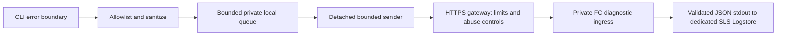

# Error reporting to FC and SLS (proposal)

Status: proposed; design only, updated 2026-10-23. None of the settings, routes or resources below are deployed or implemented by this document. Current `abx` does not have this general error-reporting service. The telemetry note in the skill installation guide describes the external skills installer, not this service. [中文](../../zh/design/error-reporting.md).

## Outcome and ownership

Every observable CLI failure should be eligible for a small, sanitized diagnostic event. Users can disable reporting before the first invocation. Reporting cannot change exit codes, stdout, stderr, terminal ownership or whether an operation is retried. Never promise delivery of every error: offline machines, SIGKILL, OOM, early loader failures, user opt-out and bounded queues can lose events.

The CLI repository owns capture, schema, policy, redaction, worker and deployment source. Put a proposed `services/error-ingest/` backend and its IaC here, with an independent CI job and deployment identity. It is not a Registry ingestion route and does not run in the website function. Registry and website publish the privacy/settings documentation only. SDKs are separate future integrations; a CLI change cannot capture arbitrary errors in external SDK applications.

## Recommended first release



Use client-side asynchronous sending. The public ingress handles a short synchronous request, validates it and writes one structured stdout line to its configured SLS Logstore. Return 202 only after that write completes; this means accepted by the application, not confirmed durable SLS indexing. There is no expensive business work requiring an FC async queue in v1. [FC stdout collection](https://www.alibabacloud.com/help/en/functioncompute/context-and-log-format-1) supplies the transport into SLS.

If load later requires a queue, accept/validate at the same ingress, then invoke an authenticated private worker asynchronously using a function role. Keep the ingress-to-worker service identity separate from client identity. FC supports `X-Fc-Invocation-Type: Async` and returns 202 for queued invocations; that response does not mean application validation ran. Configure retry count, event lifetime and dead-letter handling explicitly. [FC asynchronous invocation](https://www.alibabacloud.com/help/en/functioncompute/fc-asynchronous-invocation).

Do not expose a raw anonymous async FC trigger as the only protection. Rejection inside the worker happens after queue admission and may already incur cost. The gateway must strip or reject client-supplied FC invocation/control headers so a caller cannot bypass synchronous validation. FC origin must be private or authenticate the gateway; closing only the custom domain leaves an origin bypass. Verify this with deployment tests, not a diagram. [FC HTTP trigger protection](https://www.alibabacloud.com/help/en/functioncompute/configure-an-http-trigger-for-a-function-and-invoke-the-function-by-using-http-requests).

## User control and policy

Proposed public interface:

```bash
# Persistent opt-out, also usable before any other command
abx config set diagnostics.enabled false
# Inspect without sending an event
abx config get diagnostics.enabled
# Enable again deliberately
abx config set diagnostics.enabled true
# One process / automation (also disables bootstrap and retries)
ABX_DIAGNOSTICS=0 abx template deploy ./codex -y
```

Proposed user `~/.abx/config.toml`:

```toml
[diagnostics]
enabled = false
```

Respect `DO_NOT_TRACK=1` and `DISABLE_TELEMETRY=1` as disabling aliases. Any recognized explicit disable wins over enable in other layers. No provider credential schema is used: diagnostics is a host setting, independent of active Provider. No remote endpoint override from project YAML, plugins or project dotenv; release configuration fixes an HTTPS endpoint. Administrative custom builds may set one at build time with the same security requirements.

Default proposal is enabled for the minimal safe schema below, with a clear install/first-error notice linking to the policy and opt-out. Print the notice on stderr only in ordinary human mode; no notice in JSON/quiet/MCP protocol channels. Publish the notice in installer/help docs for those modes. No networking during module import or help/completion/version. Disabling must be resolved before worker/bootstrap scheduling; `config set diagnostics.enabled false` never reports itself, cancels this installation's pending worker, deletes pending events and identity/token cache and does not enqueue new events. Already transmitted data cannot be retracted by local configuration. Deleting a spool does not race a worker: use a shared lock and generation marker, recheck immediately before network requests, and expire idle workers.

Invalid or unreadable diagnostic/user configuration fails closed for telemetry, without preventing the original command from displaying its configuration error. False must not be treated as an absent value. No configuration or identity writes occur merely to print help. Unset/default behavior, precedence and notice need tests before release. A future detailed debug bundle must require separate explicit consent and local preview; enabling minimal reporting does not enable raw logs.

## Capture boundaries and coverage

| Surface | Capture point | Event policy |
| --- | --- | --- |
| Native command/configuration/usage error | Framework error boundary and `handleErrors` | Exactly one terminal event per operation; preserve original formatting/status |
| Embedded standard CLI | Explicit failure hook in pinned source build process | Structured code/category, never scrape raw terminal text; replay vendor lockfile and provenance checks |
| Provider/plugin or build failures | Host adapter, deploy outcome | Stage and safe provider ID; treat plugin message/stdout as untrusted |
| MCP tool failure | Tool result boundary | Safe operation ID and category, never JSON-RPC params or protocol bytes |
| Background task / remote command nonzero | Task outcome adapter | `remote_exit` and integer status, no command text or output; never mislabel as CLI crash |
| Uncaught exception / rejected promise | Earliest reachable process boundary | Minimal `internal_error`; best effort synchronous enqueue, preserve fatal exit; worker cannot guarantee pre-import crash capture |
| Expected cancel / Ctrl-C | Explicit outcome | Local cancellation, no failure event by default |
| Internal recovered retries | Retry adapter | Aggregate retry count in final failure; do not upload every retry separately |

Install the reporter before dynamically loading `abx_main`. Parsing failures must not require successful full application config loading to become eligible. An in-process operation ID and stable error-object marker prevent duplicate events when a failure passes several boundaries. Use `AsyncLocalStorage` for concurrent MCP operations, not one global operation ID. Preserve successful operations; no usage tracking is required. Reporter errors never report themselves or trigger recursion. Do not replace normal error handlers with `uncaughtException` continuation.

## Minimal schema and privacy

Proposed route `POST /v1/diagnostics/events`, versioned independently of CLI releases; this is not an existing endpoint. JSON object, UTF-8, no compression; one event/request, max 8 KiB encoded and max depth 4. Reject unknown keys, duplicate JSON keys, arrays where objects are expected, malformed UTF-8 and non-finite values. Require `Content-Type: application/json`. Parse incrementally with a hard body cap even for chunked requests. No attachments or arbitrary metadata map.

| Field | Type / limit | Source |
| --- | --- | --- |
| `schema_version` | integer 1 | Fixed schema |
| `event_id` | UUIDv4 | New per event; stable through retries |
| `occurred_at` | RFC3339 UTC | Client clock; server records receipt time separately |
| `cli_version` | validated version string, 32 chars | Built package constant; untrusted claim on server |
| `runtime` | Node major integer, OS enum, CPU enum | No hostname, user or exact OS fingerprint |
| `command_id` | allowlisted route, 80 chars | Canonical command, no argv or arbitrary plugin operation names |
| `provider_id` | built-in/catalog ID or `custom`, 64 chars | No local path, source URL or customer-specific ID |
| `category` / `error_code` | enums / known code or `unknown` | Parser, configuration, auth, capability, network, build, remote_exit, internal |
| `diagnostic_code` | required versioned enum | Reporter-owned classifier; independent of exception class or message |
| `rejected_option` | optional known public option enum or `custom` | Parser token ID only, never its value or an arbitrary token |
| `stage` / `exit_code` | enum / bounded integer | Current operation outcome |
| `missing_fields` | max 12 allowlisted field IDs | Names only; custom fields become `custom` |
| `retry_count` | integer 0–10 | Aggregate only |
| `stack_frames` | max 8 package-relative module/function IDs | Optional internal failures only; no full stack/error text |

### Stable diagnostic classification

`diagnostic_code` is required even when `error_code=unknown`. Start a versioned catalog with `usage.unknown_option`, `usage.missing_argument`, `config.missing_field`, `config.invalid_value`, `auth.rejected`, `provider.unsupported`, `network.timeout`, `network.unavailable`, `build.failed`, `remote.nonzero`, and `internal.unclassified`. Each capture adapter maps typed parser/validation/outcome metadata to this enum before sanitization; do not classify by parsing arbitrary error text. Existing uncoded `CliError` values need explicit metadata or a typed boundary adapter before their path is considered covered. Preserve an allowlisted original `error_code` separately rather than inventing E-codes for upstream errors.

The server owns localized message templates and parameter constraints for this catalog. For example, a recognized `--template` rejected by standard create yields `usage.unknown_option`, `command_id=sandbox.create`, `rejected_option=--template`; a private/unrecognized token becomes `custom`. Missing fields retain only known field IDs. No option values, arbitrary JSON context, or message substitutions are accepted. Unknown failures still retain a safe category/stage/command with `internal.unclassified`; they cannot reconstruct the original error. Track the unclassified rate to prioritize adapters. Include diagnostic_code in grouping and test distinct parser/config failures, private names, and absent metadata before release.

No free-form `message` in v1. The server renders messages from known codes/templates. Never send raw argv, remote shell input/output, prompts, generated code, files, working directory, username, home paths, repository URLs, environment values, keys/tokens, cloud account/resource IDs, API endpoints, HTTP bodies/headers or arbitrary provider error messages. Hashing a secret or username does not make it anonymous. Fingerprint groups category/code/canonical command and package-relative frames, never raw error strings. Retain rich diagnostics locally only under the existing explicit logging policy.

Installation subjects are pseudonymous, not fully anonymous: they correlate events within the identity lifetime. Do not link them to accounts.

Build the event from an allowlist first; a second redaction pass removes credential-shaped values, URLs, paths, control characters and known active secret values as defense in depth. Drop ambiguous fields rather than sending them. Server independently validates and serializes JSON once; do not concatenate user text into logs. Private provider IDs/operation IDs become fixed buckets. Sanitizer unit/property tests include nested Error.cause, AggregateError, JWTs, AK/SK, signed URLs, Windows/Unix paths and hostile Unicode/newlines.

## Async delivery, latency and loss

No foreground DNS, token acquisition, HTTP or waiting for a reporter response. On a terminal failure, cap serialization to 8 KiB and enqueue atomically under a private `~/.abx/diagnostics/` directory (0700, files 0600). Reject symlinks and unsafe ownership, never inherit user file targets. Bound the queue to 100 events / 1 MiB / 24 hours; drop oldest on overflow, record only local counters. Disk-full, permissions and malformed files are silent reporter failures. File I/O/spawn has nonzero cost: the performance target is foreground p95 <= 10 ms added on reference hardware, measured separately for npm and SEA, cold and warm. If the target fails, use memory-only best effort rather than claiming zero cost.

Spawn one detached, unref'ed sender only after an eligible error, with stdio ignored, a minimal environment and a single-installation lock. No shell invocation. Implement explicit npm entry and SEA executable modes; test Windows process behavior. Use native HTTPS with certificate verification, no redirects, release-pinned host and no cloud credentials. A local queue resumes on a later invocation if spawning is unavailable; no cron/service or installer persistence. Successful/help invocations may drain a pre-existing queue only after policy is resolved and only if doing so meets the startup budget; help/version themselves must never start a worker.

Sender lifetime <= 5 seconds, per-request timeout <= 1 second, at most 3 requests/run including bootstrap. Batch later if measured necessary, with a separately versioned schema. Retry network/5xx/429 with full jitter on later invocations; honor Retry-After within the bounded lifetime. Drop invalid 4xx; expire or re-enroll once on 401/403 without loops. A 202 removes an event from the local spool. No secret identity is copied into an event. Delivery is best effort with stable event IDs and server deduplication, not exactly once. SIGKILL/OOM, failed enqueues and offline expiry are documented losses; preserving primary command behavior is the stronger requirement.

## Authentication and abuse controls

TLS protects transport. Optional payload encryption is defense in depth only if gateways must not see event bodies; select a reviewed hybrid-encryption format and rotate recipient public keys. It is unnecessary for a v1 schema with no free-form sensitive data. Encryption and a signature do not prove the client told the truth.

Never embed a shared HMAC secret, cloud AccessKey or permanent bearer token in a downloadable CLI. A public key used to verify server tokens is safe to embed; its private signing key stays server-side. Per-installation keys may bind requests to an installation, but an attacker can install the public CLI or generate more keys. Treat anonymous events as untrusted observations, not billing, authorization, security evidence or ground truth.

Recommended v1 enrollment, all off the foreground path:

1. Worker creates an Ed25519 installation keypair in the private diagnostics directory. No hardware fingerprint, login or Sandbox credential is required. Exclude this key from logs/backups and rotate identity/token every 30 days.
2. Proposed `POST /v1/diagnostics/enroll` accepts only the public key plus schema capability. Gateway limits enrollment by trusted network identity and global budget. Server issues a signed 24-hour token scoped to `diagnostics:write`, with audience, expiry, issuance ID, random installation subject and public-key thumbprint. It grants no cloud/account access. Prefer opaque tokens if key-bound JWT validation cannot be audited.
3. Worker signs the exact UTF-8 bytes `abx-diagnostics-v1\nPOST\n/v1/diagnostics/events\n<token-jti>\n<unix-seconds>\n<nonce>\n<lowercase-hex-sha256-of-body>`, no final newline. Nonce is 128 random bits (base64url without padding). Use `Authorization: Bearer <token>`, `X-Abx-Diagnostics-Timestamp`, `X-Abx-Diagnostics-Nonce` and `X-Abx-Diagnostics-Signature` (unpadded base64url Ed25519 signature). Bound Authorization to 2 KiB and each custom header to 128 bytes; never put them in the URL. A fresh retry keeps event_id but generates a new nonce/timestamp/signature.
4. Ingress checks token issuer/audience/scope/key binding, signature, timestamp within five minutes and strict schema. Multi-instance replay protection uses atomic insert-if-absent of `(token-jti, nonce)` with 10-minute TTL in a shared store after full validation. Reserve event processing separately using the crash-recoverable protocol below; an event reservation alone is never acceptance. In-process maps alone are insufficient. Store outage fails closed with bounded 503; no raw body/error is logged. Clock skew drops/defers diagnostics without blocking the user's operation.

### Event claims, retries and crash recovery

Use a shared atomic/CAS store. Key deduplication by `(installation_subject, event_id)`, never a global event ID; keep the subject stable through 24-hour token renewal. Retain accepted records for at least 24 hours from acceptance. Nonce replay rejection is separate from event deduplication: retries always use a fresh nonce. A validated request for an accepted event returns 202; it does not print another line. Bind the record to the SHA-256 of the exact event body; the same key with different bytes is a 409 conflict and a safe counter, never an overwrite.

For a new event, atomically claim `inflight` with body digest, random owner/fencing token and a 30-second lease. A live inflight duplicate receives 503 with bounded `Retry-After`; retain it locally and retry on a later invocation, without extending the 24-hour local event lifetime. Expired claims can be reacquired with a new fence. The handler checks ownership/lease before emitting, writes one structured stdout line, then CAS-transitions its own claim to `accepted` before returning 202. A lost lease, write failure, failed commit or store outage returns bounded 503 and never claims acceptance. Keep the FC handler lifetime shorter than the lease (initial target <= 2 seconds); workers retain their existing 1-second request deadline. Use independent bounded service calls rather than retry loops inside FC.

A crash before output leaves a reclaimable lease; it must not suppress the event for 24 hours. A crash after output but before the accepted transition may print a duplicate on retry. A lost 202 after commit returns 202 on a fresh signed retry without re-emitting. Stdout and the claim store are not transactional: lease/fencing checks cannot eliminate a paused-handler race around output. This is an at-least-once processing attempt for retried events within bounded lifetimes, with best-effort SLS collection, not guaranteed delivery or exactly-once logging. Deduplicate analysis by subject/event ID; counters and budgets must tolerate duplicate attempts. Stronger semantics require durable queue acceptance rather than a larger dedup TTL.

Fault injection must cover crashes before/after claim, output, commit and response; concurrent duplicate requests, changed-body conflicts, lease expiry, stale owners, token renewal and store outages. Verify no 202 for a merely inflight event, recovery after a pre-output crash and one analytical event for duplicate lines. These are implementation/release gates, not results established by this proposal.

This proves possession of an enrollment key and stops replay of a captured signed request. It does not attest an official unmodified binary or stop Sybil traffic. Default rollout limits (configurable operational targets, not existing capabilities): 10 events/minute/installation burst 20; 100/minute/network bucket burst 200; 5 enrollments/hour/network bucket; one invocation is at most 8 KiB. NAT-aware limits may drop diagnostics and need tuning. Use a daily rotating server HMAC of the trusted IP for limits; do not store raw IP in application logs/events. Configure gateway access logs to omit bodies, Authorization, raw client IP and query strings or keep a strictly separated, short-lived security log under an explicit policy. Trust forwarded addresses only from the controlled gateway.

Apply edge request/body/rate limits before FC, plus global accepted-event budget and a server kill switch. Initial canary budgets: 10,000 accepted events/day, 100,000 total ingress requests/day; these are controls to configure and test, not guarantees of a currency cost ceiling. Set WAF/gateway quotas, FC reserved concurrency/max instances, execution timeout and retry caps. Watch enrollment rejection, gateway drops, validation failures, accepted count, ingestion delay and spend. Alert at 50/80/100 percent of budget; stop intake at the ceiling rather than retrying forever. Invalid requests get counters/reason buckets only, no printed body. Unknown schema is rejected without recursive reports.

## SLS, IAM and operations

Provision dedicated same-region SLS project/logstore and FC, with resource names/region selected during deployment; no cloud resources are created by this proposal. FC uses a RAM role limited to log delivery into that Logstore. Gateway alone may invoke the ingress; any async worker is private and callable only by the ingress role. Deployment credentials never reach clients. No public search/query endpoint. Define infrastructure/deletion ownership, TTL, quotas and rollback in IaC.

Store one JSON line/event tagged `abx_diagnostic_v1`, server receipt time, event ID, anonymous installation subject and `trust=anonymous_unverified`. Selectively index version/category/code/command/fingerprint, keep retention 7 days for canary and at most 30 days for production, and restrict read access to maintainers with audit logging. Do not link installation subjects to customer accounts. Strip authentication headers before both function and gateway logging. Disabling does not delete historical server events automatically; publish retention/contact/deletion procedures before default-on release. The service itself emits separate safe operational metrics and never reuses the client reporter.

Do not promise stdout -> SLS is a durable acceptance transaction. Canary tests must measure lost/duplicate/delayed logs through restarts and ingestion outages. If stronger delivery is needed, acknowledge only after a supported durable queue accepts the event, then perform SLS delivery with stable IDs and dead-letter metrics. This introduces cost and complexity and must be decided from measured requirements.

## Implementation and release gates

1. Land schema, setting registry/preference resolution, pure sanitizer and error-boundary hooks. Keep remote sending off behind a release gate. Document all proposed capture coverage and exclusions. Replay the standard source build; never hand-edit its generated runtime.
2. Implement the private FC backend, enrollment, signature/replay/rate controls and IaC; test invalid floods and direct-origin bypass. Start a capped canary, inspect actual SLS records and IAM permissions.
3. Implement bounded worker/spool and npm/SEA packaging. Verify disable before first run, enable/disable across concurrent workers, cancellation, file permissions, queue recovery, offline mode and no change to stdout/stderr/status.
4. E2E: native usage/config error; embedded parser/auth error; provider/network/build error; MCP tool failure; remote command status; early fatal error. Include all output modes, no-terminal CI and opt-out, proxy/TLS/redirect failures, no secret sent/stored, duplicate/replay, clock skew, token rotation, Sybil flood limits and budget shutdown. Fault-inject DNS hang, disk full, partial writes, log outages and killed workers. Measure startup/error latency.
5. Publish bilingual privacy/help/install/settings documentation; staged rollout 1% -> 10% -> 100%, monitor counts/latency/loss/spend. Remote kill switch can disable collection; it must never override local opt-out to enable it. Rollback disables endpoint plus client release gate, then ages out queued events.

Acceptance requires real HTTPS -> FC -> SLS readback of sanitized events and zero requests with opt-out, including enrollment and delayed retries. Documentation review or unit mocks do not establish deployment. Release checklist records selected domain/region, resource identity, budget owner, retention and actual tested results; until those are completed, this feature remains proposed.
