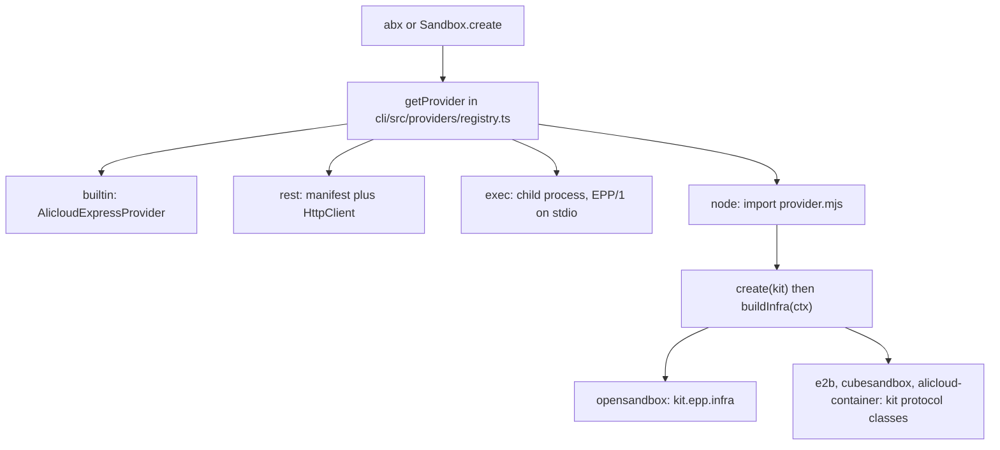
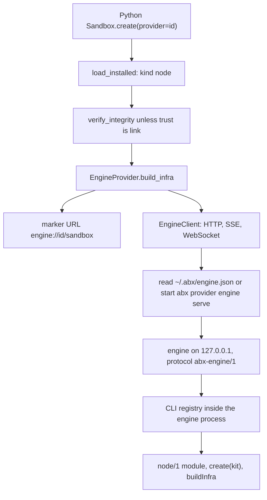

# Node provider architecture

The provider layer is implemented once, in the Node.js / TypeScript CLI. The CLI calls it in process. Every other host calls the same code through the local engine. The wire protocol of that engine is [Engine HTTP API](../reference/engine-api.md) (`abx-engine/1`).

This page is the current design. The earlier Python gRPC engine (`agent_sandbox.engine`, `engine.proto`, Unix socket `~/.abx/engine.sock`) is [kept as history](https://github.com/alibaba-agent-sandbox/python-sdk/blob/main/docs/en/design/provider-engine.md) and is superseded for catalog providers.

## 1. Goals

- One implementation of each catalog provider, so the CLI and every SDK observe the same behavior.
- A host that already speaks HTTP, server-sent events and WebSocket, which is what sandbox backends and terminals need.
- A plugin the installer can copy into `~/.abx/providers/<id>` with nothing to install inside the plugin directory: the module has no imports for the host to resolve.
- A process boundary for third-party plugins written in any language.
- A local engine so a language that does not load JavaScript can still run the Node provider code.

## 2. The four kinds

`runtime.kind` in `abx-provider.toml` selects the host adapter. The manifest parser accepts `exec`, `rest` and `node` (`cli/src/providers/manifest.ts`). `builtin` is not a manifest kind; it is the compiled-in provider. A manifest with `kind = "python"` is rejected.

| Kind | Protocol | Where the code lives | When to use it |
|---|---|---|---|
| `builtin` | the platform HTTP API inside each host | `AlicloudExpressProvider` in the TypeScript CLI and a separate copy in the Python SDK. Id `alicloud-express` | The default provider. It is reserved and cannot be installed as a plugin |
| `rest` | `e2b-rest/1` | The manifest only. The host's HTTP client calls an E2B-shaped control plane, and envd for the data plane | A backend that already speaks that HTTP shape, and that needs no plugin program |
| `exec` | `epp/1` | A child process. JSON-RPC 2.0, newline-delimited, on stdin/stdout (`cli/src/providers/epp.ts`) | A third-party plugin in any language. The process can be isolated from the host. Optional terminal methods `pty.open`, `pty.write`, `pty.resize`, `pty.close`, with notifications `pty.output` and `pty.exit` |
| `node` | `node/1` | An ES module, default entry `provider.mjs`, loaded in the host process | The four catalog providers, and any backend whose code should be that one module. The module exports `create(kit)` (default export or a named `create`) |

Catalog ids, all `node`:

| Id | Module | How `create(kit)` builds the protocols |
|---|---|---|
| `opensandbox` | `awesome-providers/opensandbox/provider.mjs` | `kit.epp.infra`. The EPP/1 methods run in the host process. `node provider.mjs` still speaks EPP/1 on stdio for any other host. `pty` is advertised when the process has a global `WebSocket` (Node 22+) |
| `e2b` | `awesome-providers/e2b/provider.mjs` | `kit.SandboxProtocol` and the other protocol classes, plus `kit.e2b.resumeConnect` |
| `cubesandbox` | `awesome-providers/cubesandbox/provider.mjs` | The same kit protocol classes |
| `alicloud-container` | `awesome-providers/alicloud-container/provider.mjs` | The same kit protocol classes |

`alicloud-container` is the container edition. It is a catalog plugin. It is separate from built-in `alicloud-express`.

## 3. The kit

`create(kit)` receives the host's constructors (`cli/src/providers/node_provider.ts`, `providerKit()`). The plugin directory does not import the CLI.

| Member | Role |
|---|---|
| `hostVersion` | The host version string handed to the plugin |
| `SandboxProtocol`, `ProcessProtocol`, `FilesystemProtocol`, `CodeInterpreterProtocol` | The protocol classes the built-in provider uses |
| `errors.InvalidAPIKeyError`, `errors.ProviderConfigError`, `errors.ProviderFeatureNotSupportedError` | Errors the plugin may throw |
| `e2b.resumeConnect`, `e2b.withDefault`, `e2b.overlay`, `e2b.parseExecution` | Helpers for E2B-shaped backends: connect-route order, a default option, a method overlay, and a Jupyter-style `/execute` body |
| `epp.infra(ctx, factory)` | Run an EPP/1 dispatcher in this process and adapt it to the protocol objects (`cli/src/providers/node_epp.ts`) |

`buildInfra(ctx)` receives the resolved configuration for one call:

- `id`, `features`, `options` (manifest fields), `core` (generic keys the user consented to inherit), `secretKeys`, `callTimeout`
- `http(opts)`, `headerKeyAuth(key, header)`, `noAuth()`

The host then wraps each protocol with the feature gate. A feature the manifest does not declare fails as `E8004` before a backend request. The authoring walk-through is [Authoring Providers](../guide/authoring-providers.md).

## 4. In-process, the engine, and exec

Three places run provider code.

**In process.** The CLI's `getProvider` returns `builtin`, `rest`, `exec` or `node` and calls `buildInfra` in the CLI process. A `node` module is imported with a cache key of the file path plus the tree digest. `opensandbox` stays in that process: `kit.epp.infra` calls the dispatcher directly and reuses the exec adapters, so there is no child process.

**The engine.** `abx provider engine serve` is that same CLI, listening for other languages. Python reaches a `node` provider through `EngineProvider` (`agent_sandbox.providers.engine_provider`). The sandbox URL it returns is the marker `engine://<provider>/<id>`. `EngineClient` (`agent_sandbox.providers.engine_client`) speaks HTTP, SSE and WebSocket to `127.0.0.1`. Python `rest` providers stay in the Python process (`RestProvider`). Python `exec` providers stay in the Python process (`ExecProvider`) and spawn the plugin themselves. The registry branch is `load_installed` in `agent_sandbox.providers.registry`.

**Exec.** Kind `exec` starts the manifest `command` and speaks EPP/1 on stdio. Use it when the plugin is not a `node/1` module. The engine can host an `exec` provider too, because the engine runs the CLI registry; the Python SDK does not send `exec` providers there.

The built-in Python path for `alicloud-express` still has its own copy of the provider, and `Sandbox.create` for that id still calls the older gRPC slice in `agent_sandbox.engine`. Catalog providers do not.

## 5. Request flow

### CLI to a provider

`abx --provider <id> create` and `Sandbox.create` in the CLI share this path.

### Python SDK to the engine to a provider

This path is for `runtime.kind = "node"` only.

`EngineClient` sends `Authorization: Bearer <token>` and `X-Abx-Connection` on every request, including the WebSocket upgrade. Command streams are SSE. The terminal is a WebSocket. Routes, status codes and the discovery file are specified in [Engine HTTP API](../reference/engine-api.md).

## 6. Security model

- **Token file.** `startEngine` draws 24 random bytes, encodes them base64url, and writes `~/.abx/engine.json` with mode `0600`. The directory `~/.abx` is created with mode `0700`. The lock file `~/.abx/engine.lock` is mode `0600`. One live process holds the lock.
- **Loopback.** The server listens on `127.0.0.1` only. A request whose `Host` is outside `127.0.0.1`, `localhost`, `[::1]` and `::1` is rejected. A request that carries an `Origin` header is rejected, so a browser page cannot call the engine. The bearer check uses a constant-time compare.
- **Credentials.** The engine keeps no account. The Python client puts the resolved connection (provider id, options, API key, API URL, domain, access key id, access key secret) in `X-Abx-Connection`, base64url of the JSON with the padding removed. Those values are not written into `engine.json`.
- **Plugin tree.** For an install whose receipt `trust` is not `link`, the host recomputes the SHA-256 tree digest and compares it with `tree_sha256` before use (`store.verifyIntegrity` in the CLI; `store.verify_integrity` in Python before `EngineProvider` talks to the engine). A mismatch is `ProviderIntegrityError`. `trust = "link"` skips that check; install requires `--yes` for a link.

An `exec` plugin receives a scrubbed environment. Its secrets travel in the EPP `initialize` message (`cli/src/providers/epp.ts`). A `node` plugin runs with the host's privileges, because it is loaded in the host process.

The engine exits after 900 seconds with no request and no stream in flight. A sandbox session is closed after 600 seconds unused, and only while the engine has nothing in flight. Both numbers are the defaults in `startEngine`.

## 7. Why Node/TypeScript, and what was not adopted

The CLI is already the Node.js host (`@agent-sandbox/cli`). Catalog plugins are ES modules that call the kit and do not ship a package for the host to install (`node_provider.ts`: the plugin directory has no imports to resolve). The OpenSandbox authoring evaluation recorded the same choice: Node ESM on Node 20 or newer, using the built-in `fetch`, because CLI users already have that runtime and the installer does not install plugin dependencies.

These were considered and were not adopted for catalog providers:

| Candidate | Where it is recorded | Outcome |
|---|---|---|
| `grpcio` and `protobuf`, and the generated stubs `engine_pb2` / `engine_pb2_grpc` | `python-sdk/client-sdk/pyproject.toml`; `agent_sandbox/engine/engine.proto` | The Python gRPC engine remains in the tree for the earlier `alicloud-express` slice. Catalog providers do not use it |
| A second implementation of each catalog provider as a Python entry point | `providers-and-credentials.md` §7.3 option A; both manifest parsers reject `runtime.kind = "python"` | A `Provider` subclass may still be registered in process with `register_provider`. It is not an installable catalog plugin |
| A localhost gRPC or HTTP plugin server, and a WASM component | `providers-and-credentials.md` §7.3 options D and E, rejected for v1 | Still not the plugin transport. Third-party plugins use EPP/1 over stdio |

No other shortlist of libraries (for example an npm gRPC package) is recorded in this repository. The engine uses Node's `http` module and the `ws` package already depended on by the CLI.

## 8. Why gRPC was not adopted

gRPC was evaluated as the transport from an SDK to a provider. The evaluation outcome for catalog providers is the Node engine's HTTP, SSE and WebSocket API.

HTTP, SSE and WebSocket are part of the standard library or the usual HTTP client in the languages this project targets (Python today; Go, Java and Node later). A client does not need a generated stub per language. A command stream is an SSE response. A terminal is a WebSocket of bytes. File bodies are raw HTTP bytes. The same routes are listed once in [Engine HTTP API](../reference/engine-api.md).

## 9. How a Go, Java or Node SDK integrates

The integration surface is HTTP, SSE and WebSocket. There is no generated client to vendor.

1. Find `abx` with `ABX_BIN` (a command line) or on `PATH`, the way `EngineClient.abx_command` does.
2. Read `~/.abx/engine.json`. If the process is gone or `GET /v1/health` does not report protocol `abx-engine/1`, start `abx provider engine serve` and read the file again.
3. Send `Authorization: Bearer <token>` from that file on every request and on the WebSocket upgrade.
4. Send the resolved provider, options and credentials in `X-Abx-Connection` (base64url JSON, padding removed).
5. Call the routes in [Engine HTTP API](../reference/engine-api.md): JSON for one-shot calls, `text/event-stream` for command output and directory watch, a WebSocket for `GET /v1/sandboxes/:id/terminal`.
6. Map the JSON `error.type` back to the SDK exception of that name. `501` is a capability the provider did not declare (`E8004`).

A future Node SDK uses this HTTP API as well. The CLI process is the host that already loads providers in process; a separate Node SDK is another client of the engine.

## 10. Deliberately not done

- Catalog providers `opensandbox`, `e2b`, `cubesandbox` and `alicloud-container` are not reimplemented in Python. Python forwards them to the engine.
- The engine does not speak gRPC, and it does not listen beyond `127.0.0.1`.
- Python does not load `provider.mjs`. It does not send `rest` or `exec` providers through the engine.
- `alicloud-express` is not a shared plugin. TypeScript and Python each keep `AlicloudExpressProvider`.
- Provider secrets are not stored in `engine.json`. The discovery file holds the bearer token.
- The engine does not choose which account a call belongs to, and it does not read the caller's `config.toml` to fill a missing secret. The client sends the connection it already resolved.
- There is no per-language code generator for `abx-engine/1`.
- OS-level plugin confinement, keychain storage, and a long-lived plugin daemon (EPP/2) remain the open items in the [CLI provider spec](../../design/providers-and-credentials-cli.md). gRPC as that spec's transport item was evaluated and was not adopted for catalog providers.
