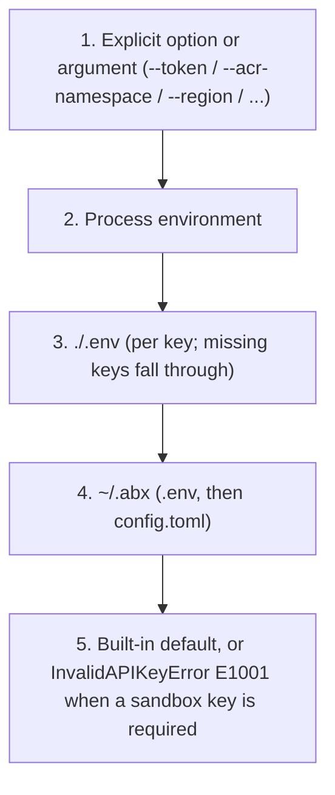

# Authentication

> Scope: this page describes native provider/MCP configuration and errors. Native configuration uses `ABX_SANDBOX_API_KEY`, `ABX_SANDBOX_BASE_URL` and `ABX_SANDBOX_DOMAIN`. The standard Express command entry additionally accepts `E2B_API_KEY`, `E2B_API_URL` and `E2B_DOMAIN`, mapped at that entry only, and falls back to project configuration. Standard command flags, terminal environment and error behavior follow the [migration guide](../guide/migrate-from-e2b.md).

Sandbox runtime requests require an **API Key**. **AK/SK (Alibaba Cloud AccessKey)** is configured separately for official control-plane operations.

> **Historical note**: the `abx auth` CLI command group (`login`/`logout`/`status`/`switch`) was removed before the first stable release (`0.1.0`). Credentials are configured with the environment variables and `abx config set sandbox_api_key` shown below; check the effective state with `abx config list`.

---

## Authentication Overview

Agent Sandbox provides three authentication paths for different scenarios:

- **API Key mode**: The most common approach. Accesses the platform API via the `Authorization: Bearer {api_key}` header. Suitable for personal development, CI/CD, and most other scenarios.
- **AK/SK control plane**: Used by official template/image/ACR operations. It does not automatically create or exchange a sandbox API key.
- **envd internal authentication**: After sandbox creation, the CLI communicates with the in-sandbox envd service using `envdAccessToken` (obtained from the creation response). This is an internal mechanism managed automatically — no manual handling required (the headers are described in the SDK documentation linked at the bottom).

---

## API Key Authentication

API Key is the most common authentication method, sent to the platform API via the `Authorization: Bearer {api_key}` header.

### Configuration Methods

#### 1. Environment variable (wins over `~/.abx`)

```bash
export ABX_SANDBOX_API_KEY="your-api-key"
```

`ABX_SANDBOX_API_KEY` is the only environment variable for the sandbox API key. `E2B_API_KEY` is not read. The base URL is `ABX_SANDBOX_BASE_URL` and the domain is `ABX_SANDBOX_DOMAIN` (`E2B_API_URL` and `E2B_DOMAIN` are not read).

#### 2. abx config set (persisted to local file)

```bash
abx config set sandbox_api_key your-api-key
# Writes to ~/.abx/.env
# File permissions: 600 (owner read/write only)
```

Stored as `ABX_SANDBOX_API_KEY=your-key` in `~/.abx/.env`.

#### 3. .env file

Create a `.env` file in the project root directory:

```dotenv
ABX_SANDBOX_API_KEY=your-api-key
```

The CLI merges `.env` files per key. `./.env` wins for a key it sets. A key it omits still comes from `~/.abx/.env`.

1. `.env` in the current directory
2. `~/.abx/.env`

#### 4. config.toml file

Set in `~/.abx/config.toml`:

```toml
[transport]
sandbox_base_url = "https://api.cn-hangzhou.e2b.fc.aliyuncs.com"
sandbox_domain = "cn-hangzhou.e2b.fc.aliyuncs.com"
```

The sandbox API key is stored in `~/.abx/.env` as `ABX_SANDBOX_API_KEY`, not in `config.toml`.

<a id="aksk-alibaba-cloud-extended-authentication-"></a>
## AK/SK control plane and migration

The previous automatic AK/SK-to-sandbox-key exchange has been removed. With only
AccessKey credentials, sandbox authentication now raises `InvalidAPIKeyError`
(E1001) locally, before any exchange/network request. Configure
`ABX_SANDBOX_API_KEY` or pass `sandbox_api_key=` / `api_key=` explicitly for
sandbox create/connect/list and data-plane requests.

Keep `ALICLOUD_ACCESS_KEY_ID`, `ALICLOUD_ACCESS_KEY_SECRET` and the configured
region for official template/image and ACR control-plane operations. These
operations have their own clients and credentials; their supported endpoints
are unchanged. API key and AccessKey credentials may be configured together for
a workflow that needs both runtime and template deployment.

The locked official FCSandbox SDK has a `CreateApiKey` operation, but models it
as `POST /pop/2026-05-09/api-keys` with a structured `apiKey.apiKeyValue` response.
That credential-resource API does not establish an STS-style one-hour exchange
or safe automatic refresh lifecycle. The old guessed RPC GET/signing/parser
implementation is retired; the runtime never mints credentials implicitly.

The CLI does not expose a custom token-service flag. Programmatic custom auth
adapters are documented by the [Python SDK](https://github.com/Alibaba-Agent-Sandbox/python-sdk/blob/main/docs/en/guide/authentication.md).
Direct imports of removed private CLI exchange/signing helpers must migrate to
an explicitly documented application-owned service.

---

## Configuration Priority Chain

Credentials are resolved in the following priority order (highest to lowest):



LLM keys, the GitHub token, and the region use this same chain. A blank or whitespace-only value is skipped. The names and defaults are listed in [Credential resolution](../reference/configuration.md#credential-resolution).

The sandbox API key is never derived from AK/SK. When both are configured, runtime calls use the API key:
- If both `sandbox_api_key` and `access_key_id` are provided, API Key is used
- If both `ABX_SANDBOX_API_KEY` and `ALICLOUD_ACCESS_KEY_ID` are set, `ABX_SANDBOX_API_KEY` is used

---

## CLI Authentication Management

```bash
# Set API Key
abx config set sandbox_api_key your-api-key

# Set AK/SK for official control-plane operations
abx config set access_key_id your-access-key-id
abx config set access_key_secret your-access-key-secret

# View the effective configuration and where each value came from
abx config list
# (env) process environment, (user) ./.env or ~/.abx, (default), (not set)

abx config get sandbox_api_key
abx config get access_key_id
```

---

## Secret Storage (File-Based)

Secrets are stored in `~/.abx/secrets.json`, a plaintext JSON file protected by `chmod 600` file permissions. This is suitable for local development only.

> **⚠️ Warning**: `secrets.json` stores secrets in **plaintext**. It relies solely on POSIX file permissions (`chmod 600`) for access control. For production environments, use a dedicated secrets management service.

Manage secrets via environment variables or configuration:

```bash
# Set API Key via environment variable (recommended)
export ABX_SANDBOX_API_KEY="your-api-key"

# Or persist via abx config
abx config set sandbox_api_key your-api-key
```

For an interactive standard terminal session, pass process environment with `--env`. This is terminal-session environment, not a sandbox-wide store; detached creation has no terminal. Use the SDK/native provider creation environment when future processes must inherit values:

```bash
abx create base --env MY_TOKEN=your-secret-value --env ANOTHER_SECRET=another-value
```

> **Historical note**: macOS Keychain integration was removed in the overdesign cleanup (ADR 2026-09-23). The `abx secret` CLI command group has also been removed. All secret management is now done through environment variables, `.env` files, or `abx config set`.

---

## Common Issues

### InvalidAPIKeyError (E1001)

```text
[E1001] API key cannot be empty
  Suggestion: Check your ABX_SANDBOX_API_KEY environment variable or pass sandbox_api_key.
```

**Solution**: Ensure a valid API Key is configured via any of the methods above.

### InvalidCredentialsError (E1003)

```text
[E1003] AccessKey ID and Secret cannot be empty
  Suggestion: Check ALICLOUD_ACCESS_KEY_ID and ALICLOUD_ACCESS_KEY_SECRET environment variables.
```

**Solution**: Ensure both AK ID and AK Secret are set.

### TokenExpiredError (E1002)

```text
[E1002] envdAccessToken not available. Sandbox may not be created or connected.
```

**Solution**: Check that the system clock is accurate. The CLI auto-refreshes tokens; if this error persists, the clock skew may be too large.

---

## Related SDK documentation

Passing credentials as code parameters (`Sandbox.create(sandbox_api_key=...)`, `access_key_id=` / `access_key_secret=`) and the envd request headers are described in the SDK's [Authentication guide](https://github.com/alibaba-agent-sandbox/python-sdk/blob/main/docs/en/guide/authentication.md) in the `python-sdk` repository.
