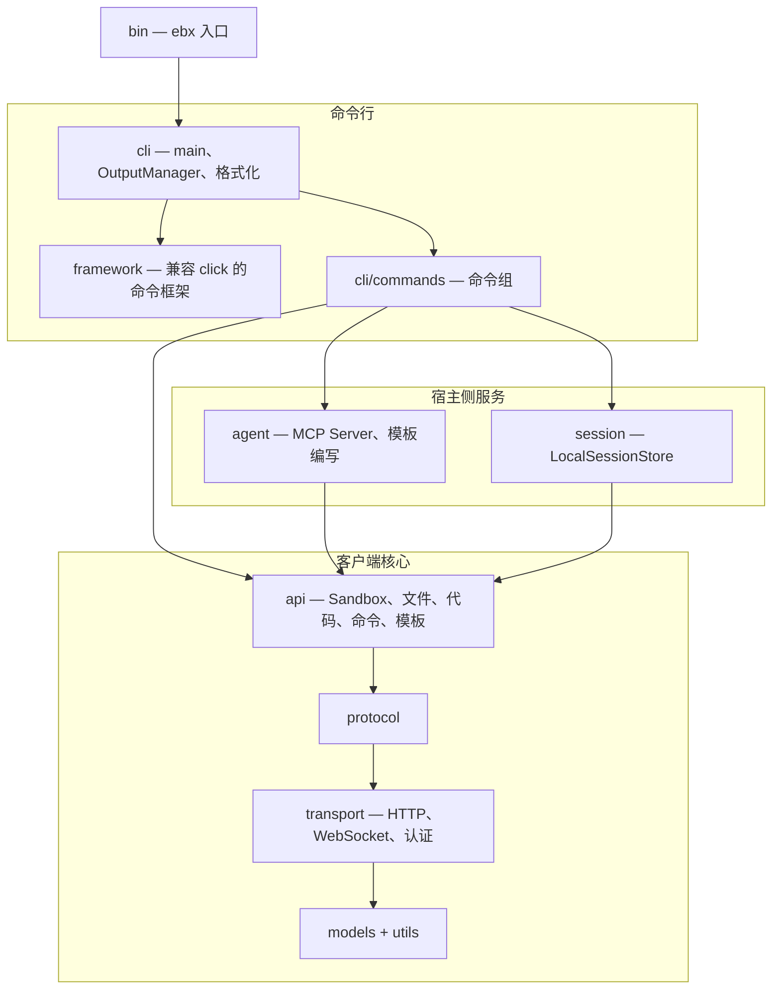

# Easy Sandbox CLI — 设计文档索引

> **版本**：v3.0 | **最后更新**：2026-10-12
>
> 本文档是 `ebx` CLI（本仓库）设计文档的入口和索引。详细设计位于 [`design/`](design/) 目录下的各专题文档中。Python SDK 的设计文档位于 [`python-sdk` 仓库](https://github.com/Easy-Sandbox/python-sdk)，见 [相关 SDK 文档](#相关-sdk-文档)。

---

## 项目概述

**`ebx`**（npm 包名 `@easy-sandbox/cli`）是面向阿里云 FC Agent 沙箱服务的命令行客户端，同时服务人类开发者和 AI Agent。它以 Node.js / TypeScript 实现，行为与原 Python `ebx` 一致（一致性契约见 [`PORTING.md`](../PORTING.md)），并承载向 IDE Agent 暴露沙箱的 MCP Server。

### 核心设计原则

1. **一致性优先** — 命令名、选项、帮助文本、错误文本、输出通道和退出码（0–6）与 Python `ebx` 一致，并由黄金文件守护
2. **AI-First** — 自然语言创建沙箱、`--json` / `--quiet` / `--ci` 输出模式、MCP Server 是一等公民
3. **零配置默认** — 安装、导出 API Key、创建沙箱

### 快速上手

```bash
npm install -g @easy-sandbox/cli   # ebx CLI（需要 Node.js 20+）
export EBX_SANDBOX_API_KEY=your-api-key
ebx create --template base
ebx list
```

---

## 架构概览

CLI 采用严格的分层结构——下层从不导入上层。完整说明（分层表、源码目录、构建与发布、一致性契约）见 [CLI 架构](design/architecture.md)。



---

## 设计专题索引

### 架构与命令

| 专题 | 文档 | 摘要 |
|------|------|------|
| **CLI 架构** | [architecture.md](design/architecture.md) | 分层、`src/` 目录结构、命令组、输出与退出码、配置/凭证、构建 / SEA 二进制 / 发布、一致性契约 |
| **CLI 命令体系** | [cli-design.md](design/cli-design.md) | 命令树（45 个命令）、全局选项、自然语言创建、OutputManager、AI Friendly 设计 |
| **模板目录** | [templates-catalog.md](design/templates-catalog.md) | 单一真源（SSOT）：awesome-templates 目录仓库、远程索引客户端、缓存/降级行为、fixture 边界、模板命令面 |

### AI 与 Agent 集成

| 专题 | 文档 | 摘要 |
|------|------|------|
| **MCP Server** | [mcp-server.md](design/mcp-server.md) | 7 个 P0 MCP 工具、STDIO 与 Streamable HTTP 传输、FC 部署产物、会话绑定 |
| **自带 Agent（BYO）集成** | [byo-agent-integration.md](guide/byo-agent-integration.md) | 用户如何把自带 Agent CLI 放进沙箱模板：职责边界、`custom_commands`、凭证白名单、版本锁定 |

### 移植、布局与 Provider 草案

以下为仅有英文的维护者文档，位于 [`docs/design/`](../design/) 与 [`docs/PORTING.md`](../PORTING.md)。

| 专题 | 文档 | 摘要 |
|------|------|------|
| **Python 到 Node 移植** | [PORTING.md](../PORTING.md) | 逐模块移植规则、一致性门禁、测试台账 |
| **仓库布局** | [repository-layout.md](../design/repository-layout.md) | CLI 仓库布局评审与文档归属规则 |
| **Provider 与凭证（CLI 规格）** | [providers-and-credentials-cli.md](../design/providers-and-credentials-cli.md) | 草案：provider 层的 CLI 语法、JSON 形态与测试，一致性达成后实施 |
| **Provider 评审记录** | [providers-and-credentials-cli-review.md](../design/providers-and-credentials-cli-review.md) | 上述草案的评审记录 |

---

## 实现状态

| 功能 | 状态 | 备注 |
|------|------|------|
| CLI（45 个命令） | **已实现** | 详见 [cli-design.md](design/cli-design.md) |
| MCP Server（STDIO） | **已实现** | 7 个 P0 工具 |
| MCP Server（Streamable HTTP） | **已实现** | `agent/mcp_http.ts` |
| `ebx mcp deploy`（FC 产物生成） | **已实现** | 生成部署产物并打印手动 FC 部署步骤。详见 [mcp-server.md](design/mcp-server.md#7-fc-部署) |
| 模板 build/push/create 流水线 | **已实现** | 通过官方 CreateTemplate API |
| 单文件二进制（Node SEA） | **已实现** | 详见 [二进制安装](guide/binary-installation.md) |
| Provider 层 | **规划中** | 一致性门禁后实施，见上方 provider 草案 |

---

## 相关资源

| 资源 | 位置 |
|------|------|
| 架构决策记录 (ADR) | [`.agents/notes/`](../../.agents/notes/README.md) |
| CLI 黄金文件证据 | [`.agents/evidence/`](../../.agents/evidence/) |
| BYO Agent 集成指南 | [`docs/zh/guide/byo-agent-integration.md`](guide/byo-agent-integration.md) |
| 用户指南 | [`docs/zh/guide/`](guide/) |
| CLI 参考 | [`docs/zh/reference/`](reference/) |
| English design index | [`docs/en/DESIGN.md`](../en/DESIGN.md) |

## 相关 SDK 文档

Python SDK（`easy-sandbox`）、沙箱内 Server SDK 与平台契约的文档位于 [`python-sdk` 仓库](https://github.com/Easy-Sandbox/python-sdk)。CLI 读者最常需要的页面：

- [系统架构](https://github.com/Easy-Sandbox/python-sdk/blob/main/docs/zh/design/architecture.md) — SDK 的六层架构，CLI 的客户端核心与之对应
- [SDK API 设计](https://github.com/Easy-Sandbox/python-sdk/blob/main/docs/zh/design/sdk-api-design.md) 与 [沙箱类型体系](https://github.com/Easy-Sandbox/python-sdk/blob/main/docs/zh/design/sandbox-types.md)
- [模板体系](https://github.com/Easy-Sandbox/python-sdk/blob/main/docs/zh/design/template-system.md) 与 [template.yaml 规范](https://github.com/Easy-Sandbox/python-sdk/blob/main/docs/zh/reference/template-yaml-spec.md) — `template.yaml` 契约
- [内置 Agent](https://github.com/Easy-Sandbox/python-sdk/blob/main/docs/zh/design/built-in-agents.md) 与 [Server API](https://github.com/Easy-Sandbox/python-sdk/blob/main/docs/zh/design/server-api.md)
