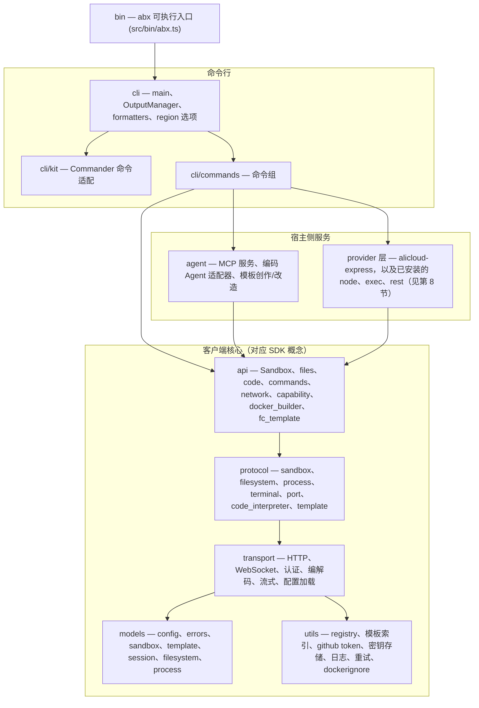

# CLI 架构设计

> 本文描述 Node.js / TypeScript 实现的 `abx` CLI（`@agent-sandbox/cli`）本身：分层结构、源码目录、构建与发布方式。命令级行为见
> [CLI 命令体系设计](cli-design.md)；MCP 服务见 [MCP Server 设计](mcp-server.md)；模板目录客户端见
> [模板目录设计](templates-catalog.md)。
>
> CLI 是 Agent Sandbox 平台的客户端。它用 TypeScript 重新实现了命令行所需的客户端分层（模型、传输、协议、高层 API、会话存储），这些分层与 Python SDK 的概念一一对应；SDK 自身的设计记录在 SDK 仓库中（见本文末尾的[相关 SDK 文档](#相关-sdk-文档)）。

---

## 1. 分层结构

下层永不 import 上层。CLI 仓库只实现命令行需要的那几层；它不包含 Compat、Declarative、Extensions、Integrations 以及沙箱内 Server 层。



| 层 | 目录 | 职责 |
|----|------|------|
| 入口 | `src/bin/` | `abx.ts`，可执行入口（构建为 `dist/bin/abx.js`，即 npm 包的 `bin` 目标） |
| 命令框架 | `src/cli/kit.ts` | click 兼容的迷你框架（`Context`、`Command`、`Group`、`Option`、`Argument`、参数类型、帮助格式化、`termui` 交互提示、懒加载子命令），目的是让 Node CLI 在参数解析、帮助文本、错误文本和退出码上与 Click 逐字节一致 |
| CLI | `src/cli/` | `main`（根命令组、全局选项）、`output`（`OutputManager`）、`formatters`（表格 / JSON / quiet）、`region`（共享的命令级 `--region` 选项）、`table`（终端表格渲染） |
| 命令组 | `src/cli/commands/` | 每个命令组一个模块，见第 4 节 |
| Agent / MCP | `src/agent/` | MCP 服务（`mcp`、`mcp_http`、`mcp_main`、`tools`）、宿主侧编码 Agent 适配（`coding_agent`、`qwen_code`、`clarify`、`codegen`、`template_guide`）、模板创作/改造（`adopt`、`dockerfile_sources`） |
| API | `src/api/` | `Sandbox` 及其模块（`files`、`code`、`commands`、`network`）、`fc_template`（官方 CreateTemplate API 适配器）、`docker_builder`（本地 `docker build` + ACR 推送）、`capability` |
| Protocol | `src/protocol/` | 平台 API 与沙箱内 envd API 的类型化封装（`sandbox`、`filesystem`、`process`、`terminal`、`code_interpreter`、`template`） |
| Transport | `src/transport/` | HTTP / WebSocket 客户端、API Key / AK-SK 认证、编解码、流式处理，以及分层配置加载器（`config`） |
| Models | `src/models/` | 类型化数据模型与错误体系（`errors`，错误码 `E1xxx`–`E7xxx`） |
| Utils | `src/utils/` | GitHub / 本地模板 registry 客户端、远程模板索引客户端、GitHub token 指引、日志、`.dockerignore` 匹配器，以及 dotenv / tar / YAML 辅助 |

以下划线开头的文件（例如 `src/api/_yaml.ts`、`src/utils/_pyformat.ts`、`src/agent/_pycompat.ts`）是内部兼容辅助模块，用来复刻原实现所依赖的 Python 标准库调用的精确语义，使线上协议输出、`--json` 输出和磁盘文件保持逐字节一致。

## 2. 命令定义（`src/cli/kit.ts`）

Commander 负责参数解析与帮助渲染。`kit.ts` 将 `command`、`group`、`option`、
`argument` 声明映射到 Commander，并提供异步回调上下文。`types.ts`、`io.ts`、
`errors.ts` 分别负责参数校验、终端 I/O 和用法错误。当前没有 `src/cli/kit.ts`。
命令按需加载，避免版本和帮助入口加载无关模块。参见
[命令贡献指南](../../../src/cli/commands/README.md)。

## 3. 输出与格式化（`src/cli/output.ts`、`src/cli/formatters.ts`）

- `OutputManager` 是唯一决定内容输出到 stdout 还是 stderr 的地方：结果走 stdout；诊断、进度和警告走 stderr（通道策略见 [CLI 命令体系设计 §7](cli-design.md)）。
- 全局开关 `--json`、`--quiet`、`--ci`、`--no-color`、`--verbose` 只解析一次并保存在 click 上下文中（`ctx.meta["abx.output"]`），formatters（表格、JSON、quiet）由它获得。
- CI 与 TTY 检测（`isCiEnv`、`isTty`）：通过一组固定的 CI 环境变量识别 CI；CI 下自动启用 quiet、无颜色、适合 JSON 的输出。非 TTY、`TERM=dumb`、`--json`、`--quiet`、`--ci` 都不绘制瞬态"运行中"标题。
- 长耗时步骤会绘制瞬态标题和滚动的灰色活动行（`ABX_ACTIVITY_LINES`，1–10）。
- 退出码是确定的：`0` 成功、`1` 一般错误、`2` 参数错误、`3` 认证失败、`4` 资源不存在、`5` 超时、`6` 配额超限。

## 4. 命令组（`src/cli/commands/`）

命令树定义见 [CLI 命令体系设计](cli-design.md)。模块划分遵循移植契约（`cli/commands/<name>.py` 对应 `src/cli/commands/<name>.ts`）：

| 模块 | 命令组 |
|------|--------|
| `config_cmd` | `abx config`（`init`、`get`、`set`、`list`、`delete`）（凭证与区域；`--build` / `--llm` 追加相应部分） |
| `sandbox` | 沙箱生命周期命令（`create`、`list`、`info`、`kill`、`exec`、`run`、`connect`、`upload`、`download`），可在顶层和 `abx sandbox` 下使用 |
| `sandbox_files` | `abx sandbox files`（`list`、`stat`、`mkdir`、`rm`、`mv`、`search`） |
| `sandbox_process` | `abx sandbox process`（`list`、`start`、`info`、`signal`） |
| `sandbox_system` | `abx sandbox system`（`info`、`env`、`ports`、`packages`、`metrics`） |
| `template` | `abx template`（`init`、`deploy`、`build`、`push`、`create`、`install`、`list`、`info`、`delete`、`search`） |
| `deploy` | `abx deploy` |
| `mcp` | `abx mcp`（`install`、`start`、`status`、`deploy`） |

`abx sandbox capabilities`、`abx sandbox command` 与固定的顶层快捷方式（`src/cli/command_surface.ts`）同属该命令树，具体参数见 [CLI 命令体系设计](cli-design.md)。

命令只负责编排：通过框架解析选项、加载配置、调用 `api` 层（自然语言创建和 MCP 则调用 `agent` 层），并通过 `OutputManager` 输出。

## 5. 客户端核心：api、protocol、transport、models

CLI 的客户端核心镜像 Python SDK 的分层，使行为、错误码和线上格式保持一致：

- **Transport**（`src/transport/`）：`HttpClient`（超时、连接管理）、WebSocket 辅助、流式解码器，`AuthProvider` 接口背后的 `ApiKeyAuth` / `AkSkAuth`，以及 `config.ts`——按代码参数、进程环境（`ABX_*` 与厂商官方的 `ALICLOUD_*` / `ALIBABA_CLOUD_*` 名称）、`.env`（逐 key 合并）、`~/.abx/config.toml` 的顺序解析配置的分层加载器。
- **Protocol**（`src/protocol/`）：每种线上接口一个类（`SandboxProtocol`、`ProcessProtocol`、`FilesystemProtocol`、`CodeInterpreterProtocol`、`TerminalSession`、`TemplateProtocol`）。
- **API**（`src/api/`）：供内部命令使用的 `Sandbox` 类及其模块、`DockerBuilder` 与官方模板 API 适配器。
- **Models**（`src/models/`）：出现在线上协议或 `--json` 输出中的数据字段保持 Python 的 `snake_case` 名称和键顺序；异常类保持名称、`code` 与消息文本。

移除的 SDK 专用移植模块及替代方式见[退役边界](cli-module-retirement.md)。

## 6. Agent 与 MCP 模块（`src/agent/`）

| 模块 | 作用 |
|------|------|
| `mcp.ts` | MCP STDIO 服务：自包含的最小 JSON-RPC 2.0 处理器（`abx mcp start`），`SandboxManager` 负责默认沙箱的会话绑定 |
| `mcp_http.ts` | 基于 `node:http` 的 MCP Streamable HTTP 传输（`POST/GET/DELETE /mcp`、`/health`、Bearer Token 认证），供 `abx mcp start --http` 与 FC 部署产物使用 |
| `mcp_main.ts` | 等价于 `python -m agent_sandbox.agent.mcp` 的入口 |
| `tools.ts` | 7 个 P0 工具的 schema（`TOOL_SCHEMAS`）与处理函数 |
| `coding_agent.ts`、`qwen_code.ts` | 可插拔的宿主侧编码 Agent 边界与 Qwen Code 适配器（定位或安装 Agent、以 headless 方式运行） |
| `clarify.ts`、`codegen.ts`、`template_guide.ts` | 自然语言 `abx create "<描述>"`：先调研的需求澄清、模板生成、提供给 Agent 的参考资料 |
| `adopt.ts`、`dockerfile_sources.ts` | `abx template init --adopt`：暂存已有项目、仅回写审查通过的白名单文件、校验 Dockerfile 的 `COPY`/`ADD` 源路径 |
| `_archive.ts`、`_http.ts` | 面向 Qwen Code 独立安装器的安全 tar/zip 解压与支持代理的下载器 |

MCP 的行为（工具、会话绑定、传输、FC 部署）见 [MCP Server 设计](mcp-server.md)。

## 7. 配置与凭据

- 每个凭据的解析顺序：显式选项 → 进程环境 → `./.env` → `~/.abx`（先 `.env` 后 `config.toml`）→ 内置默认值。空白值不计入。完整表格见[配置参考](../reference/configuration.md#凭证解析)。
- 磁盘状态位于 `~/.abx/`：`config.toml`、`.env`（凭据，权限 600）、`templates/`、`index/`（远程模板索引缓存）、`bin/`（已安装的编码 Agent）、`generated/`（自然语言生成产物）以及提供方安装回执和引擎发现记录。
- `utils/github_token.ts` 保存 registry 客户端与模板索引客户端共用的 GitHub token 提示文案；`utils/template_index.ts` 是[模板目录设计](templates-catalog.md)中描述的远程目录客户端。
- 凭据永不打印：`abx config list` 对密钥做掩码，测试夹具只使用占位符。

## 8. Provider 层

`abx provider` 和 `--provider` 加载内置的 `alicloud-express`，以及已安装的 `node`、`exec` 和 `rest` 插件。目录 id `opensandbox`、`alicloud-container`、`cubesandbox`、`e2b` 是 `node` 插件（`provider.mjs`，`create(kit)`），用 `abx provider install alibaba-agent-sandbox/awesome-providers//<id>` 安装（或本地路径、git URL）。既不是内置也未安装的 id 以 `E8001` 退出。`kind = "python"` 的清单会被拒绝。语法见 [Providers and Credentials — CLI spec](../../design/providers-and-credentials-cli.md)（英文；中文副本在本目录的 `providers-and-credentials-cli.md`）。这一层位于命令组与 `api` 层之间。`src/utils/config_keys.ts` 由共享键注册表生成。Python SDK 通过 `abx provider engine serve` 使用同一批 `node` 插件。使用步骤见[提供商](../guide/providers.md)。

## 9. 目录结构

```
cli/
├── src/
│   ├── bin/               # abx.ts — 可执行入口
│   ├── cli/               # main、Commander 适配、output、formatters、region
│   │   └── commands/      # config_cmd、deploy、mcp、provider、sandbox、sandbox_files、sandbox_process、sandbox_system、template
│   ├── agent/             # MCP 服务、编码 Agent 适配器、模板创作/改造
│   ├── providers/         # 内置、node、exec、rest、安装器、清单
│   ├── engine/            # 本机引擎：127.0.0.1 上的 HTTP、SSE 和 WebSocket
│   ├── api/               # Sandbox、files、code、commands、network、capability、docker_builder、fc_template
│   ├── protocol/          # 平台与 envd 协议封装
│   ├── transport/         # HTTP/WS、认证、编解码、流式、配置
│   ├── models/            # 数据模型与错误
│   └── utils/             # registry、模板索引、github token、日志、兼容辅助函数
├── tests/                 # 镜像 src/（test_api/、test_cli/、test_agent/ …）；vitest；helpers/、fixtures/
├── parity/                # Python 测试台账与已知差异
├── scripts/               # build_binary.mjs、parity-coverage.mjs、仓库检查、模板部署辅助脚本
├── benchmarks/            # CLI 启动性能基准
├── docs/                  # en/ 与 zh/ 文档、PORTING.md、design/ 草案
└── .agents/               # ADR、证据、调研（不随包发布）
```

## 10. 构建、打包与独立二进制

- **npm 包**：`npm run build` 执行 `tsc -p tsconfig.build.json` 并输出 `dist/`；`package.json#bin` 将 `abx` 映射到 `dist/bin/abx.js`；`files` 为白名单（`dist`、`README.md`、`SKILL.md`、`LICENSE`、`NOTICE`）。要求 Node.js ≥ 20；CI 在 Node 20 与 22 上运行测试矩阵。
- **发布**：推送 `vX.Y.Z` 标签会触发 `release.yml`，校验标签与 `package.json#version` 一致后，带 provenance 发布 `@agent-sandbox/cli` 到 npm。
- **独立二进制**：`scripts/build_binary.mjs` 用 esbuild 将 `src/bin/abx.ts` 及全部依赖打成单个 CommonJS 文件，再通过 Node.js 单一可执行应用（SEA）机制（`postject`；macOS 上做 ad-hoc 重签名）注入 `node` 二进制的副本。产物命名为 `abx-{version}-{platform}-{arch}[.exe]`（`linux`/`darwin`/`windows`，`x64`/`arm64`），以 `abx --version` 做冒烟测试，并由 `release-binary.yml` 在四平台构建矩阵上发布并附带 SHA256 校验和。安装方式见[二进制安装](../guide/binary-installation.md)。
- **开发命令**：`make test`、`make typecheck`、`make lint`、`make build`、`make binary`、`make ci`；`npm run dev -- --help` 通过 `tsx` 从源码运行 CLI。

## 11. 与 Python 保持一致的契约

Node CLI 取代原单包 Python 项目中的 CLI，不得丢失、降级或悄悄改变任何行为。契约及其保障手段：

| 项 | 位置 |
|----|------|
| 移植规则（模块镜像、命名、数据字段与字符串规则、配置位置、技术栈） | [`docs/PORTING.md`](../../PORTING.md) |
| 必须有对应 Node 测试的 Python 测试（台账） | `parity/python-tests-to-port.txt` |
| 台账覆盖率报告 | `npm run parity:coverage`（`scripts/parity-coverage.mjs`） |
| 已记录的行为差异（语言层面，绝不静默） | `parity/KNOWN-GAPS.md` |
| CLI 输出 golden 采集 | `.agents/evidence/cli/` 与 `tests/` 下的 golden 文件 |
| 两个 `abx` 二进制的差分测试 | `parity/diff/`（见 PORTING.md） |

阅读或修改代码时要记住：模块放在 `src/<pkg>/<mod>.ts`；函数使用 camelCase，线上/JSON 数据字段保持 `snake_case`；所有面向用户的字符串逐字保留；stdout/stderr 路由与退出码属于契约的一部分。

## 相关 SDK 文档

Python SDK、沙箱内 Server 运行时以及共享的 `template.yaml` 契约记录在 [`python-sdk` 仓库](https://github.com/alibaba-agent-sandbox/python-sdk)中：

- [系统架构](https://github.com/alibaba-agent-sandbox/python-sdk/blob/main/docs/zh/design/architecture.md) — 本 CLI 所镜像的客户端分层所属的六层架构
- [SDK API 设计](https://github.com/alibaba-agent-sandbox/python-sdk/blob/main/docs/zh/design/sdk-api-design.md)
- [沙箱类型](https://github.com/alibaba-agent-sandbox/python-sdk/blob/main/docs/zh/design/sandbox-types.md)
- [模板系统](https://github.com/alibaba-agent-sandbox/python-sdk/blob/main/docs/zh/design/template-system.md) 与
  [模板 YAML 规范](https://github.com/alibaba-agent-sandbox/python-sdk/blob/main/docs/zh/reference/template-yaml-spec.md)
- [Server API](https://github.com/alibaba-agent-sandbox/python-sdk/blob/main/docs/zh/design/server-api.md)

命令回调从 `cli/error_handler.ts` 导入错误处理；根入口保留旧导出，并加载命令，命令不再反向导入根入口。Python 兼容异常辅助位于 `utils/_pyerrors.ts`，提供方错误值位于 `models/provider_errors.ts`。旧深层路径重新导出相同类对象。
