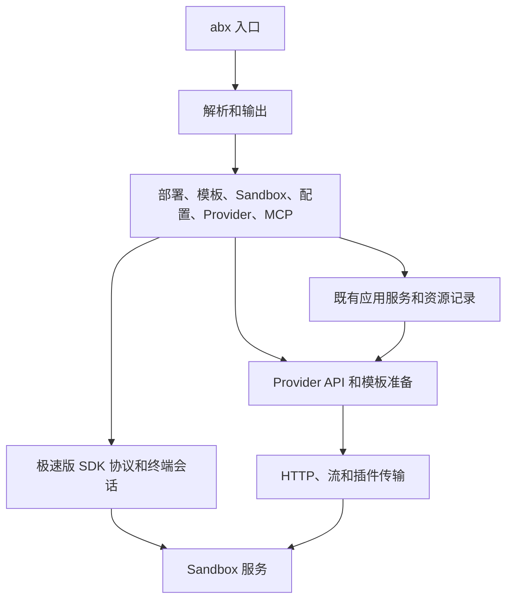

# CLI 架构

CLI 使用一个解析器和命令树。Provider 选择决定请求后端，不切换命令行实现。内置极速版 runtime 保留固定版本 SDK 协议及署名，session 辅助代码负责 stdin、终端和信号。

| 职责 | 源码 | 作用 |
| --- | --- | --- |
| 入口和解析 | `src/bin/`、`src/framework/`、`src/cli/main.ts` | 全局选项、命令发现、帮助和分派 |
| 用户操作 | `src/cli/commands/` | 校验输入、引导配置、调用服务 |
| 部署名称 | `src/cli/deployment_store.ts` | 定位既有收据，记录非密钥目标配置 |
| 应用生命周期 | `src/application/` | profile 校验、FC 部署、版本发布和所属资源清理 |
| 模板流程 | `src/cli/template_catalog.ts`、`template_build.ts`、`template_publish.ts`、`template_launch.ts` | 获取、创作、准备、发布源码和启动声明的服务 |
| Provider 契约 | `src/providers/` | 能力、配置、原生管理和准备适配器 |
| 极速版协议 | `src/standard_cli/` | 固定 SDK 传输及进程/PTY 辅助，不含命令解析器 |
| 客户端操作 | `src/api/`、`src/protocol/`、`src/transport/` | 绑定 Provider 的生命周期、文件、命令和传输 |
| MCP 和创作 | `src/agent/` | 本机 MCP 工具和可选编码 Agent 辅助 |

底层客户端不依赖 CLI 解析器。部署名称是本机定位信息，不是新的云资源权威。托管应用清理复用既有账号、资源身份和排空检查；Sandbox 清理依据持久意图和已确认身份。不确定结果保留供观察，不作为重放创建的依据。

可复用构建与运行实例分开。显式构建属于作者，部署自动构建属于应用生命周期；消费登记和构建清理共用本机锁，该锁不协调多台主机。

Python 仓库拥有客户端和沙箱内服务端。可选 server extra 安装本机运行时；标准、异步、Provider 与 HTTP 客户端继续承担各自职责。Node.js SDK 保持应用 HTTP 客户端范围。Provider engine 供 Python Provider 路径复用，不构成另一层用户部署入口。

使用 `npm ci` 和 `npm run build` 构建，仓库 CI 检查打包与固定 SDK 再现。当前命令布局在发行前通过源码使用。参阅[命令](cli-design.md)、[目录](templates-catalog.md)、[MCP](mcp-server.md)及[贡献指南](../../../.github/CONTRIBUTING.md)。
