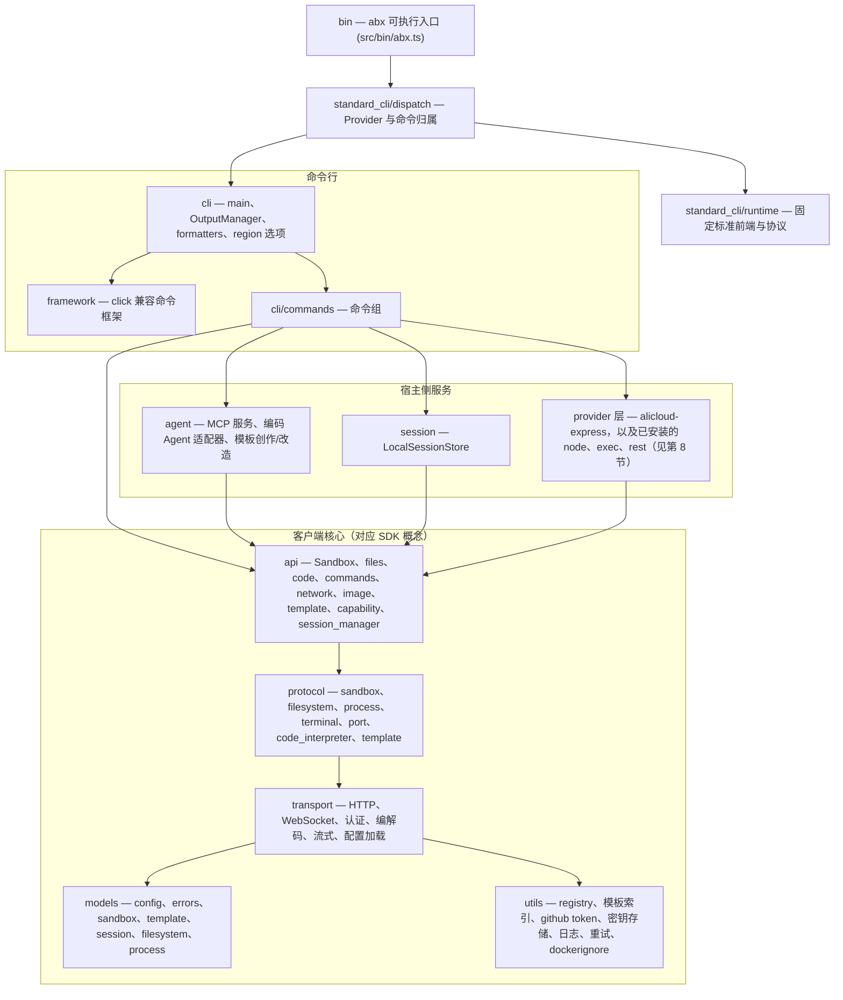

# CLI 架构设计

> 本文描述 Node.js / TypeScript 实现的 `abx` CLI（`@agent-sandbox/cli`）本身：分层结构、源码目录、构建与发布方式。命令级行为见
> [CLI 命令体系设计](cli-design.md)；MCP 服务见 [MCP Server 设计](mcp-server.md)；模板目录客户端见
> [模板目录设计](templates-catalog.md)。
>
> 可执行程序分发到两套命令前端。阿里云极速版的标准命令使用 `src/standard_cli/` 中固定版本、MIT 许可的源码移植；Provider 与项目扩展使用下文描述的原生 TypeScript 分层。两套前端仍有不同的参数解析、输出和终端实现。标准契约见[从 E2B 迁移](../guide/migrate-from-e2b.md)，适配器覆盖见[提供商](../guide/providers.md)。

后端请求发出之前必须确定 Provider 归属。全局选项不能让标准命令静默切入原生实现；标准解析器明确拒绝不支持的选项。这约束了归属和语义边界，不表示两套前端已经统一。

---

## 1. 分层结构

原生分层遵循向下依赖规则。标准源码移植有自己的协议实现，不经原生 `api`／`protocol` 层执行；CLI 不包含沙箱内 Server 的实现。



| 层 | 目录 | 职责 |
|----|------|------|
| 入口 | `src/bin/` | `abx.ts`，可执行入口（构建为 `dist/bin/abx.js`，即 npm 包的 `bin` 目标） |
| 标准命令 | `src/standard_cli/` | 分发边界、维护的固定版本 CLI／协议源码移植、内嵌脚手架与声明 |
| 原生命令框架 | `src/framework/` | click 兼容的迷你框架（`Context`、`Command`、`Group`、`Option`、`Argument`、参数类型、帮助格式化、`termui` 交互提示、懒加载子命令），用于保留原生项目扩展的 Python CLI 行为；标准前端使用其固定版本解析器 |
| CLI | `src/cli/` | `main`（根命令组、全局选项）、`output`（`OutputManager`）、`formatters`（表格 / JSON / quiet）、`region`（共享的命令级 `--region` 选项）、`_rich*`（终端表格渲染辅助） |
| 命令组 | `src/cli/commands/` | 每个命令组一个模块，见第 4 节 |
| Agent / MCP | `src/agent/` | MCP 服务（`mcp`、`mcp_http`、`mcp_main`、`tools`）、宿主侧编码 Agent 适配（`coding_agent`、`qwen_code`、`clarify`、`codegen`、`template_guide`）、模板创作/改造（`adopt`、`dockerfile_sources`） |
| Session | `src/session/` | `LocalSessionStore`：`~/.abx/sessions/` 下的 JSON 会话文件 |
| API | `src/api/` | `Sandbox` 及其模块（`files`、`code`、`commands`、`network`）、`image`、`template`（`TemplateManager`）、`fc_template`（官方 CreateTemplate API 适配器）、`docker_builder`（本地 `docker build` + ACR 推送）、`capability`、`session_manager` |
| Protocol | `src/protocol/` | 平台 API 与沙箱内 envd API 的类型化封装（`sandbox`、`filesystem`、`process`、`terminal`、`port`、`code_interpreter`、`template`） |
| Transport | `src/transport/` | HTTP / WebSocket 客户端、API Key / AK-SK 认证、编解码、流式处理，以及分层配置加载器（`config`） |
| Models | `src/models/` | 类型化数据模型与错误体系（`errors`，错误码 `E1xxx`–`E7xxx`） |
| Utils | `src/utils/` | GitHub / 本地模板 registry 客户端、远程模板索引客户端、GitHub token 指引、密钥存储（`keychain`）、日志、重试、`.dockerignore` 匹配器，以及 dotenv / tar / YAML 辅助 |

以下划线开头的文件（例如 `src/api/_yaml.ts`、`src/utils/_pyformat.ts`、`src/agent/_pycompat.ts`）是内部兼容辅助模块，用来复刻原实现所依赖的 Python 标准库调用的精确语义，使线上协议输出、`--json` 输出和磁盘文件保持逐字节一致。

## 2. 原生命令框架（`src/framework/`）

- 参数与命令属性沿用 Click 的 snake_case 命名（`is_flag`、`help_option_names`）；方法使用 camelCase（`ctx.getHelp()`、`group.addCommand()`）。
- Python 的 `None` 对应 `null`；"尚无值"使用 `UNSET` 哨兵。
- 所有可能执行用户代码或加载懒加载命令的操作都是 `async`。命令回调签名为 `(ctx, params) => unknown | Promise<unknown>`，`params` 按参数名保存取值。
- 子命令可以懒注册，使 `abx --version` 与 `abx --help` 不必加载所有命令模块（启动耗时由 `benchmarks/` 跟踪）。
- 测试使用 `CliRunner` 辅助类（`tests/helpers/cliRunner.ts`），对应 `click.testing.CliRunner`。

## 3. 原生输出与格式化（`src/cli/output.ts`、`src/cli/formatters.ts`）

本节适用于原生命令。标准命令使用固定版本前端的格式、选项名称和退出行为（含远程命令退出码），不通过 `OutputManager` 统一处理。

- `OutputManager` 决定原生命令输出到 stdout 还是 stderr：结果走 stdout；诊断、进度和警告走 stderr（通道策略见 [CLI 命令体系设计 §7](cli-design.md)）。
- 全局开关 `--json`、`--quiet`、`--ci`、`--no-color`、`--verbose` 只解析一次并保存在 click 上下文中（`ctx.meta["abx.output"]`），formatters（表格、JSON、quiet）由它获得。
- CI 与 TTY 检测（`isCiEnv`、`isTty`）：通过一组固定的 CI 环境变量识别 CI；CI 下自动启用 quiet、无颜色、适合 JSON 的输出。非 TTY、`TERM=dumb`、`--json`、`--quiet`、`--ci` 都不绘制瞬态"运行中"标题。
- 长耗时步骤会绘制瞬态标题和滚动的灰色活动行（`ABX_ACTIVITY_LINES`，1–10）。
- 退出码是确定的：`0` 成功、`1` 一般错误、`2` 参数错误、`3` 认证失败、`4` 资源不存在、`5` 超时、`6` 配额超限。

## 4. 命令组（`src/cli/commands/`）

下表描述原生命令模块，不等于最终分发树。极速版优先走标准命令：`template init`／`template create` 保持 E2B 语义；项目生成／改造使用 `template scaffold --prompt/--adopt`，镜像创建使用 `template from-image`。其他 Provider 和显式项目扩展使用原生生命周期处理器。调用语法见 [CLI 命令体系设计](cli-design.md) 与迁移指南。原生模块划分遵循移植契约（`cli/commands/<name>.py` 对应 `src/cli/commands/<name>.ts`）：

| 模块 | 命令组 |
|------|--------|
| `config_cmd` | `abx config`（`init`、`get`、`set`、`list`、`delete`）（凭证与区域；`--build` / `--llm` 追加相应部分） |
| `sandbox` | 沙箱生命周期命令（`create`、`list`、`info`、`kill`、`exec`、`run`、`connect`、`upload`、`download`），可在顶层和 `abx sandbox` 下使用 |
| `sandbox_files` | `abx sandbox files`（`list`、`stat`、`mkdir`、`rm`、`mv`、`search`） |
| `sandbox_process` | `abx sandbox process`（`list`、`start`、`info`、`signal`） |
| `sandbox_system` | `abx sandbox system`（`info`、`env`、`ports`、`packages`、`metrics`） |
| `template` | `abx template`（`scaffold`、`from-image`、`deploy`、`build`、`push`、`install`、`list`、`info`、`delete`、`search`） |
| `deploy` | `abx deploy` |
| `mcp` | `abx mcp`（`install`、`start`、`status`、`deploy`） |

`abx sandbox capabilities`、`abx sandbox command` 与固定的顶层快捷方式（`src/cli/command_surface.ts`）同属该命令树，具体参数见 [CLI 命令体系设计](cli-design.md)。

原生命令负责编排：通过框架解析选项、加载配置、调用 `api` 层（自然语言创建和 MCP 则调用 `agent` 层），并通过 `OutputManager` 输出。

## 5. 客户端核心：api、protocol、transport、session、models

原生客户端核心对应 Python SDK 的 Provider／Server 扩展分层；标准命令使用内嵌的协议客户端：

- **Transport**（`src/transport/`）：`HttpClient` 负责超时、连接和流式处理，数据面通过 `AuthProvider` 使用 `ApiKeyAuth`。极速版官方控制面客户端单独使用 AK/SK。分层配置依次解析当前参数、环境变量、环境文件和 TOML 设置。
- **Protocol**：`src/protocol/contracts.ts` 定义宿主接口，实现位于所属提供方模块（包括 `src/providers/shared/e2b/`）；极速版模板操作使用官方控制面适配器。
- **API**（`src/api/`）：原生 `Sandbox` 门面、沙箱功能模块和提供方自有的模板项目准备。`DockerBuilder` 与官方模板适配器属于极速版提供方。
- **Session**（`src/session/`）：`LocalSessionStore` 将命名会话持久化为 JSON 文件；并发访问通过每个文件旁的锁目录保护（Node 没有 `flock`，见 `parity/KNOWN-GAPS.md`）。
- **Models**（`src/models/`）：出现在线上协议或 `--json` 输出中的数据字段保持 Python 的 `snake_case` 名称和键顺序；异常类保持名称、`code` 与消息文本。

## 6. Agent 与 MCP 模块（`src/agent/`）

| 模块 | 作用 |
|------|------|
| `mcp.ts` | MCP STDIO 服务：自包含的最小 JSON-RPC 2.0 处理器（`abx mcp start`），`SandboxManager` 负责默认沙箱的会话绑定 |
| `mcp_http.ts` | 基于 `node:http` 的 MCP Streamable HTTP 传输（`POST/GET/DELETE /mcp`、`/health`、Bearer Token 认证），供 `abx mcp start --http` 与 FC 部署产物使用 |
| `mcp_main.ts` | 等价于 `python -m agent_sandbox.agent.mcp` 的入口 |
| `tools.ts` | 7 个 P0 工具的 schema（`TOOL_SCHEMAS`）与处理函数 |
| `coding_agent.ts`、`qwen_code.ts` | 可插拔的宿主侧编码 Agent 边界与 Qwen Code 适配器（定位或安装 Agent、以 headless 方式运行） |
| `clarify.ts`、`codegen.ts`、`template_guide.ts` | 自然语言 `abx create --prompt "<描述>"`：先调研的需求澄清、模板生成、提供给 Agent 的参考资料 |
| `adopt.ts`、`dockerfile_sources.ts` | `abx template scaffold --adopt`：暂存已有项目、仅回写审查通过的白名单文件、校验 Dockerfile 的 `COPY`/`ADD` 源路径 |
| `_archive.ts`、`_http.ts` | 面向 Qwen Code 独立安装器的安全 tar/zip 解压与支持代理的下载器 |

MCP 的行为（工具、会话绑定、传输、FC 部署）见 [MCP Server 设计](mcp-server.md)。

## 7. 配置与凭据

- 每个凭据的解析顺序：显式选项 → 进程环境 → `./.env` → `~/.abx`（先 `.env` 后 `config.toml`）→ 内置默认值。空白值不计入。完整表格见[配置参考](../reference/configuration.md#凭证解析)。
- 磁盘状态位于 `~/.abx/`：`config.toml`、`.env`（凭据，权限 600）、`sessions/`、`templates/`、`index/`（远程模板索引缓存）、`bin/`（已安装的编码 Agent）、`generated/`（自然语言生成产物）以及 `secrets.json`（明文，权限 600，仅限本地开发）。
- `utils/github_token.ts` 保存 registry 客户端与模板索引客户端共用的 GitHub token 提示文案；`utils/template_index.ts` 是[模板目录设计](templates-catalog.md)中描述的远程目录客户端。
- 凭据永不打印：`abx config list` 对密钥做掩码，测试夹具只使用占位符。

## 8. Provider 层

`abx provider` 和 `--provider` 加载内置的 `alicloud-express`，以及已安装的 `node`、`exec` 和 `rest` 插件。目录 id `opensandbox`、`alicloud-container`、`cubesandbox`、`e2b` 是 `node` 插件（`provider.mjs`，`create(kit)`），用 `abx provider install alibaba-agent-sandbox/awesome-providers//<id>` 安装（或本地路径、git URL）。既不是内置也未安装的 id 以 `E8001` 退出。`kind = "python"` 的清单会被拒绝。语法见 [Providers and Credentials — CLI spec](../../design/providers-and-credentials-cli.md)（英文；中文副本在本目录的 `providers-and-credentials-cli.md`）。这一层位于命令组与 `api` 层之间。`src/utils/config_keys.ts` 由共享键注册表生成。Python SDK 通过 `abx provider engine serve` 使用同一批 `node` 插件。使用步骤见[提供商](../guide/providers.md)。

注册表描述适配器能力，不会自动提供 CLI 命令，也不证明账号／运行时已启用该能力。原生 FC／ACR 模板处理器在对应适配器实现之前只用于极速版。通用暂停／恢复命令及 Provider PTY 语义尚未在两套前端之间完全统一。Python 标准 `Sandbox`／`AsyncSandbox` 不随 `ABX_PROVIDER` 切换协议，SDK 的 Provider 路径使用 `ProviderSandbox`。

## 9. 目录结构

```
cli/
├── src/
│   ├── bin/               # abx.ts — 可执行入口
│   ├── standard_cli/      # 分发、固定标准前端／协议移植、资源与声明
│   ├── framework/         # 原生 click 兼容命令框架
│   ├── cli/               # main、output、formatters、region、_rich*
│   │   └── commands/      # config_cmd、deploy、mcp、provider、sandbox、sandbox_files、sandbox_process、sandbox_system、template
│   ├── agent/             # MCP 服务、编码 Agent 适配器、模板创作/改造
│   ├── providers/         # 内置、node、exec、rest、安装器、清单
│   ├── engine/            # 本机引擎：127.0.0.1 上的 HTTP、SSE 和 WebSocket
│   ├── session/           # LocalSessionStore
│   ├── api/               # Sandbox、files、code、commands、network、image、template、capability、session_manager
│   ├── protocol/          # 平台与 envd 协议封装
│   ├── transport/         # HTTP/WS、认证、编解码、流式、配置
│   ├── models/            # 数据模型、错误、配置
│   └── utils/             # registry、模板索引、github token、密钥存储、日志、重试、辅助函数
├── tests/                 # 镜像 src/（test_api/、test_cli/、test_agent/ …）；vitest；helpers/、fixtures/
├── parity/                # Python 测试台账与已知差异
├── scripts/               # build_binary.mjs、parity-coverage.mjs、仓库检查、模板部署辅助脚本
├── benchmarks/            # CLI 启动性能基准
├── docs/                  # en/ 与 zh/ 文档、PORTING.md、design/ 草案
└── .agents/               # ADR、证据、调研（不随包发布）
```

## 10. 构建、打包与独立二进制

- **标准源码移植**：`vendor/e2b-cli/package-lock.json` 固定再生成输入，使用 `npm ci --prefix vendor/e2b-cli && npm run vendor:e2b` 重建维护的标准 bundle；脚手架资源内嵌以供独立二进制使用。
- **npm 包**：`npm run build` 执行 `tsc -p tsconfig.build.json`，输出 `dist/` 并复制标准运行时资源与声明；`package.json#bin` 将 `abx` 映射到 `dist/bin/abx.js`；`files` 为白名单（`dist`、`README.md`、`SKILL.md`、`LICENSE`、`NOTICE`）。要求 Node.js ≥ 20；CI 在 Node 20 与 22 上运行测试矩阵。
- **发布**：推送 `vX.Y.Z` 标签触发 `release.yml`；仅在 `NPM_PUBLISH=true` 时执行 npm 发布，校验标签与 `package.json#version` 一致并使用 provenance。工作流配置不代表包已经发布。
- **独立二进制**：`scripts/build_binary.mjs` 用 esbuild 将 `src/bin/abx.ts` 及全部依赖打成单个 CommonJS 文件，再通过 Node.js 单一可执行应用（SEA）机制（`postject`；macOS 上做 ad-hoc 重签名）注入 `node` 二进制的副本。产物命名为 `abx-{version}-{platform}-{arch}[.exe]`（`linux`/`darwin`/`windows`，`x64`/`arm64`），以 `abx --version` 做冒烟测试，并由 `release-binary.yml` 在五目标构建矩阵上发布并附带 SHA256 校验和。安装方式见[二进制安装](../guide/binary-installation.md)。
- **开发命令**：`make test`、`make typecheck`、`make lint`、`make build`、`make binary`、`make ci`；`npm run dev -- --help` 通过 `tsx` 从源码运行 CLI。

## 11. 与 Python 保持一致的契约

Python 移植台账继续作为保留的原生项目扩展的回归基线。极速版标准命令按固定 E2B 契约实现，当前 golden 集合及行为变化另行记录。历史 Python golden 保留为证据，不定义这些标准命令的当前行为。原生移植检查如下：

| 项 | 位置 |
|----|------|
| 移植规则（模块镜像、命名、数据字段与字符串规则、配置位置、技术栈） | [`docs/PORTING.md`](../../PORTING.md) |
| 必须有对应 Node 测试的 Python 测试（台账） | `parity/python-tests-to-port.txt` |
| 台账覆盖率报告 | `npm run parity:coverage`（`scripts/parity-coverage.mjs`） |
| 已记录的行为差异（语言层面，绝不静默） | `parity/KNOWN-GAPS.md` |
| CLI 输出 golden 采集 | `.agents/evidence/cli/` 与 `tests/` 下的 golden 文件 |
| 两个 `abx` 二进制的差分测试 | `parity/diff/`（见 PORTING.md） |

原生移植规则保留模块归属、camelCase 函数与 snake_case 线上／JSON 字段。输出通道和退出码属于各自前端的契约。除原生辅助测试外，还须验证实际可执行入口；仅通过 parity coverage 不能证明标准命令行为。

## 复用现有基础方法

给命令或 Agent 工具新增辅助函数前，先检查已有归属模块：

| 需求 | 现有归属 |
| --- | --- |
| 解析配置、校验字段和认证条件 | `utils/config_resolver.ts` |
| 交互补齐 CLI 配置并继续当前操作 | `cli/config_guidance.ts` |
| 解析和补齐模板运行环境 | `cli/template_environment.ts` |
| 获取本地、目录或代码仓库中的模板源码 | `cli/template_catalog.ts` 的 `acquireTemplateSource` |
| 将字面量渲染成始终带引号的 POSIX shell 参数 | `utils/shell.ts` 的 `quoteShellLiteral` |
| 格式化 Python 兼容浮点数 | `utils/_pyformat.ts` 的 `pyFloatRepr` |
| 构造 MCP JSON-RPC 响应和错误 | `agent/mcp.ts` 的 `_jsonrpcResponse`、`_jsonrpcError` |

命令和 Agent 工具直接导入归属模块；兼容导出可以转发到同一实现。
保持现有 shell 命令文本：`api/_shlex.ts` 单独遵循已测试的 CPython
`shlex.quote` 格式。输入、输出和失败语义一致时才共享基础方法。
Provider 准入、进程归属和解包策略继续由各自模块负责。CLI 交互不进入 SDK 配置。

## 相关 SDK 文档

Python SDK、沙箱内 Server 运行时以及共享的 `template.yaml` 契约记录在 [`python-sdk` 仓库](https://github.com/alibaba-agent-sandbox/python-sdk)中：

- [系统架构](https://github.com/alibaba-agent-sandbox/python-sdk/blob/main/docs/zh/design/architecture.md) — 标准客户端与原生 Provider 扩展分层
- [SDK API 设计](https://github.com/alibaba-agent-sandbox/python-sdk/blob/main/docs/zh/design/sdk-api-design.md)
- [沙箱类型](https://github.com/alibaba-agent-sandbox/python-sdk/blob/main/docs/zh/design/sandbox-types.md)
- [模板系统](https://github.com/alibaba-agent-sandbox/python-sdk/blob/main/docs/zh/design/template-system.md) 与
  [模板 YAML 规范](https://github.com/alibaba-agent-sandbox/python-sdk/blob/main/docs/zh/reference/template-yaml-spec.md)
- [Server API](https://github.com/alibaba-agent-sandbox/python-sdk/blob/main/docs/zh/design/server-api.md)


主分支整合后，核心只消费结构化契约，会话、端口和文件 URL 归属所选 Provider。极速版原生实现归属 providers/alicloud_express 与 shared/e2b。旧转发导入已删除，已退役的 Python gRPC 引擎保持删除。固定版本的标准迁移入口与显式 Provider 路由独立；注册命令不会赋予后端缺失的能力。
