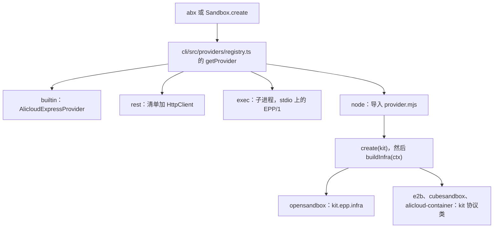
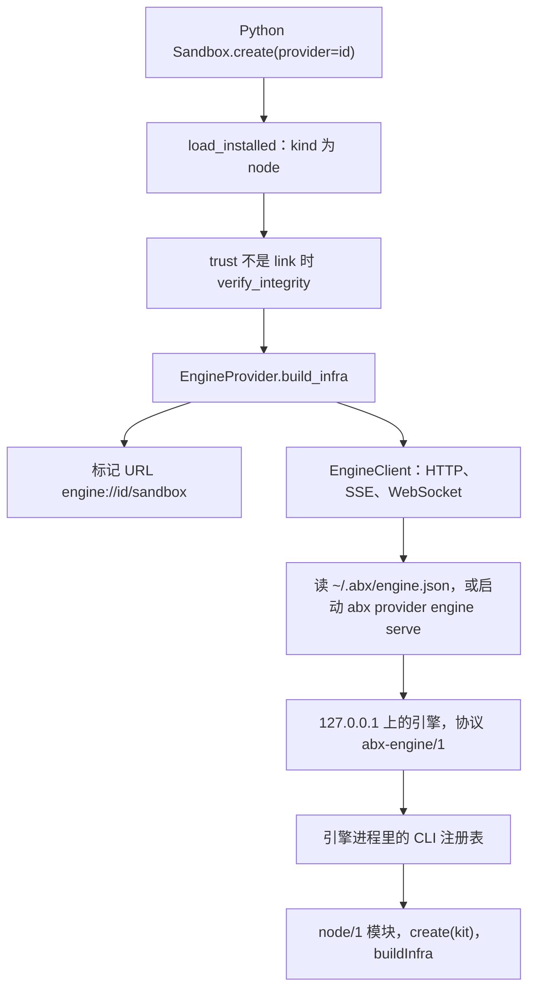

# Node 提供方架构

提供方这一层只在 Node.js / TypeScript 的 CLI 里实现一次。CLI 在进程内调用它。其他宿主通过本机引擎调用同一份代码。引擎的线协议是[引擎 HTTP API](../reference/engine-api.md)（`abx-engine/1`）。

本页是现行设计。较早的 Python gRPC 引擎（`agent_sandbox.engine`、`engine.proto`、Unix socket `~/.abx/engine.sock`）[作为历史保留](https://github.com/alibaba-agent-sandbox/python-sdk/blob/main/docs/zh/design/provider-engine.md)，对目录提供方已被取代。

## 1. 目标

- 每个目录提供方只实现一次，CLI 和所有 SDK 看到的行为一致。
- 宿主本身就会 HTTP、服务器发送事件（SSE）和 WebSocket，沙箱后端和终端用的就是这三样。
- 安装器把插件复制到 `~/.abx/providers/<id>` 即可。插件目录里没有需要宿主解析的 import，也没有要安装的依赖。
- 第三方插件可以用任何语言写，并跑在单独的进程里。
- 本机引擎让不加载 JavaScript 的语言也能运行这份 Node 提供方代码。

## 2. 四种类型

`abx-provider.toml` 里的 `runtime.kind` 决定宿主适配器。清单解析器接受 `exec`、`rest` 和 `node`（`cli/src/providers/manifest.ts`）。`builtin` 不是清单类型，它是编译进宿主的提供方。`kind = "python"` 的清单会被拒绝。

| 类型 | 协议 | 代码在哪里 | 什么时候用 |
|---|---|---|---|
| `builtin` | 各宿主内部的平台 HTTP API | TypeScript CLI 里的 `AlicloudExpressProvider`，以及 Python SDK 里的另一份拷贝。id 为 `alicloud-express` | 默认提供方。id 保留，不能安装成插件 |
| `rest` | `e2b-rest/1` | 只有清单。宿主的 HTTP 客户端打 E2B 形状的控制面，数据面打 envd | 后端已经说这套 HTTP，而且不需要插件程序 |
| `exec` | `epp/1` | 子进程。stdin/stdout 上的 JSON-RPC 2.0，按行分隔（`cli/src/providers/epp.ts`） | 任何语言的第三方插件。进程可以和宿主分开。可选终端方法 `pty.open`、`pty.write`、`pty.resize`、`pty.close`，通知为 `pty.output` 和 `pty.exit` |
| `node` | `node/1` | ES 模块，默认入口 `provider.mjs`，在宿主进程内加载 | 四个目录提供方，以及任何希望只维护这一份模块的后端。模块导出 `create(kit)`（默认导出，或名为 `create` 的导出） |

目录 id 全部是 `node`：

| Id | 模块 | `create(kit)` 如何建立协议对象 |
|---|---|---|
| `opensandbox` | `awesome-providers/opensandbox/provider.mjs` | `kit.epp.infra`。EPP/1 方法在宿主进程内运行。`node provider.mjs` 仍然在 stdio 上说 EPP/1，供其他宿主使用。进程有全局 `WebSocket` 时才宣告 `pty`（Node 22+） |
| `e2b` | `awesome-providers/e2b/provider.mjs` | `kit.SandboxProtocol` 和其他协议类，再加上 `kit.e2b.resumeConnect` |
| `cubesandbox` | `awesome-providers/cubesandbox/provider.mjs` | 同一套 kit 协议类 |
| `alicloud-container` | `awesome-providers/alicloud-container/provider.mjs` | 同一套 kit 协议类 |

`alicloud-container` 是容器版，是目录插件，和内置的 `alicloud-express` 不是同一个提供方。

## 3. kit

`create(kit)` 拿到的是宿主的构造器（`cli/src/providers/node_provider.ts` 的 `providerKit()`）。插件目录不 import CLI。

| 成员 | 作用 |
|---|---|
| `hostVersion` | 交给插件的宿主版本字符串 |
| `SandboxProtocol`、`ProcessProtocol`、`FilesystemProtocol`、`CodeInterpreterProtocol` | 内置提供方使用的协议类 |
| `errors.InvalidAPIKeyError`、`errors.ProviderConfigError`、`errors.ProviderFeatureNotSupportedError` | 插件可以抛出的错误 |
| `e2b.resumeConnect`、`e2b.withDefault`、`e2b.overlay`、`e2b.parseExecution` | E2B 形状后端的辅助：连接路由的顺序、默认选项、方法覆盖，以及 Jupyter 风格的 `/execute` 响应体 |
| `epp.infra(ctx, factory)` | 在本进程运行 EPP/1 分发器，并适配成协议对象（`cli/src/providers/node_epp.ts`） |

`buildInfra(ctx)` 拿到这一次调用已经解析好的配置：

- `id`、`features`、`options`（清单字段）、`core`（用户同意 inherit 的通用键）、`secretKeys`、`callTimeout`
- `http(opts)`、`headerKeyAuth(key, header)`、`noAuth()`

宿主再用特性门包装每个协议。清单没有声明的特性在发往后端之前以 `E8004` 失败。编写步骤见[编写提供方](../guide/authoring-providers.md)。

## 4. 进程内、引擎，以及 exec

提供方代码在三个地方运行。

**进程内。** CLI 的 `getProvider` 返回 `builtin`、`rest`、`exec` 或 `node`，并在 CLI 进程里调用 `buildInfra`。`node` 模块按文件路径加目录摘要做缓存键导入。`opensandbox` 留在这个进程里：`kit.epp.infra` 直接调用分发器，并复用 exec 适配器，因此没有子进程。

**引擎。** `abx provider engine serve` 就是这份 CLI，给其他语言听请求。Python 通过 `EngineProvider`（`agent_sandbox.providers.engine_provider`）使用 `node` 提供方。它返回的沙箱 URL 是标记 `engine://<provider>/<id>`。`EngineClient`（`agent_sandbox.providers.engine_client`）对 `127.0.0.1` 说 HTTP、SSE 和 WebSocket。Python 的 `rest` 提供方留在 Python 进程里（`RestProvider`）。Python 的 `exec` 提供方留在 Python 进程里（`ExecProvider`），由它自己启动插件。分支在 `agent_sandbox.providers.registry` 的 `load_installed`。

**Exec。** `exec` 启动清单里的 `command`，在 stdio 上说 EPP/1。插件不是 `node/1` 模块时用它。引擎也能承载 `exec` 提供方，因为引擎跑的是 CLI 的注册表；Python SDK 不会把 `exec` 提供方送到引擎。

Python 的内置 `alicloud-express` 仍保留自己的一份提供方，这个 id 的 `Sandbox.create` 仍调用 `agent_sandbox.engine` 里较早的 gRPC 切片。目录提供方不走那条路。

## 5. 请求路径

### CLI 到提供方

`abx --provider <id> create` 和 CLI 里的 `Sandbox.create` 走同一条路。

### Python SDK 到引擎再到提供方

这条路只给 `runtime.kind = "node"`。

`EngineClient` 在每个请求上发送 `Authorization: Bearer <token>` 和 `X-Abx-Connection`，WebSocket 升级也一样。命令流是 SSE。终端是 WebSocket。路由、状态码和发现文件的规格在[引擎 HTTP API](../reference/engine-api.md)。

## 6. 安全模型

- **令牌文件。** `startEngine` 取 24 字节随机数，编成 base64url，以模式 `0600` 写入 `~/.abx/engine.json`。目录 `~/.abx` 以模式 `0700` 创建。锁文件 `~/.abx/engine.lock` 是 `0600`。一个活着的进程持有这把锁。
- **回环。** 服务器只听 `127.0.0.1`。`Host` 不是 `127.0.0.1`、`localhost`、`[::1]`、`::1` 的请求会被拒绝。带 `Origin` 头的请求会被拒绝，因此浏览器页面不能调用引擎。Bearer 校验使用恒定时间比较。
- **凭证。** 引擎自己不保存账户。Python 客户端把已经解析好的连接（提供方 id、选项、API key、API URL、domain、access key id、access key secret）放进 `X-Abx-Connection`：JSON 的 base64url，去掉填充。这些值不会写入 `engine.json`。
- **插件目录。** 收据的 `trust` 不是 `link` 时，宿主在使用前重算 SHA-256 目录摘要，并和 `tree_sha256` 比较（CLI 的 `store.verifyIntegrity`；Python 在 `EngineProvider` 与引擎通话之前调用 `store.verify_integrity`）。不一致是 `ProviderIntegrityError`。`trust = "link"` 跳过这次检查；链接安装需要 `--yes`。

`exec` 插件拿到的是清理过的环境。它的密钥走 EPP 的 `initialize` 消息（`cli/src/providers/epp.ts`）。`node` 插件在宿主进程里加载，因此拥有宿主的权限。

没有请求、也没有进行中的流时，引擎在 900 秒后退出。沙箱会话闲置 600 秒后关闭，而且只在引擎没有任何进行中的请求或流时才关闭。这两个数都是 `startEngine` 的默认值。

## 7. 为什么是 Node/TypeScript，以及没有采用的方案

CLI 本身就是 Node.js 宿主（`@agent-sandbox/cli`）。目录插件是调用 kit 的 ES 模块，不随插件附带一份要宿主安装的包（`node_provider.ts`：插件目录没有需要解析的 import）。OpenSandbox 的编写评估记录了同一个选择：Node 20 或更新版本上的 Node ESM，使用内置 `fetch`，因为 CLI 用户已经有这个运行时，安装器也不会安装插件依赖。

下面这些曾经考虑过，目录提供方没有采用：

| 候选 | 记录在哪里 | 结果 |
|---|---|---|
| `grpcio` 和 `protobuf`，以及生成的桩 `engine_pb2` / `engine_pb2_grpc` | `python-sdk/client-sdk/pyproject.toml`；`agent_sandbox/engine/engine.proto` | Python gRPC 引擎仍留在树里，服务较早的 `alicloud-express` 切片。目录提供方不用它 |
| 把每个目录提供方再写成一份 Python 入口点 | `providers-and-credentials.md` §7.3 方案 A；两边的清单解析器都拒绝 `runtime.kind = "python"` | 进程内仍可用 `register_provider` 登记 `Provider` 子类。它不是可安装的目录插件 |
| 本机 gRPC 或 HTTP 插件服务，以及 WASM 组件 | `providers-and-credentials.md` §7.3 方案 D 和 E，v1 否决 | 仍然不是插件传输。第三方插件用 stdio 上的 EPP/1 |

本仓库没有记录另一份库的候选清单（例如某个 npm 上的 gRPC 包）。引擎使用 Node 的 `http` 模块，以及 CLI 已经依赖的 `ws` 包。

## 8. 为什么没有采用 gRPC

gRPC 曾作为 SDK 到提供方的传输被评估。对目录提供方，评估的结果是 Node 引擎的 HTTP、SSE 和 WebSocket API。

HTTP、SSE 和 WebSocket 在本项目要覆盖的语言里，属于标准库或常用 HTTP 客户端（现在是 Python，之后是 Go、Java 和 Node）。客户端不需要按语言生成桩代码。命令流是一条 SSE 响应。终端是传输字节的 WebSocket。文件正文是原始 HTTP 字节。同一组路由只在[引擎 HTTP API](../reference/engine-api.md) 里列一次。

## 9. Go、Java 或 Node SDK 如何接入

接入面是 HTTP、SSE 和 WebSocket。没有需要随 SDK 分发的生成客户端。

1. 用 `ABX_BIN`（一条命令行）或 `PATH` 找到 `abx`，和 `EngineClient.abx_command` 一样。
2. 读取 `~/.abx/engine.json`。进程已退出，或 `GET /v1/health` 报告的协议不是 `abx-engine/1` 时，启动 `abx provider engine serve`，再读一次这个文件。
3. 每个请求和 WebSocket 升级都带上该文件中的 `Authorization: Bearer <token>`。
4. 把已经解析好的提供方、选项和凭证放进 `X-Abx-Connection`（base64url 的 JSON，去掉填充）。
5. 调用[引擎 HTTP API](../reference/engine-api.md) 里的路由：一次性调用用 JSON，命令输出和目录监视用 `text/event-stream`，`GET /v1/sandboxes/:id/terminal` 用 WebSocket。
6. 把 JSON 里的 `error.type` 映射回同名的 SDK 异常。`501` 表示提供方没有声明该能力（`E8004`）。

以后的 Node SDK 也使用这套 HTTP API。CLI 进程是已经在进程内加载提供方的宿主；单独的 Node SDK 是引擎的另一个客户端。

## 10. 有意不做的事

- 目录提供方 `opensandbox`、`e2b`、`cubesandbox`、`alicloud-container` 不在 Python 里再实现一份。Python 把它们转给引擎。
- 引擎不说 gRPC，监听地址也不超出 `127.0.0.1`。
- Python 不加载 `provider.mjs`。Python 也不把 `rest` 或 `exec` 提供方送到引擎。
- `alicloud-express` 不是共享插件。TypeScript 和 Python 各自保留 `AlicloudExpressProvider`。
- 提供方密钥不存放在 `engine.json` 里。发现文件只放 bearer 令牌。
- 引擎不决定一次调用属于哪个账户，也不会去读调用方的 `config.toml` 来补上缺失的密钥。客户端发送自己已经解析好的连接。
- `abx-engine/1` 没有按语言生成的代码。
- 操作系统级的插件隔离、钥匙串存储，以及长期运行的插件守护进程（EPP/2），仍是 [CLI 提供方规格](providers-and-credentials-cli.md) 里的未做项。该规格里的 gRPC 传输项已经评估过，目录提供方没有采用。
