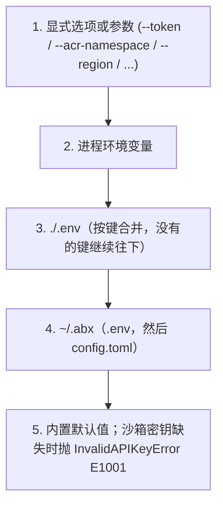

# 认证详解

Agent Sandbox 支持两种认证模式：**API Key** 和 **AK/SK（阿里云 AccessKey）**。

> **历史说明**：`abx auth` CLI 命令组（`login`/`logout`/`status`/`switch`）已在首个正式版 `0.1.0` 之前移除。凭证通过下方介绍的环境变量与 `abx config set sandbox_api_key` 配置；用 `abx config list` 查看生效状态。

---

## 认证方式总览

Agent Sandbox 存在三条认证路径，适用于不同场景：

- **API Key 模式**：最常用。通过 `Authorization: Bearer {api_key}` 请求头访问平台 API。适用于个人开发、CI/CD 等绝大多数场景。
- **AK/SK 模式（阿里云 AccessKey）🧪 实验性**：使用阿里云 AccessKey 对，通过 token 交换获取临时 API Key。框架已实现，但 token 交换端点待 FC 平台确认，当前推荐仍使用 API Key 模式。适用于阿里云生态集成、企业内部使用 RAM 角色授权的场景。
- **envd 内部认证**：沙箱创建后，CLI 与沙箱内部 envd 服务之间的通信认证。使用 `envdAccessToken`（从创建响应中获取），由 CLI 自动管理，用户无需手动处理（请求头说明见文末链接的 SDK 文档）。

---

## API Key 认证

API Key 是最常用的认证方式，通过 `Authorization: Bearer {api_key}` 请求头发送到平台 API。

### 配置方式

#### 1. 环境变量（优先于 `~/.abx`）

```bash
export ABX_SANDBOX_API_KEY="your-api-key"
```

`ABX_SANDBOX_API_KEY` 是沙箱 API Key 唯一的环境变量。

#### 2. abx config set（持久化到本地文件）

```bash
abx config set sandbox_api_key your-api-key
# 写入到 ~/.abx/.env
# 文件权限: 600（仅所有者可读写）
```

存储格式为 `ABX_SANDBOX_API_KEY=your-key`，位于 `~/.abx/.env`。

#### 3. .env 文件

在项目根目录创建 `.env` 文件：

```dotenv
ABX_SANDBOX_API_KEY=your-api-key
```

CLI 按键合并 `.env`。`./.env` 写了该键时优先；没写的键仍然来自 `~/.abx/.env`。

1. 当前目录下的 `.env`
2. `~/.abx/.env`

#### 4. config.toml 文件

在 `~/.abx/config.toml` 中设置：

```toml
[transport]
sandbox_base_url = "https://api.cn-hangzhou.e2b.fc.aliyuncs.com"
sandbox_domain = "cn-hangzhou.e2b.fc.aliyuncs.com"
```

沙箱 API Key 存在 `~/.abx/.env` 的 `ABX_SANDBOX_API_KEY`，不放在 `config.toml`。

## AK/SK 阿里云扩展认证 🧪

> **⚠️ 实验性功能**：AK/SK → API Key 的 token 交换框架已在 CLI 中实现（`transport/auth.ts`，对应 Python SDK），但 token 交换端点的 action 名称（`CreateApiKey`）和响应字段解析**仍待 FC 平台团队确认**。TTL（3600s）和提前刷新时间（300s）是占位值，要等平台确认端点之后才算数。当前可用于本地调试，**生产环境仍推荐使用 API Key 认证**。

AK/SK 模式使用阿里云 AccessKey 对，通过 token 交换获取临时 API Key（设计 TTL 3600 秒，到期前 300 秒自动刷新）。

### 配置方式

#### 1. 环境变量

```bash
export ALICLOUD_ACCESS_KEY_ID="your-access-key-id"
export ALICLOUD_ACCESS_KEY_SECRET="your-access-key-secret"
```

#### 2. abx config set（持久化到本地文件）

```bash
abx config set access_key_id your-access-key-id
abx config set access_key_secret your-access-key-secret
# 写入到 ~/.abx/.env
# 文件权限: 600（仅所有者可读写）
```

存储格式为 `ALICLOUD_ACCESS_KEY_ID=...` / `ALICLOUD_ACCESS_KEY_SECRET=...`，位于 `~/.abx/.env`。

### AK/SK 工作原理

1. CLI 使用 AK/SK 通过阿里云 RPC (POP) V1 HMAC-SHA1 签名调用 `https://fcsandbox.{region}.aliyuncs.com` 的 token 交换端点获取临时 API Key
2. 临时 Key 缓存在内存中（不持久化到磁盘）
3. 设计有效期 3600 秒，CLI 在到期前 300 秒自动刷新（实际参数以 FC 平台最终确认为准）
4. 后续请求使用临时 Key 作为 Bearer Token

> **注意**：以上参数（TTL、端点 action 名等）基于 ACR token exchange 模式实现，正式上线前可能调整。

---

## 配置优先级链

认证凭证按以下优先级解析（从高到低）：



LLM 密钥、GitHub token 和区域走同一条链。空白或只含空格的值会被跳过。变量名和默认值见 [凭证解析](../reference/configuration.md#凭证解析)。

在同一层级内，API Key 优先于 AK/SK：
- 若同时提供了 `sandbox_api_key` 和 `access_key_id`，使用 API Key
- 若同时设置了 `ABX_SANDBOX_API_KEY` 和 `ALICLOUD_ACCESS_KEY_ID`，使用 `ABX_SANDBOX_API_KEY`

---

## CLI 认证管理

```bash
# 设置 API Key
abx config set sandbox_api_key your-api-key

# 设置 AK/SK（实验性）
abx config set access_key_id your-access-key-id
abx config set access_key_secret your-access-key-secret

# 查看生效配置以及每个值的来源
abx config list
# (env) 进程环境变量，(user) ./.env 或 ~/.abx，(default)，(not set)

abx config get sandbox_api_key
abx config get access_key_id
```

---

## 密钥存储（基于文件）

密钥存储在 `~/.abx/secrets.json` 中，这是一个明文 JSON 文件，通过 `chmod 600` 文件权限保护。仅适合本地开发使用。

> **⚠️ 警告**：`secrets.json` 以**明文**存储密钥。仅依赖 POSIX 文件权限（`chmod 600`）控制访问。生产环境请使用专用密钥管理服务。

通过环境变量或配置命令管理密钥：

```bash
# 通过环境变量设置 API Key（推荐）
export ABX_SANDBOX_API_KEY="your-api-key"

# 或通过 abx config 持久化
abx config set sandbox_api_key your-api-key
```

创建沙箱时通过 `--env` 参数注入密钥：

```bash
abx create --template base --env MY_TOKEN=your-secret-value --env ANOTHER_SECRET=another-value
```

> **历史说明**：macOS Keychain 集成已在过度设计清理中移除（ADR 2026-09-23）。`abx secret` CLI 命令组也已被移除。所有密钥管理现通过环境变量、`.env` 文件或 `abx config set` 完成。

---

## 常见问题

### InvalidAPIKeyError (E1001)

```text
[E1001] API key cannot be empty
  Suggestion: Check your ABX_SANDBOX_API_KEY environment variable or pass sandbox_api_key.
```

**解决**：确保通过上述任一方式配置了有效的 API Key。

### InvalidCredentialsError (E1003)

```text
[E1003] AccessKey ID and Secret cannot be empty
  Suggestion: Check ALICLOUD_ACCESS_KEY_ID and ALICLOUD_ACCESS_KEY_SECRET environment variables.
```

**解决**：确保同时设置了 AK ID 和 AK Secret。

### TokenExpiredError (E1002)

```text
[E1002] The CLI should auto-refresh tokens. If this persists, check system clock synchronization.
```

**解决**：检查系统时钟是否准确。CLI 会自动刷新 token，如果持续出现此错误，可能是时钟偏差过大。

---

## 相关 SDK 文档

以代码参数传递凭据（`Sandbox.create(sandbox_api_key=...)`、`access_key_id=` / `access_key_secret=`）以及 envd 请求头的说明，见 `python-sdk` 仓库中 SDK 的[认证指南](https://github.com/alibaba-agent-sandbox/python-sdk/blob/main/docs/zh/guide/authentication.md)。
