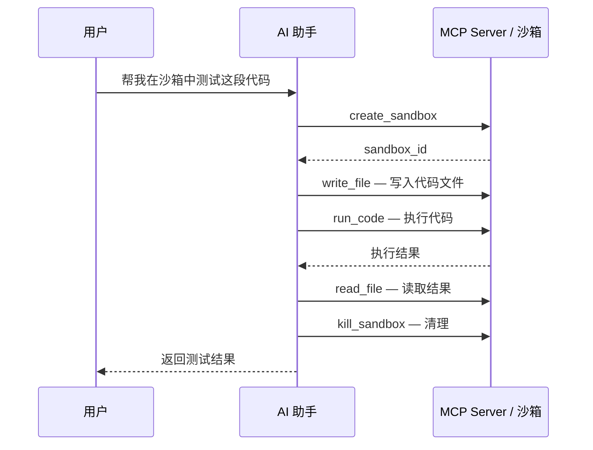

# MCP 集成

Agent Sandbox 提供 MCP（Model Context Protocol）Server，使 AI IDE 和工具能够直接操作沙箱。

---

## 先完成一个真实任务

本机 AI 助手优先使用 STDIO，让客户端负责启动 MCP 进程；需要远程接入时再用 HTTP。Skill 可提供操作指导，但不是连接 MCP 的前提。助手的模型账号、Sandbox Key、模板管理 AK/SK 和 HTTP MCP Bearer 是不同配置。

1. 按[安装指南](getting-started.md)安装 CLI，检查 `abx --version` 和 `abx --help`。源码版与发行版的 CLI 命令不能混用；下方扩展工具清单以当前源码为准。
2. 运行 `abx config init`，将自己的 Sandbox Key 和地域保存到本机。不要把密钥写入项目 MCP 文件或聊天；桌面客户端可能不继承终端环境。
3. 配置客户端并启用服务。Qwen Code 的项目配置需要在 `/mcp` 审核批准；`Pending approval` 不代表服务已连接。
4. 在客户端确认能发现 `agent-sandbox` 工具，再输入下面的任务。检查实际文件、退出码和清理结果，不能仅凭助手正常退出判断成功。

> 通过 Agent Sandbox MCP 创建一个存活 300 秒的 base 沙箱。写入 sales.csv：表头 item,amount，两行 apple,12 和 pear,30。用 run_command 调用 python3 求和并写入 result.json。读取实际文件，确认 total 为 42；列出文件并查询状态。最后删除本次沙箱，再查询确认不存在。不要创建管理 Key，也不要删除其他资源。

这条路径使用 `create_sandbox → write_file → run_command → read_file / list_files → get_sandbox → kill_sandbox`。示例的实际业务结果是 `{"total":42}`。先保存需要交付的文件，再删除自己的临时资源。普通 Python 脚本通过 `run_command` 执行；当前源码内置极速版的原生 `run_code` 入口不受支持，会返回 E8004，不应将其写成解释器成功。

### Qwen Code

将以下条目合并到项目 `.qwen/settings.json` 的 `mcpServers`，保留已有配置。把 `command` 换成实际可执行文件的绝对路径：macOS/Linux 用 `command -v abx`，Windows PowerShell 用 `(Get-Command abx).Source`。Windows JSON 路径中的反斜杠需转义。

Windows 的 npm/源码安装如果解析到 `.ps1` 或 `.cmd` 包装器，改用 `(Get-Command node).Source` 得到的 `node.exe` 作为 `command`，并把 `Join-Path (npm root -g) '@agent-sandbox/cli/dist/bin/abx.js'` 得到的 JS 路径放在 `args` 第一项，再跟 `mcp`、`start` 等参数。独立二进制直接使用 `abx.exe`。

```json
{
  "mcpServers": {
    "agent-sandbox": {
      "command": "abx",
      "args": ["mcp", "start", "--template", "base"]
    }
  }
}
```

重新打开 Qwen Code，在 `/mcp` 查看、审核并启用项目服务。用户级配置也可使用同一个条目，放在用户的 `.qwen/settings.json`；仅配置可信来源。配置文件存在、`abx mcp status` 正常、助手进程返回 0，都不能代替客户端已连接并完成业务任务。

### 结果交付与长任务

- 文本：`write_file` / `read_file` 使用沙箱路径。
- 二进制：`upload_file` 接收 base64 与 SHA-256，不会读取用户电脑上的路径；`download_file` 返回 base64 与哈希，助手或调用程序必须真的写到本机并核对。工具有大小上限，大文件使用 CLI 传输。
- 后台：保存 `start_task` 返回的 `sandbox_id` 和 `task_id`。重连后用同一组 ID 调用 `get_task`，读取 `state`、`exit_code` 与有界日志。终态包括 `succeeded`、`failed`、`cancelled`；取消需继续查询到终态，不能只看请求接受。
- 归属：后台任务会保留沙箱；借用、显式保留和普通临时资源的清理不同。明确告诉助手何时释放资源，不使用账号范围的批量清理。

## 什么是 MCP

MCP（Model Context Protocol）是一个开放协议，允许 AI 模型与外部工具和服务交互。Agent Sandbox 的 MCP Server 以 STDIO 传输、JSON-RPC 2.0 协议运行，为 AI 助手提供沙箱操作能力；远程部署也可使用 Streamable HTTP 传输（见下文）。

### 前置条件

```bash
curl -fsSL https://www.agent-sandbox.cn/install.sh | sh
export ABX_SANDBOX_API_KEY=your-api-key     # 或：abx config set sandbox_api_key your-api-key
```

---

## 安装到 IDE

### Cursor

```bash
abx mcp install --target cursor
```

向 `~/.cursor/mcp.json` 写入 `agent-sandbox` 条目，然后重启 Cursor。

### Claude Desktop

```bash
abx mcp install --target claude
```

写入 `claude_desktop_config.json`（路径取决于操作系统），然后重启 Claude Desktop。

### VS Code

```bash
abx mcp install --target vscode
```

写入工作区 `.vscode/mcp.json` 的 `servers` 键（`type: stdio`），然后重新加载 VS Code 窗口。这个文件经常会被提交，所以安装器不把 API key 写进去；`abx mcp start` 从环境变量或 `~/.abx` 读取。

所有目标注册的都是同一个 STDIO 命令：`abx mcp start`。命令写成正在运行的 `abx` 可执行文件的绝对路径（找不到时退回到 `node <abx.js 的绝对路径>`），这样 IDE 自带的精简 PATH 也能拉起 server。安装器采用合并写入 — 已配置的其他 MCP server 会被保留。配置文件如果不是严格 JSON（注释、尾逗号），安装器会拒绝覆盖。Cursor、Claude 和 VS Code 注册均不嵌入 Sandbox API Key。安装器记录适用的非密钥生效端点、domain 和地域；`abx mcp start` 运行时按[凭证解析](../reference/configuration.md#凭证解析)读取密钥。交互式安装可以进入[配置引导](guided-configuration.md)，也可继续离线注册。IDE 注册不代表云端访问已验证，临时配置不会传给之后由 IDE 启动的进程。

### 查看安装状态

```bash
abx mcp status
# server、transport、工具列表、auth_configured、installed_<ide> 标志

abx --json mcp status
```

---

## 可用工具

MCP Server 提供 21 个工具：下面按用途列出当前源码默认 Provider 的工具；其他 Provider 与发行版以实际 tools/list 为准。

| 工具名 | 说明 | 参数 |
|--------|------|------|
| `create_sandbox` | 创建新沙箱，并把它设为默认沙箱 | `template`（可选，省略时用 server 配置的模板）、`timeout`（可选，默认 300）、`envs`（可选） |
| `run_code` | 原生解释器入口；当前源码内置极速版返回 E8004 | `code`（必填）、`sandbox_id`（可选）、`language`（可选，默认 python）、`timeout`（可选，默认 30） |
| `run_command` | 通过 `sh -c` 执行命令（支持管道、`&&`、`$VAR`、`cd`） | `command`（必填）、`sandbox_id`（可选）、`cwd`（可选，省略时用镜像工作目录）、`timeout`（可选，默认 60，非零退出码视为工具错误） |
| `read_file` | 读取沙箱中的文件 | `path`（必填）、`sandbox_id`（可选）、`encoding`（可选，默认 utf-8） |
| `write_file` | 写入文件到沙箱 | `path`、`content`（必填）、`sandbox_id`（可选） |
| `list_files` | 列出沙箱中的目录内容 | `path`（可选，默认 `/`）、`sandbox_id`（可选） |
| `kill_sandbox` | 销毁沙箱 | `sandbox_id`（可选；省略时销毁默认沙箱。没有默认沙箱时返回错误） |

### 生命周期、文件、后台与模板工具

| 工具 | 用途 | 主要参数 |
| --- | --- | --- |
| `get_capabilities` | 发现能力与未验证的平台依赖 | `{}` |
| `list_sandboxes` | 只读列出资源；列表可短暂滞后 | `limit?, offset?` |
| `get_sandbox` | 只读查询状态，不续期、不取得归属 | `sandbox_id` |
| `set_sandbox_timeout` | 显式续期，并返回实际查询结果 | `sandbox_id, timeout` |
| `retain_sandbox` | 明确保留会话资源 | `sandbox_id, retain` |
| `upload_file` | 有界二进制上传并验证哈希 | `sandbox_id, path, content_base64, sha256` |
| `download_file` | 返回二进制和哈希，客户端负责本机交付 | `sandbox_id, path, max_bytes?` |
| `start_task` | 启动持久后台任务并保留沙箱 | `sandbox_id, command, cwd?` |
| `get_task` | 查询原任务状态和日志 | `sandbox_id, task_id, max_bytes?` |
| `cancel_task` | 请求取消，随后仍需查询终态 | `sandbox_id, task_id` |
| `verify_sandbox` | 实际命令与二进制读写探针 | `sandbox_id` |
| `submit_template_build` | 极速版模板提交，需要管理 AK/SK 和明确 Team | `team_id, name, image, generation?, cpu?, memory?, envd_inject?` |
| `get_template_build` | 查询构建状态；就绪不等于运行验证 | `team_id, template_id` |
| `validate_template` | 创建临时沙箱，验证运行与独立清理 | `template_id, region?` |

模板构建的 `submitted`、`ready` 与实际运行验证是不同阶段。构建失败先查看 reason、镜像权限和 envd 注入条件；只有已经准备好 envd 的兼容镜像才适用 `envd_inject=false`。模板管理用 AK/SK，沙箱运行用 Sandbox Key；不自动创建管理 Key 或覆盖已有模板。

> **命名说明**：MCP 工具 `run_command` 通过 `sh -c` 执行命令（SDK 中 `sandbox.commands.run(..., shell=True)`），与 SDK 中已弃用的 `Sandbox.run_command()` 方法无关——后者用于调度命名自定义命令，请使用 `Sandbox.custom()` 替代。
>
> **默认沙箱**：`create_sandbox` 的结果会成为默认沙箱，所以随后省略 `sandbox_id` 的 `write_file` / `run_code` / `kill_sandbox` 都作用在刚创建的那只沙箱上。还没有默认沙箱时，第一次省略 `sandbox_id` 的工具调用会懒创建一只。省略 `template` 时使用 server 配置的模板（`abx mcp start` 默认为 `code-interpreter-v1`）。查询和普通执行不会延长存活时间；需要续期时显式调用 `set_sandbox_timeout`。断开连接只销毁会话新建的临时沙箱。借用、显式保留和运行后台任务的沙箱会保留到平台超时或显式删除。

---

## 手动启动 MCP Server（STDIO）

通常 MCP Server 由 IDE 自动启动。手动运行时进程会停在 stdin 上等 JSON-RPC，这是正常状态。启动后会把传输、协议、模板、API key 是否已配置、工具列表和停止方式写到 **stderr**（stdout 只留给 JSON-RPC，密钥本身不会打印）：

```bash
abx mcp start
```

另一个终端里停止它：

```bash
abx mcp stop
```

`abx mcp stop` 向记录的 pid 发送 SIGTERM。前台 STDIO 也可以直接 Ctrl-C。pid 和日志在 `~/.abx/run/`（`mcp-server.json`、`mcp-server.log`）；测试可用 `ABX_MCP_RUNTIME_DIR` 换目录。`abx mcp status` 的 `mcp_running` 表示这只本地进程是否还在。

| 选项 | 说明 |
|------|------|
| `--template` | 默认模板（默认 code-interpreter-v1） |
| `--api-key` | API Key 覆盖（环境变量: `ABX_SANDBOX_API_KEY`） |
| `--api-url` | API URL 覆盖（环境变量: `ABX_SANDBOX_BASE_URL`） |
| `--domain` | Domain 覆盖（环境变量: `ABX_SANDBOX_DOMAIN`） |
| `--http` | 改为 Streamable HTTP（默认 `127.0.0.1:9000`） |
| `--host` / `--port` | HTTP 绑定地址和端口。非回环地址必须带非空 `--auth-token` |
| `--auth-token` | HTTP Bearer token（环境变量: `ABX_MCP_AUTH_TOKEN`） |
| `--background` | 把 HTTP server 放到后台。STDIO 脱离终端后读到 EOF 会退出，所以该选项会改走 HTTP |

后台 HTTP：

```bash
abx mcp start --http --background
abx mcp stop
```

父进程打印 pid、`http://127.0.0.1:9000/mcp` 和日志路径后返回。API key 和 token 只放进子进程环境，不出现在命令行参数里。`--quiet` 不打印这些说明。

Server 以 STDIO 模式运行时，通过 stdin/stdout 上的换行分隔 JSON-RPC 2.0 与调用方通信。可以不经 IDE 直接冒烟测试（说明文字在 stderr，管道里仍是 JSON）：

```bash
# 通过管道发送 initialize + tools/list；server 在 stdout 回复
printf '%s\n' \
  '{"jsonrpc":"2.0","id":1,"method":"initialize","params":{}}' \
  '{"jsonrpc":"2.0","id":2,"method":"tools/list","params":{}}' \
  | abx mcp start | head -n 2
```

---

## 远程服务（Streamable HTTP）

团队共享或远程访问时，将 MCP Server 作为 Streamable HTTP 服务运行，而不是 STDIO。

### 本地运行

从 CLI 运行 Streamable HTTP 服务（`abx mcp start --http`，选项见下表）：

```bash
export ABX_MCP_AUTH_TOKEN=replace_me   # Bearer token（回环地址下省略则关闭认证）
export ABX_SANDBOX_API_KEY=your-api-key

abx mcp start --http --host 0.0.0.0 --port 9000
```

端点：`POST /mcp`（JSON-RPC）、`DELETE /mcp`（会话终止）、`GET /health`（健康检查）。`GET /mcp` 返回 405（SSE 通知尚未实现，按 Streamable HTTP 规范用 405 而不是 501）。部署的 MCP 模板必须带非空 Bearer token。带 `Origin` 且不是本机、也不在 `ABX_MCP_ALLOWED_ORIGINS` 里的请求返回 403。

### Bearer Token 认证

三层要分开看：

| 入口 | 客户端鉴权 | 怎么配置 |
|------|------------|----------|
| `abx mcp start`（STDIO） | 没有 Bearer。进程由本机 IDE 拉起，不对外监听 | 沙箱调用用 `ABX_SANDBOX_API_KEY` / `abx config set sandbox_api_key` |
| `abx mcp start --http` | Bearer。回环地址可以不配 token（启动时会警告）；`--host` 不是回环时必须有非空 `--auth-token` | `--auth-token` 或 `ABX_MCP_AUTH_TOKEN` |
| 部署的 MCP 模板 | Bearer 必填，app.py 缺少令牌时拒绝启动 | 默认使用 CLI 管理的 ABX_SERVER_TOKEN，可用 ABX_MCP_AUTH_TOKEN 覆盖；Provider endpoint 认证仍独立。GET /health 公开且不含密钥 |

设置 `ABX_MCP_AUTH_TOKEN`（或 `auth_token`）后，`/mcp` 的每个请求必须携带：

```
Authorization: Bearer <token>
```

- 本机回环上未设置 token → 认证关闭，启动时会警告
- token 已设置但为空 → **fail-closed**：所有请求返回 401
- MCP 模板的两个令牌输入均未设置或为空 → 进程拒绝启动

token 比较使用常量时间算法。部署的模板默认复用 CLI 自动生成并保存的应用令牌。

### 客户端配置（远程）

```json
{
  "mcpServers": {
    "agent-sandbox-remote": {
      "url": "http://your-server:9000/mcp",
      "headers": {
        "Authorization": "Bearer replace_me"
      }
    }
  }
}
```

---

## 部署可编辑的 MCP 模板

```bash
abx template init ./my-mcp --template mcp
abx deploy ./my-mcp --name my-mcp -e ABX_SANDBOX_API_KEY="$ABX_SANDBOX_API_KEY" -e ABX_SANDBOX_BASE_URL="$ABX_SANDBOX_BASE_URL" -e ABX_SANDBOX_DOMAIN="$ABX_SANDBOX_DOMAIN" # example: environment references, no literal credentials
```

生成的源码包含 template.yaml、Dockerfile、app.py、requirements.txt、.dockerignore
和 README.md。部署前可编辑应用和清单。它在 Sandbox 中以单个 HTTP 进程运行已有的
带认证 Python MCP 应用。依赖固定为公开版 `agent-sandbox-client[mcp]==0.4.0a6`，
该发行版包含匹配的运行时和 ASGI 依赖。

MCP 应用需要自己的 Sandbox API Key、API 地址和沙箱域名来创建会话沙箱。
通过运行时输入传入同账号、同地域的这些值；构建镜像的凭据不能替代它们。
`template init` 不把凭据复制到源码。

CLI 自动准备 ABX_SERVER_TOKEN，MCP 服务默认将其用于 Bearer 认证；显式提供
ABX_MCP_AUTH_TOKEN 时使用后者。客户端配置部署结果里的 mcp 服务 URL 加 `/mcp`、
`Authorization: Bearer <TOKEN>`，以及 Provider 为此 endpoint 返回的流量认证头。
Provider 流量认证和 MCP 认证是两层独立凭据，应同时保留。

后续请求复用 initialize 返回的 Mcp-Session-Id。DELETE /mcp 结束会话并清理该会话
拥有的沙箱。GET /mcp 仍返回 405，未实现服务端通知 SSE。会话存于进程内存，不跨应用
替换保存。先结束会话，再执行 `abx delete my-mcp --yes`。
编辑后的源码可按[模板编写指南](authoring-templates.md)构建或发布。

---

## 场景示例

### 在 Cursor 中使用

安装 MCP 后，在 Cursor 的 AI 对话中，模型可以自动调用 Agent Sandbox 工具：

1. **代码执行**：「在沙箱中运行这段 Python 代码，看看输出是什么」
2. **环境搭建**：「创建一个沙箱，安装 flask 和 sqlalchemy，然后运行我的项目」
3. **文件操作**：「把这个文件写入沙箱的 /app 目录」
4. **调试辅助**：「在沙箱里执行 pip list 看看装了哪些包」

### 典型工作流



### 快速执行一段代码（HTTP，curl）

```bash
# 1. initialize（创建会话；记下 Mcp-Session-Id）
curl -s http://localhost:9000/mcp \
  -H "Content-Type: application/json" \
  -H "Authorization: Bearer replace_me" \
  -d '{"jsonrpc":"2.0","id":1,"method":"initialize","params":{}}'

# 2. 携带会话头调用工具
curl -s http://localhost:9000/mcp \
  -H "Content-Type: application/json" \
  -H "Authorization: Bearer replace_me" \
  -H "Mcp-Session-Id: <步骤1的会话ID>" \
  -d '{"jsonrpc":"2.0","id":2,"method":"tools/call",
       "params":{"name":"run_code","arguments":{"code":"print(1+1)"}}}'

# 3. 终止会话（销毁其沙箱）
curl -s -X DELETE http://localhost:9000/mcp \
  -H "Authorization: Bearer replace_me" \
  -H "Mcp-Session-Id: <步骤1的会话ID>"
```

---

## 故障排查

| 症状 | 可能原因 | 解决方法 |
|------|----------|----------|
| IDE 显示 server 失败 / 无工具 | `abx` 不在 IDE 的 `PATH` 中 | 在 IDE 配置中使用绝对路径，如 `/usr/local/bin/abx`（npm 全局 bin 目录见 `npm prefix -g`） |
| 工具列表正常但每次调用报错 | API key 缺失或无效 | `abx mcp status` 看 `auth_configured`；设置 `ABX_SANDBOX_API_KEY` 或 `abx config set sandbox_api_key` |
| IDE 重启后 `create_sandbox` 失败 | 后端 API URL/地域不匹配 | 在 server 参数/env 块中传 `--api-url`（或设 `ABX_SANDBOX_BASE_URL`） |
| HTTP 每个请求都 401 | `ABX_MCP_AUTH_TOKEN` 为空（fail-closed） | 设置非空 token。本机回环可以删掉该变量来关闭认证。MCP 模板没有 token 时不会启动 |
| HTTP 404 Unknown session | `Mcp-Session-Id` 已过期（空闲 TTL 3600 秒）或实例重启 | 重新发送 `initialize` 创建新会话 |
| HTTP 503 会话上限 | 进程内并发会话超过 100 | 关闭空闲会话（`DELETE /mcp`）或经 `create_mcp_app()` 调高 `max_sessions` |
| `GET /mcp` 返回 405 | SSE 通知尚未实现 | 预期行为 — 只使用 `POST /mcp` |

更普遍的问题：见[故障排查指南](troubleshooting.md)与[错误码](../reference/error-codes.md)。

---

## 技术细节

- **传输协议**：STDIO（换行分隔 JSON-RPC 2.0，协议版本 2024-11-05）与 Streamable HTTP（规范 2025-06-18）。`initialize` 按 transport 协商支持版本 —— 请求版本受支持时原样回显，缺失或不支持时回退到该 transport 自己的版本（因此 HTTP 的 /health 与 initialize 均报告 2025-06-18）
- **沙箱管理**：MCP Server 为每个会话内部维护 `SandboxManager`，管理多个沙箱实例的生命周期
- **默认模板**：`abx mcp start` 为 `code-interpreter-v1`；HTTP 应用与 MCP 模板为 `base`。`create_sandbox` 省略 `template` 时用的就是这个 server 模板
- **STDIO**：单条消息上限 8 MiB；超限的一行会被拒绝，进程继续服务下一条。`ping` 在工具调用进行中也会返回
- **HTTP 会话**：空闲 TTL 3600 秒、每进程最多 100 个并发会话，容量满返回 503

---

## 下一步

- [CLI 教程](cli-tutorial.md) — CLI 完整使用教程
- [CLI 参考](../reference/cli-reference.md) — MCP 命令详细参考
- [MCP Server 设计](../design/mcp-server.md) — 工具、传输与 远程 HTTP 架构

---

## 相关 SDK 文档

MCP 服务的 Python 实现——`python -m agent_sandbox.agent.mcp`、ASGI 入口（`uvicorn agent_sandbox.agent.mcp_http:asgi_app`）以及 `create_mcp_app()`——见 `python-sdk` 仓库中 SDK 的 [MCP 集成指南](https://github.com/alibaba-agent-sandbox/python-sdk/blob/main/docs/zh/guide/mcp-integration.md)与 [SDK 使用指南](https://github.com/alibaba-agent-sandbox/python-sdk/blob/main/docs/zh/guide/sdk-usage.md)。

闭环工具：`get_capabilities`、`list_sandboxes`、`get_sandbox`、`set_sandbox_timeout`、`retain_sandbox`、`upload_file`、`download_file`、`start_task`、`get_task`、`cancel_task`、`verify_sandbox`；Alibaba 模板适配器：`submit_template_build`、`get_template_build`、`validate_template`。实际验收方法、生命周期及 Provider 边界见 [Skill 最佳实践](sandbox-skill-best-practices.md)。

连接的用户资源、显式保留以及后台任务沙箱在客户端断连后继续存在，直到平台到期或显式删除；仅会话创建的临时沙箱自动删除。只读查询不自动续期。


### 生成产物的安装与生命周期边界

`abx template init --template mcp` 生成可编辑的应用源码。依赖选择公开版 MCP
客户端 extra 及其匹配运行时；通过 `python -m pip install -r requirements.txt`
安装，导入名称仍为 `agent_sandbox`。
生成的 Python HTTP 服务器与 Node CLI MCP 服务器是两个独立入口，应查询各自的
`tools/list`，不要假设工具目录相同。

CLI 生命周期工具使用显式沙箱 ID。列表和元数据查询不会接管、连接、恢复或续期
外部沙箱；`set_sandbox_timeout` 直接请求控制面，分别报告请求是否被接受及能否
观察到目标超时。只读查询与普通执行不隐式续期，借用资源在会话结束后保留。
生命周期错误保留安全分类和 HTTP 状态，不输出厂商凭据、响应正文或异常堆栈。


### 显式指定 CPU 和内存

`create_sandbox` 支持可选的 `cpu` 和 `memory`（MB）。指定资源要求后，工具会重新查询
新沙箱的元数据。实际值不一致或无法确认时，返回 `isError: true`、
`category: resource_configuration`、请求值、实际值和 `cleanup_verified`。
工具只删除本次刚创建的沙箱并检查其已不存在；清理未确认时，使用返回的沙箱 ID 显式重试清理。

核验会新建控制面连接，沿用创建时的实际 Provider 和完整配置，包括 Provider 选项。
即使会话缓存在核验期间变化，回滚也只操作本次刚创建的句柄。其他地域的未找到响应、
初始化失败或关闭客户端失败均不能确认清理成功。结果不确定时，返回带 Provider 前缀的
`recovery_sandbox_id`；查询或重试清理时，应原样传回该句柄。

Express 可能忽略创建沙箱时的资源覆盖值，实际规格取决于模板。选择或构建满足规格的模板，
再确认实际沙箱的规格，不要把未生效的覆盖值报告为成功。元数据缺少 `timeout` 时保持未知；
显式修改存活时间后，可通过独立查询的 `end_at` 确认到期时间。
