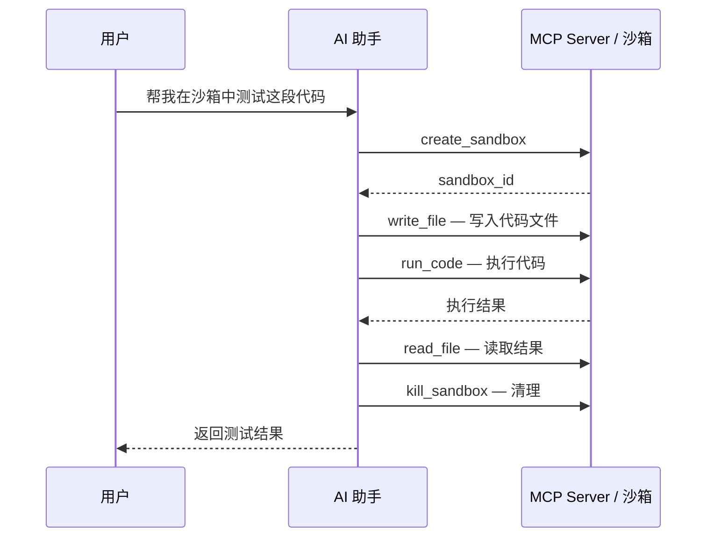

# MCP 集成

> 范围：本页说明原生 provider/MCP 的配置和错误。原生配置使用 `ABX_SANDBOX_API_KEY`、`ABX_SANDBOX_BASE_URL`、`ABX_SANDBOX_DOMAIN`。标准极速版命令入口额外接受 `E2B_API_KEY`、`E2B_API_URL`、`E2B_DOMAIN`，仅在该入口映射，并回退到项目配置。标准命令选项、终端环境变量和错误行为见[迁移指南](../guide/migrate-from-e2b.md)。

Agent Sandbox 提供 MCP（Model Context Protocol）Server，使 AI IDE 和工具能够直接操作沙箱。

---

## 什么是 MCP

MCP（Model Context Protocol）是一个开放协议，允许 AI 模型与外部工具和服务交互。Agent Sandbox 的 MCP Server 以 STDIO 传输、JSON-RPC 2.0 协议运行，为 AI 助手提供沙箱操作能力；远程部署也可使用 Streamable HTTP 传输（见下文）。

### 前置条件

```bash
curl -fsSL https://www.agent-sandbox.cn/install.sh | sh
export ABX_SANDBOX_API_KEY=your-api-key     # 或：abx config set sandbox_api_key your-api-key
```

---

## 安装到 IDE

### Cursor

```bash
abx mcp install --target cursor
```

向 `~/.cursor/mcp.json` 写入 `agent-sandbox` 条目，然后重启 Cursor。

### Claude Desktop

```bash
abx mcp install --target claude
```

写入 `claude_desktop_config.json`（路径取决于操作系统），然后重启 Claude Desktop。

### VS Code

```bash
abx mcp install --target vscode
```

写入工作区 `.vscode/mcp.json` 的 `servers` 键（`type: stdio`），然后重新加载 VS Code 窗口。这个文件经常会被提交，所以安装器不把 API key 写进去；`abx mcp start` 从环境变量或 `~/.abx` 读取。

所有目标注册的都是同一个 STDIO 命令：`abx mcp start`。命令写成正在运行的 `abx` 可执行文件的绝对路径（找不到时退回到 `node <abx.js 的绝对路径>`），这样 IDE 自带的精简 PATH 也能拉起 server。安装器采用合并写入 — 已配置的其他 MCP server 会被保留。配置文件如果不是严格 JSON（注释、尾逗号），安装器会拒绝覆盖。Cursor、Claude 和 VS Code 注册均不嵌入 Sandbox API Key。安装器记录适用的非密钥生效端点、domain 和地域；`abx mcp start` 运行时按[凭证解析](../reference/configuration.md#凭证解析)读取密钥。交互式安装可以进入[配置引导](guided-configuration.md)，也可继续离线注册。IDE 注册不代表云端访问已验证，临时配置不会传给之后由 IDE 启动的进程。

### 查看安装状态

```bash
abx mcp status
# server、transport、工具列表、auth_configured、installed_<ide> 标志

abx --json mcp status
```

---

## 可用工具

MCP Server 提供 21 个工具：下面保留七个兼容核心工具，其后列出新增闭环工具。

| 工具名 | 说明 | 参数 |
|--------|------|------|
| `create_sandbox` | 创建新沙箱，并把它设为默认沙箱 | `template`（可选，省略时用 server 配置的模板）、`timeout`（可选，默认 300）、`envs`（可选） |
| `run_code` | 在沙箱中执行代码 | `code`（必填）、`sandbox_id`（可选）、`language`（可选，默认 python）、`timeout`（可选，默认 30） |
| `run_command` | 通过 `sh -c` 执行命令（支持管道、`&&`、`$VAR`、`cd`） | `command`（必填）、`sandbox_id`（可选）、`cwd`（可选，省略时用镜像工作目录）、`timeout`（可选，默认 60，非零退出码视为工具错误） |
| `read_file` | 读取沙箱中的文件 | `path`（必填）、`sandbox_id`（可选）、`encoding`（可选，默认 utf-8） |
| `write_file` | 写入文件到沙箱 | `path`、`content`（必填）、`sandbox_id`（可选） |
| `list_files` | 列出沙箱中的目录内容 | `path`（可选，默认 `/`）、`sandbox_id`（可选） |
| `kill_sandbox` | 销毁沙箱 | `sandbox_id`（可选；省略时销毁默认沙箱。没有默认沙箱时返回错误） |

> **命名说明**：MCP 工具 `run_command` 通过 `sh -c` 执行命令（SDK 中 `sandbox.commands.run(..., shell=True)`），与 SDK 中已弃用的 `Sandbox.run_command()` 方法无关——后者用于调度命名自定义命令，请使用 `Sandbox.custom()` 替代。
>
> **默认沙箱**：`create_sandbox` 的结果会成为默认沙箱，所以随后省略 `sandbox_id` 的 `write_file` / `run_code` / `kill_sandbox` 都作用在刚创建的那只沙箱上。还没有默认沙箱时，第一次省略 `sandbox_id` 的工具调用会懒创建一只。省略 `template` 时使用 server 配置的模板（`abx mcp start` 默认为 `code-interpreter-v1`）。查询和普通执行不会延长存活时间；需要续期时显式调用 `set_sandbox_timeout`。断开连接只销毁会话新建的临时沙箱。借用、显式保留和运行后台任务的沙箱会保留到平台超时或显式删除。

---

## 手动启动 MCP Server（STDIO）

通常 MCP Server 由 IDE 自动启动。手动运行时进程会停在 stdin 上等 JSON-RPC，这是正常状态。启动后会把传输、协议、模板、API key 是否已配置、工具列表和停止方式写到 **stderr**（stdout 只留给 JSON-RPC，密钥本身不会打印）：

```bash
abx mcp start
```

另一个终端里停止它：

```bash
abx mcp stop
```

`abx mcp stop` 向记录的 pid 发送 SIGTERM。前台 STDIO 也可以直接 Ctrl-C。pid 和日志在 `~/.abx/run/`（`mcp-server.json`、`mcp-server.log`）；测试可用 `ABX_MCP_RUNTIME_DIR` 换目录。`abx mcp status` 的 `mcp_running` 表示这只本地进程是否还在。

| 选项 | 说明 |
|------|------|
| `--template` | 默认模板（默认 code-interpreter-v1） |
| `--api-key` | API Key 覆盖（环境变量: `ABX_SANDBOX_API_KEY`） |
| `--api-url` | API URL 覆盖（环境变量: `ABX_SANDBOX_BASE_URL`） |
| `--domain` | Domain 覆盖（环境变量: `ABX_SANDBOX_DOMAIN`） |
| `--http` | 改为 Streamable HTTP（默认 `127.0.0.1:9000`） |
| `--host` / `--port` | HTTP 绑定地址和端口。非回环地址必须带非空 `--auth-token` |
| `--auth-token` | HTTP Bearer token（环境变量: `ABX_MCP_AUTH_TOKEN`） |
| `--background` | 把 HTTP server 放到后台。STDIO 脱离终端后读到 EOF 会退出，所以该选项会改走 HTTP |

后台 HTTP：

```bash
abx mcp start --http --background
abx mcp stop
```

父进程打印 pid、`http://127.0.0.1:9000/mcp` 和日志路径后返回。API key 和 token 只放进子进程环境，不出现在命令行参数里。`--quiet` 不打印这些说明。

Server 以 STDIO 模式运行时，通过 stdin/stdout 上的换行分隔 JSON-RPC 2.0 与调用方通信。可以不经 IDE 直接冒烟测试（说明文字在 stderr，管道里仍是 JSON）：

```bash
# 通过管道发送 initialize + tools/list；server 在 stdout 回复
printf '%s\n' \
  '{"jsonrpc":"2.0","id":1,"method":"initialize","params":{}}' \
  '{"jsonrpc":"2.0","id":2,"method":"tools/list","params":{}}' \
  | abx mcp start | head -n 2
```

---

## 远程服务（Streamable HTTP）

团队共享或远程访问时，将 MCP Server 作为 Streamable HTTP 服务运行，而不是 STDIO。

### 本地运行

从 CLI 运行 Streamable HTTP 服务（`abx mcp start --http`，选项见下表）：

```bash
export ABX_MCP_AUTH_TOKEN=replace_me   # Bearer token（回环地址下省略则关闭认证）
export ABX_SANDBOX_API_KEY=your-api-key

abx mcp start --http --host 0.0.0.0 --port 9000
```

端点：`POST /mcp`（JSON-RPC）、`DELETE /mcp`（会话终止）、`GET /health`（健康检查）。`GET /mcp` 返回 405（SSE 通知尚未实现，按 Streamable HTTP 规范用 405 而不是 501）。远程产物必须带非空 Bearer token（`--generate-token` 或 `--auth-token-file`）。带 `Origin` 且不是本机、也不在 `ABX_MCP_ALLOWED_ORIGINS` 里的请求返回 403。

### Bearer Token 认证

三层要分开看：

| 入口 | 客户端鉴权 | 怎么配置 |
|------|------------|----------|
| `abx mcp start`（STDIO） | 没有 Bearer。进程由本机 IDE 拉起，不对外监听 | 沙箱调用用 `ABX_SANDBOX_API_KEY` / `abx config set sandbox_api_key` |
| `abx mcp start --http` | Bearer。回环地址可以不配 token（启动时会警告）；`--host` 不是回环时必须有非空 `--auth-token` | `--auth-token` 或 `ABX_MCP_AUTH_TOKEN` |
| 阿里云 FC 上的远程函数 | Bearer 必填。产物里的 `app.py` 在 token 为空时拒绝启动，不会变成“免认证” | `abx mcp deploy --generate-token` 写入函数环境变量 `ABX_MCP_AUTH_TOKEN`。FC HTTP 触发器使用 `anonymous`，这样 MCP 客户端不用阿里云签名；真正的鉴权是应用层 Bearer。`GET /health` 只返回状态和协议，不校验 token，也不含密钥 |

设置 `ABX_MCP_AUTH_TOKEN`（或 `auth_token`）后，`/mcp` 的每个请求必须携带：

```
Authorization: Bearer <token>
```

- 本机回环上未设置 token → 认证关闭，启动时会警告
- token 已设置但为空 → **fail-closed**：所有请求返回 401
- FC 产物未设置或为空 → 进程拒绝启动

token 比较使用常量时间算法。可用 `openssl rand -base64 32` 生成，或让 `abx mcp deploy --generate-token` 生成。

### 客户端配置（远程）

```json
{
  "mcpServers": {
    "agent-sandbox-remote": {
      "url": "http://your-server:9000/mcp",
      "headers": {
        "Authorization": "Bearer replace_me"
      }
    }
  }
}
```

---

## 生成 FC 部署产物

`abx mcp deploy` 生成面向阿里云函数计算的待打包产物。它**不**调用 FC API —— 需要通过控制台或 SDK 手动创建函数。

```bash
abx mcp deploy \
  --generate-token \
  --api-key $ABX_SANDBOX_API_KEY \
  --output-dir ./mcp-artifact
```

产物目录包含：

| 文件 | 内容 |
|------|------|
| `requirements.txt` | 官方 PyPI 索引及固定版本 `agent-sandbox-client[mcp]==0.4.0a6`（自动安装同版本服务器与所需 HTTP 依赖） |
| `app.py` | ASGI 入口，读取 FC 环境变量（`ABX_MCP_AUTH_TOKEN`、`ABX_SANDBOX_API_KEY`、`ABX_SANDBOX_BASE_URL`、`ABX_SANDBOX_DOMAIN`、`ABX_DEFAULT_TEMPLATE`） |
| `config.yaml` | YAML 清单：函数名、地域、运行时 `python3.10`、handler `app.app`、内存/超时、环境变量、HTTP 触发器（POST/GET/DELETE）、会话亲和 |

安装依赖使用 Python 客户端发行包 `agent-sandbox-client` 的 `mcp` extra；Python 导入命名空间仍为 `agent_sandbox`。生成的依赖从官方 PyPI 安装同版本 `0.4.0a6` 客户端与服务器。

命令还会打印：手动 FC 部署步骤（打包 → 创建函数 → 创建 HTTP 触发器 → 如支持则启用 `Mcp-Session-Id` 亲和）以及指向 `<FC_HTTP_TRIGGER_URL>/mcp`、Bearer token 打码的 IDE 配置模板。

> **安全**：`config.yaml` 含 API key 与 Bearer token。切勿提交到版本控制。

部署完成后，客户端使用触发器 URL 配置：

```json
{
  "mcpServers": {
    "agent-sandbox-remote": {
      "url": "https://<FC_HTTP_TRIGGER_URL>/mcp",
      "headers": { "Authorization": "Bearer <BEARER_TOKEN>" }
    }
  }
}
```

---

## 场景示例

### 在 Cursor 中使用

安装 MCP 后，在 Cursor 的 AI 对话中，模型可以自动调用 Agent Sandbox 工具：

1. **代码执行**：「在沙箱中运行这段 Python 代码，看看输出是什么」
2. **环境搭建**：「创建一个沙箱，安装 flask 和 sqlalchemy，然后运行我的项目」
3. **文件操作**：「把这个文件写入沙箱的 /app 目录」
4. **调试辅助**：「在沙箱里执行 pip list 看看装了哪些包」

### 典型工作流



### 快速执行一段代码（HTTP，curl）

```bash
# 1. initialize（创建会话；记下 Mcp-Session-Id）
curl -s http://localhost:9000/mcp \
  -H "Content-Type: application/json" \
  -H "Authorization: Bearer replace_me" \
  -d '{"jsonrpc":"2.0","id":1,"method":"initialize","params":{}}'

# 2. 携带会话头调用工具
curl -s http://localhost:9000/mcp \
  -H "Content-Type: application/json" \
  -H "Authorization: Bearer replace_me" \
  -H "Mcp-Session-Id: <步骤1的会话ID>" \
  -d '{"jsonrpc":"2.0","id":2,"method":"tools/call",
       "params":{"name":"run_code","arguments":{"code":"print(1+1)"}}}'

# 3. 终止会话（销毁其沙箱）
curl -s -X DELETE http://localhost:9000/mcp \
  -H "Authorization: Bearer replace_me" \
  -H "Mcp-Session-Id: <步骤1的会话ID>"
```

---

## 故障排查

| 症状 | 可能原因 | 解决方法 |
|------|----------|----------|
| IDE 显示 server 失败 / 无工具 | `abx` 不在 IDE 的 `PATH` 中 | 在 IDE 配置中使用绝对路径，如 `/usr/local/bin/abx`（npm 全局 bin 目录见 `npm prefix -g`） |
| 工具列表正常但每次调用报错 | API key 缺失或无效 | `abx mcp status` 看 `auth_configured`；设置 `ABX_SANDBOX_API_KEY` 或 `abx config set sandbox_api_key` |
| IDE 重启后 `create_sandbox` 失败 | 后端 API URL/地域不匹配 | 在 server 参数/env 块中传 `--api-url`（或设 `ABX_SANDBOX_BASE_URL`） |
| HTTP 每个请求都 401 | `ABX_MCP_AUTH_TOKEN` 为空（fail-closed） | 设置非空 token。本机回环可以删掉该变量来关闭认证。FC 产物没有 token 时不会启动 |
| HTTP 404 Unknown session | `Mcp-Session-Id` 已过期（空闲 TTL 3600 秒）或实例重启 | 重新发送 `initialize` 创建新会话 |
| HTTP 503 会话上限 | 进程内并发会话超过 100 | 关闭空闲会话（`DELETE /mcp`）或经 `create_mcp_app()` 调高 `max_sessions` |
| `GET /mcp` 返回 405 | SSE 通知尚未实现 | 预期行为 — 只使用 `POST /mcp` |

更普遍的问题：见[故障排查指南](troubleshooting.md)与[错误码](../reference/error-codes.md)。

---

## 技术细节

- **传输协议**：STDIO（换行分隔 JSON-RPC 2.0，协议版本 2024-11-05）与 Streamable HTTP（规范 2025-06-18）。`initialize` 按 transport 协商支持版本 —— 请求版本受支持时原样回显，缺失或不支持时回退到该 transport 自己的版本（因此 HTTP 的 /health 与 initialize 均报告 2025-06-18）
- **沙箱管理**：MCP Server 为每个会话内部维护 `SandboxManager`，管理多个沙箱实例的生命周期
- **默认模板**：`abx mcp start` 为 `code-interpreter-v1`；HTTP 应用与 `abx mcp deploy` 产物为 `base`。`create_sandbox` 省略 `template` 时用的就是这个 server 模板
- **STDIO**：单条消息上限 8 MiB；超限的一行会被拒绝，进程继续服务下一条。`ping` 在工具调用进行中也会返回
- **HTTP 会话**：空闲 TTL 3600 秒、每进程最多 100 个并发会话，容量满返回 503

---

## 下一步

- [CLI 教程](cli-tutorial.md) — CLI 完整使用教程
- [CLI 参考](../reference/cli-reference.md) — MCP 命令详细参考
- [MCP Server 设计](../design/mcp-server.md) — 工具、传输与 FC 部署架构

---

## 相关 SDK 文档

MCP 服务的 Python 实现——`python -m agent_sandbox.agent.mcp`、ASGI 入口（`uvicorn agent_sandbox.agent.mcp_http:asgi_app`）以及 `create_mcp_app()`——见 `python-sdk` 仓库中 SDK 的 [MCP 集成指南](https://github.com/alibaba-agent-sandbox/python-sdk/blob/main/docs/zh/guide/mcp-integration.md)与 [SDK 使用指南](https://github.com/alibaba-agent-sandbox/python-sdk/blob/main/docs/zh/guide/sdk-usage.md)。

闭环工具：`get_capabilities`、`list_sandboxes`、`get_sandbox`、`set_sandbox_timeout`、`retain_sandbox`、`upload_file`、`download_file`、`start_task`、`get_task`、`cancel_task`、`verify_sandbox`；Alibaba 模板适配器：`submit_template_build`、`get_template_build`、`validate_template`。实际验收方法、生命周期及 Provider 边界见 [Skill 最佳实践](sandbox-skill-best-practices.md)。

连接的用户资源、显式保留以及后台任务沙箱在客户端断连后继续存在，直到平台到期或显式删除；仅会话创建的临时沙箱自动删除。只读查询不自动续期。


### 生成产物的安装与生命周期边界

`abx mcp deploy` 生成 ASGI 产物和手动 FC 部署步骤。依赖将
`agent-sandbox-client[mcp]` 与 `agent-sandbox-server` 同时固定到公开版本
`0.4.0a6`；使用
`python -m pip install -r requirements.txt` 安装，导入名称仍为 `agent_sandbox`。
生成的 Python HTTP 服务器与 Node CLI MCP 服务器是两个独立入口，应查询各自的
`tools/list`，不要假设工具目录相同。

CLI 生命周期工具使用显式沙箱 ID。列表和元数据查询不会接管、连接、恢复或续期
外部沙箱；`set_sandbox_timeout` 直接请求控制面，分别报告请求是否被接受及能否
观察到目标超时。只读查询与普通执行不隐式续期，借用资源在会话结束后保留。
生命周期错误保留安全分类和 HTTP 状态，不输出厂商凭据、响应正文或异常堆栈。


### 显式指定 CPU 和内存

`create_sandbox` 支持可选的 `cpu` 和 `memory`（MB）。指定资源要求后，工具会重新查询
新沙箱的元数据。实际值不一致或无法确认时，返回 `isError: true`、
`category: resource_configuration`、请求值、实际值和 `cleanup_verified`。
工具只删除本次刚创建的沙箱并检查其已不存在；清理未确认时，使用返回的沙箱 ID 显式重试清理。

Express 可能忽略创建沙箱时的资源覆盖值，实际规格取决于模板。选择或构建满足规格的模板，
再确认实际沙箱的规格，不要把未生效的覆盖值报告为成功。元数据缺少 `timeout` 时保持未知；
显式修改存活时间后，可通过独立查询的 `end_at` 确认到期时间。
